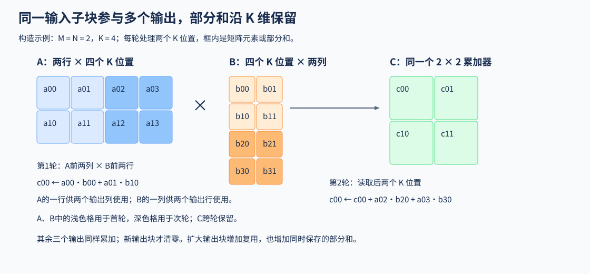
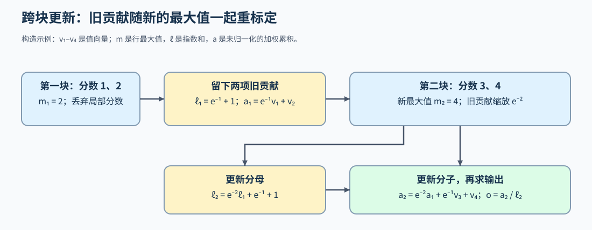

# 04 矩阵计算与推理状态的数据路径（Matrix Computation and Inference Data Paths）

## 学习问题

长输入的注意力计算会产生很大的分数矩阵。如果把它拆成小块，算完后不再保存局部分数，怎样才能得到与整行 Softmax 对应的结果？

注意力包含两次矩阵乘法（GEMM），中间的 Softmax 把每个分数的指数除以整行指数和，得到归一化权重。先看矩阵子块怎样复用，再用同一个查询、四个键的位置跟踪跨块状态：旧分数被丢弃后，哪些量还要留下？理解这条计算后，再按输入长度、头结构或存储方式选择对应的读取分支。

## GEMM 的子块怎样参与多次乘加

设 $A$ 为 $M\times K$ 矩阵， $B$ 为 $K\times N$ 矩阵，输出 $C=AB$ 有 $M$ 行、 $N$ 列。每个输出元素都要累加 K 个乘积。计算一个输出子块时，A 的同一行数据可以供多个输出列使用，B 的同一列数据可以供多个输出行使用；将这些输入子块留在片上，就有机会减少重复取数。累加器保存尚未完成的部分和，同一个输出块沿 K 维继续累加，新输出块再从零开始。

例如，一个 $2\times2$ 输出块包含四个点积。沿 K 维处理一段输入时，A 的两行分别供两列输出使用，B 的两列分别供两行输出使用。扩大输出块可以增加这种复用，也增加同时保存的部分和；具体分块与尾部累加见[Part 03 · 05 GEMM](../../03_Triton_Kernels/05_Triton_GEMM_Tutorial.ipynb)。

下图令M、N均为2，K为4，每轮处理两个K位置。A的一行同时供两个输出列使用，B的一列同时供两个输出行使用；第二轮继续累加到原来的四个部分和。

输入、累加器与输出可以使用不同类型，例如低精度输入经较高精度累加后再转换输出。Tensor Core 是矩阵计算单元，调用路径还要满足它的形状、布局和类型条件；CUDA 的 WMMA 接口让一个线程束协作执行矩阵操作，NVIDIA 的线程束（Warp）包含 32 个线程。具体约束可对照[Part 04 · 07 矩阵指令](../../04_CUDA_and_System_Optimization/07_Tensor_Core_MMA_Programming.ipynb)，而不只根据输入精度猜测执行方式。

输入子块还要及时送到计算位置。[Part 04 · 06 共享内存 GEMM](../../04_CUDA_and_System_Optimization/06_CUDA_Shared_Memory_Optimization.ipynb)让块内线程共同装载并消费当前子块；异步流水线则尝试在消费当前块时装载下一块。两组缓冲区分别保留当前与后续数据，消费前等待数据就绪，复用前确认旧数据读完。能否在时间上重叠，要继续观察实际等待区间；线程级的异步拷贝练习见[Part 04 · 09 异步拷贝](../../04_CUDA_and_System_Optimization/09_CUDA_Async_Copy_Pipeline.ipynb)。

Attention 在两次矩阵乘法之间增加了行归一化。它不能简单地把每块独立算完再拼接，还必须让不同 K/V 块共享同一个归一化基准。下面跟踪前向输出；若要接入训练，反向所需的保存量、重算与梯度需要另行核对，见[训练正文02 · Transformer 局部反向](../backpropagation_training_mechanism/02_autograd_and_transformer_backward.md)。

## 分块怎样避免保存完整分数矩阵

设查询（Query）矩阵为 $Q\in\mathbb{R}^{N_q\times d}$，键（Key）为 $K\in\mathbb{R}^{N_k\times d}$，值（Value）为 $V\in\mathbb{R}^{N_k\times d_v}$。 $N_q,N_k$ 分别表示查询与键的数量， $d$ 是点积维度， $d_v$ 是输出特征维度。对有效键位置按行归一化，输出为：

$$
O=\operatorname{softmax}\left(QK^\mathsf{T}/\sqrt{d}+M\right)V.
$$

其中 $M$ 表示掩码：允许的位置加零，被排除的位置加负无穷；每个有效查询至少有一个允许的键， $O$ 是注意力输出。直接计算会产生含 $N_qN_k$ 个元素的分数矩阵。分块则一次只计算当前 Q 块与一个 K 块之间的分数，随后继续处理下一个 K/V 块。

## 跨块保留的最大值、指数和与输出累积量

先只看一个查询。假设四个有效键的缩放后分数依次为 1、2、3、4，对应的值向量为 $v_1,v_2,v_3,v_4$，每个向量有 $d_v$ 个分量。将键分成前后两块，每块两个。第一块算完后，可以丢掉分数，但要留下行最大值 $m_1$、减去该最大值后的指数和 $\ell_1$，以及尚未除以指数和的加权累积向量 $a_1$：

$$
m_1=2,\qquad \ell_1=e^{-1}+1,\qquad a_1=e^{-1}v_1+v_2.
$$

第二块带来分数 3、4，整行最大值变为 $m_2=4$。第一块的指数原先按最大值 2 计算，现在要统一改成按 4 计算，因此旧贡献都乘以 $e^{2-4}=e^{-2}$，再加入第二块：

$$
\ell_2=e^{-2}\ell_1+e^{-1}+1,\qquad
a_2=e^{-2}a_1+e^{-1}v_3+v_4.
$$

展开后，四个值向量的系数分别为 $e^{-3},e^{-2},e^{-1},1$，与整行分数减去最大值 4 后的指数一致。最后，该查询的输出为 $o=a_2/\ell_2$。如果只缩放指数和而遗漏加权累积量，分子与分母就会使用不同的缩放基准，结果随之改变。对一组查询逐行重复计算，就得到 Q 块的注意力输出；两块之间只需继续传递最大值、指数和与加权累积量，而不用保留完整分数矩阵。[Part 02 · 20 FlashAttention模拟](../../02_PyTorch_Algorithms/20_FlashAttention_Sim.ipynb)与[Part 03 · 11 FlashAttention](../../03_Triton_Kernels/11_Triton_Flash_Attention.ipynb)分别展开这组递推和内核实现。

## 按输入与存储条件选择读取分支

前面的分块保持注意力定义，改变的是分数和中间状态怎样计算、保存。放回模型后，查询数量、键值（KV）头数、历史地址和数值表示分别改变矩阵形状、读取次数和恢复工作。预填充与解码先帮助确定工作集，再按模型选择头映射、分页或量化分支；权重与适配器则处理线性层的参数读取。各分支比较实现时，固定所选模型的结构与有效位置。

### 预填充和解码怎样改变主要工作集

预填充通常同时处理多个查询位置；每次生成一个词元（Token）的解码则用新的查询读取已有上下文 K/V，查询数量较小而上下文随生成增长。前者可以让多个查询复用读入的 K/V，后者则反复读取随上下文增长的缓存。因此，同样的注意力公式会形成不同的矩阵形状和访存需求。

解码读取缓存时，还要保留每个键对应的原始位置，变换语义可回补[Part 02 · 03 RoPE](../../02_PyTorch_Algorithms/03_RoPE_Tutorial.ipynb)。旋转位置编码（RoPE）让查询与键的特征对按位置旋转；新生成的查询使用自己的位置，缓存中的键保留原有位置对应的旋转。位置取错会改变点积分数，即使内存地址恰好正确也会算出不同结果。[Part 03 · 10 RoPE](../../03_Triton_Kernels/10_Triton_Fused_RoPE.ipynb)从索引与逐元素旋转展开这一过程。

### 头共享和有效长度怎样约束 KV 读取

解码过程中，每个查询头都要读取相应的 K/V，头结构的定义见[Part 02 · 04 Attention](../../02_PyTorch_Algorithms/04_Attention_MHA_GQA.ipynb)。分组查询注意力（GQA）让多个查询头共享一组 K/V，从而减少需要保存的 KV 头。设查询头数为 $H_q$，KV 头数为 $H_{kv}$，要求 $H_q$ 能被 $H_{kv}$ 整除。每个 KV 头服务 $G=H_q/H_{kv}$ 个查询头，零起始查询头 $h_q$ 对应：

$$
h_{kv}=\left\lfloor h_q/G\right\rfloor.
$$

例如 $H_q=8$、 $H_{kv}=2$ 时，查询头 0–3 读取 KV 头 0，查询头 4–7 读取 KV 头 1。共享的是 K/V，八个查询头仍分别计算各自的分数和输出。这里实现的是模型已经给定的头结构；比较两个 GQA 内核时固定相同的头数、权重与映射，不能把改变模型头结构与替换内核实现混为同一次优化。

头编号确定后，还要确定哪些位置有效。假设同批两个请求的长度分别是 3 和 5，存储都补齐到 5。第一个请求的后两个位置必须在 Softmax 前排除；如果将它们计入指数和，再只屏蔽最后输出，前三个位置的权重也已经被改变。[Part 03 · 12 变长GQA](../../03_Triton_Kernels/12_Triton_Variable_Length_GQA.ipynb)把这种长度差异与查询头映射放在同一次解码计算中处理。

### 分页与量化分别改变什么

前面按逻辑位置读取 K/V，并不要求它们在物理存储上连续，分页机制见[Part 02 · 22 分页缓存](../../02_PyTorch_Algorithms/22_vLLM_PagedAttention.ipynb)。以每页保存 4 个词元为例，零起始位置 6 位于逻辑页 1、页内偏移 2；若块表把逻辑页 1 映射到物理页 9，就从物理页 9 的偏移 2 取数。改变物理页安排，应该仍读到同一个逻辑位置的 K/V。

量化进一步改变页内保存的数值，表示与误差可回补[Part 02 · 54 KV量化](../../02_PyTorch_Algorithms/54_KV_Cache_Quantization_Strategies.ipynb)。读取时，内核同时取出低比特值与缩放信息，恢复近似的 K/V 再参与计算。因此，分页改变“去哪里取”，量化改变“取出的值怎样恢复”；后者还会引入近似误差。有些格式还保存零点，即实数零对应的量化编码。比较缓存容量时，这些缩放、零点元数据和布局填充都要计入，不能只用浮点与量化值的位宽之比作为实际节省。

| 改动 | 保持的关系 | 新增的核对对象 |
|:---|:---|:---|
| 分块计算 | 有效位置上的注意力定义 | 跨块状态、重标定和尾块 |
| KV 头共享 | 每个查询头仍有独立输出 | 查询头到 KV 头的映射 |
| 分页存储 | 逻辑词元顺序与数值 | 块表、物理页、页内偏移 |
| KV 量化 | 有效位置与访问关系 | 量化值、缩放信息、误差和实际存储字节 |

分页和量化也可以组合：块表先确定物理页，读取时再根据该页的数据布局找到量化值与缩放信息。如果缩放信息按词元和头存储，寻址就必须同时使用正确的页内位置与 KV 头编号；页地址正确而缩放取错，仍会改变输出。分别核对两种改动时，使用[Part 03 · 13 PagedAttention](../../03_Triton_Kernels/13_Triton_PagedAttention.ipynb)的地址、数值与接口计时，或[Part 03 · 16 量化KV解码](../../03_Triton_Kernels/16_Triton_KV_Cache_Quantized_Decode.ipynb)的输出与字节对照。要判断量化后是否更快，还需将量化、恢复与注意力计算一起计时。

### 权重与适配器的读取

权重量化处理线性层参数，KV 量化处理请求上下文；乘加表示见[Part 02 · 25 W8A16](../../02_PyTorch_Algorithms/25_Quantization_W8A16.ipynb)。按输出通道量化的权重，要根据输出通道恢复尺度；逐向量量化的 KV 则在读取相应词元与头时恢复，两者使用不同的缩放索引。若低比特值先恢复为浮点再参与乘加，节省的是存储与读取字节，仍增加了反量化工作；实际计算指令不能由存储位宽推断。

[低秩适配（LoRA）](../../02_PyTorch_Algorithms/14_LoRA_Tutorial.ipynb)用两组较小的矩阵产生对基座线性层的输出增量；一套配套参数称为一个适配器。Multi-LoRA让同一批请求选择不同适配器，按编号读取配套的低秩矩阵，再把对应增量交回各自输入。选错编号时，输出形状可能仍然正确，数值却来自另一套参数。适配器编号选择参数，KV块表查找上下文，两种索引解决的是不同问题。

权重路径可用[Part 03 · 14 W8A16](../../03_Triton_Kernels/14_Triton_Quantization.ipynb)比较 8 位权重、16 位激活下，缓存浮点权重、显式恢复与融合接口的调用成本；[Part 03 · 15 Multi-LoRA](../../03_Triton_Kernels/15_Triton_Multi_LoRA.ipynb)则展开同批输入的低秩增量计算。完成所选分支后，把读取、数值恢复和布局转换计入[测量与性能归因](./05_measurement_profiling_and_autotuning.md)。Attention替换可在[Part 03 · 20 Block集成](../../03_Triton_Kernels/20_Triton_Llama3_Block_Project.ipynb)中复测；量化与适配器则需要保留各自的接口和质量检查。
