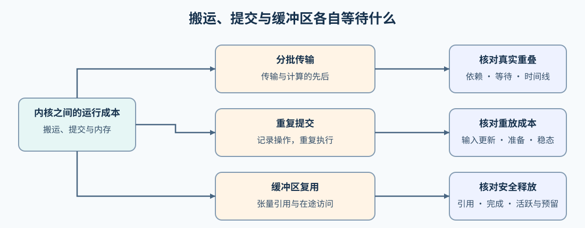
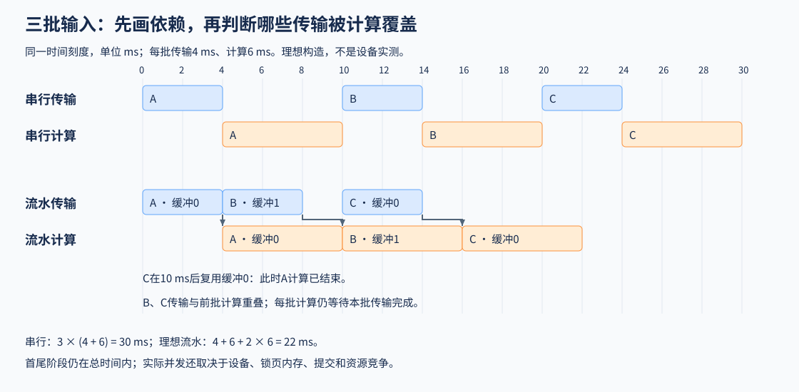

# 06 传输、提交与显存生命周期（Transfer, Submission and Memory Lifetime）

## 学习问题

一批数据从主机搬到 GPU，随后参与矩阵计算。设备可能在等待输入，内核可能在重复取数，而许多小任务之间还可能出现主机提交不及时造成的间隙。这些时间消耗在不同位置。

假设当前内核计算已经确定，沿下一批输入的搬运、当前批的设备缓冲和反复运行的小任务继续追踪：搬运能否提前？提交安排能否复用？上一批的内存何时可以交给下一批？这些问题需要同时考虑执行依赖和数据寿命。

## 下一批搬运与当前批计算的重叠

设有相互独立的三批输入 A、B、C，假设每批主机到设备搬运需要 4 ms，计算需要 6 ms。完全串行时，每批都先搬运再计算，三批合计为 $3\times(4+6)=30$ ms。这些时间仅用于说明调度关系。

若设备支持搬运与计算并发，主机源内存满足异步传输条件，且暂不计资源竞争和提交开销，A 在 0–4 ms 搬运、4–10 ms 计算；B 可在 4–8 ms 搬运、10–16 ms 计算；C 再在 10–14 ms 搬运、16–22 ms 计算。三批计算仍串行，但 B、C 的搬运被前一批计算覆盖。对 $n$ 个等长批次，若每批搬运为 $h$、计算为 $g$，上述两阶段理想流水耗时为：

$$
T_{\mathrm{pipe}}=h+g+(n-1)\max(h,g).
$$

代入 $n=3,h=4,g=6$ 得到 22 ms；首批搬运和末批计算仍要计入，不能只计算中间的重叠窗口。

Stream（流）是按顺序提交设备工作的队列，不同流之间需要另外表达依赖；Event（事件）可标记流中某个位置的工作完成。实现上述顺序时，本批计算等待本批传输完成，而后一批传输不必等待前一批计算。传输流记录完成事件，计算流等待对应事件，就能表达前一种依赖；若每批都等待整个设备，后一种重叠机会也会被消除。

主机输入通常还需要使用锁页内存（pinned memory），即在传输期间不会被操作系统换出的主机内存，以支持所用路径的异步搬运。锁页和多个流提供的是并发所需条件；若设备能力或带宽竞争限制并发，仍可能没有时间收益。

输入缓冲区还要轮换使用。A 计算结束前，B 不能覆盖 A 正在读取的设备内存；两组设备缓冲区可让 A、B 分别使用，等 A 结束后再把它的缓冲区交给 C。主机源数据也要保留到相应传输结束。实际时间线可能因带宽竞争、设备能力或同步而偏离上述理想值，但依赖与缓冲区寿命必须始终正确。

下图用同一时间刻度比较串行与理想流水；蓝色为传输，橙色为计算，箭头连接本批传输与本批计算。[Part 04 · 10 Stream 与传输](../../04_CUDA_and_System_Optimization/10_PyTorch_CUDA_Streams_and_Transfer.ipynb)核对输出与依赖，[Part 04 · 08 双缓冲估算](../../04_CUDA_and_System_Optimization/08_Async_Data_Prefetch_and_Double_Buffering.ipynb)解释时间关系；图中数值不是实际重叠测量。

## 小任务之间的提交间隙怎样缩短

若相同的一组小计算反复运行，主机可能花费较多时间逐个提交，而设备执行每个任务很短。CUDA Graph 将满足捕获条件的操作记录下来，后续通过重放减少重复提交成本。

图编译可以把激活与乘法改写成一个计算内核；Graph重放复用的是一组操作的提交安排。两者可以组合，具体编译路径也可能使用重放，因此比较融合效果时要保持Graph策略一致，比较提交成本时则保持计算实现一致。

重放仍要让计算读到本轮数据。常见做法是保持被捕获的输入缓冲区地址稳定，在每次执行前更新其中的内容，并处理更新与重放之间的依赖；形状与地址要求以所用捕获方式为准。内核内部的矩阵计算与访存仍然存在，因此，长时间计算占主导时，减少提交带来的收益可能很小。[Part 04 · 11 CUDA Graph与JIT](../../04_CUDA_and_System_Optimization/11_CUDA_Graph_and_JIT_Compile.ipynb)先用串行估算筛查候选，再检查更新输入后的重放，将捕获准备和稳态配对分开记录。

## 缓冲区不再使用后，显存为什么没有立即下降

异步计算尚未结束时，缓冲区即使已经离开主机端的当前代码段，也不能提前被覆盖。分配器负责为张量申请和复用设备内存；计算完成、张量引用释放后，它还可能保留空闲块供后续调用复用，因此活跃张量占用与分配器预留量需要分开观察。清理空闲缓存不能释放仍被使用的张量，也不能代替正确的数据依赖。

例如，活跃张量占用为 4 GiB、分配器预留为 6 GiB 时，差值不表示可以为任意大小的新张量直接分配 2 GiB；还要看空闲块布局、请求大小和其他分配来源。[Part 04 · 12 显存管理](../../04_CUDA_and_System_Optimization/12_Memory_Pool_and_VRAM_Management.ipynb)先用CPU规则筛查，再在独立进程中观察分配、保留别名、释放最后引用和清理空闲缓存时的活跃／预留量。由此可以解释哪些数据仍在驻留；若要判断复用缓冲区是否降低申请开销，还要另测相同工作量下的调用时间，不能从预留量下降推断。

## 数据需要跨进程或跨设备交换时

如果将矩阵乘法沿求和维度拆给多个参与者，每个参与者只算出一个局部和，必须把对应位置相加，才能得到完整输出。全归约（AllReduce）可以合并这些局部和并把结果交给各参与者；全收集（AllGather）则保留并收集各自的数据，不做这种求和。下一步若使用完整输出，就必须等待合并完成；与它无关的另一批计算才有机会提前执行。

这些是进程间集合操作的语义，具体传输可以采用不同算法和硬件路径。[Part 04 · 13 通信原语](../../04_CUDA_and_System_Optimization/13_Distributed_Communication_Primitives.ipynb)用 Gloo 后端在本地进程间交换 CPU 张量，核对集合语义。Gloo 是通信实现，不是设备类型；CPU 张量的正确输出也不说明多 GPU 通信的时间表现。

通信量确定后，还要判断多少通信留在计算之后。假设计算为10 ms、通信为6 ms，两者能合法重叠4 ms，且没有额外争用或间隙，则总时间为12 ms，仍有2 ms通信暴露在计算之外。这是时间区间的构造例子；把通信量除以带宽得到的估算，或CPU集合操作的正确输出，都不能替代多GPU时间线。[Part 04 · 14 Ring通信量](../../04_CUDA_and_System_Optimization/14_Ring_AllReduce_Deep_Dive.ipynb)推导每个参与者的发送量，[Part 04 · 15 通信重叠](../../04_CUDA_and_System_Optimization/15_Communication_Computation_Overlap_Advanced_Scheduling.ipynb)检查上述关键路径关系；真实GPU通信再进入[通信与并行专题](../communication_parallelism/intro.md)。

比较搬运重叠、图重放或缓冲复用时，计时覆盖各自改变的工作；同步与稳态计时的安排见[测量与性能归因](./05_measurement_profiling_and_autotuning.md)。
