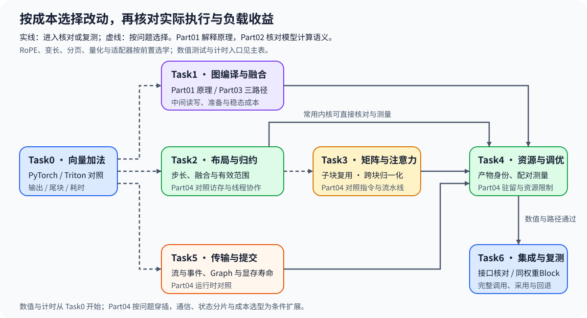
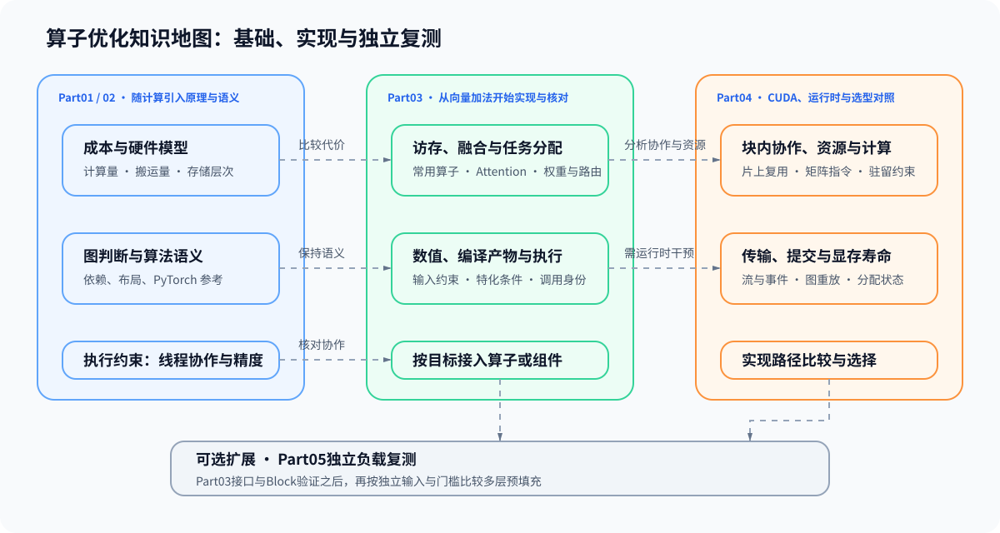

# 算子优化（Operator Optimization）

> 专题类型：主学习路线　学习目标：定位算子瓶颈，在保持数值与行为要求的前提下选择编译、计算内核或运行时优化，并判断局部收益能否传递到目标工作负载。

矩阵乘法、归一化和 Attention 变慢，可能是计算量大、数据反复搬运，也可能是大量小任务的提交开销。以同输入的 PyTorch 实现为对照，结合执行轨迹判断瓶颈，再选择编译融合、内核分块或任务提交方式。

需要基本张量运算、矩阵乘法与 PyTorch 操作；可用[Part 02 · 00 PyTorch 热身](../../02_PyTorch_Algorithms/00_PyTorch_Warmup.ipynb)回补。动手前按[Quickstart](./quickstart.md)准备主GPU环境，原生CUDA分支另检查编译工具链。

## 学习路线

首次学习从向量加法进入，先完成同输入的 PyTorch／Triton 输出与边界核对，再比较调用耗时。随后判断该改图、改内核，还是减少传输和提交等待；已经定位问题时，可直接进入相应阶段。

主表按“核心／项目／扩展”区分默认路径与按需分支；学习顺序描述核心路径。每个阶段先读正文理解要减少的工作，再进入 Part 小节核对或实现，最后回到正文解释代价与下一步。计时从 Task0 开始使用，Task4 再深入分析快慢原因；当前实验条件与结果从[实验资产表](./experiment_assets.md)查询。

| Task / 主题 | 本阶段要回答的问题 | 学习入口与验证出口 | 学习顺序 | 主要正文入口 |
|:---|:---|:---|:---|:---|
| Task0 · 向量加法与耗时对照 | 同一计算的输出和时间应怎样对照？ | 核心：[Part 03 · 01 向量加法](../../03_Triton_Kernels/01_Triton_Vector_Addition.ipynb)，核对输出与尾块；可选基准比较预热后的加法调用  扩展：[Part 04 · 01 CUDA向量加法](../../04_CUDA_and_System_Optimization/01_CUDA_Custom_Kernel_Intro.ipynb) | 固定输入 → 核对输出 → 预热与重复计时 → 解释比较范围 | [01 优化对象与比较基线](./01_optimization_targets_and_baselines.md) |
| Task1 · 图编译、融合与准备成本 | 融合后的重复执行节省，何时足以抵消准备成本？ | 核心：[Part 01 · 09 图编译](../../01_Hardware_Math_and_Systems/09_AI_Compilers_and_Graph_Optimization.ipynb) → [Part 03 · 03 SwiGLU](../../03_Triton_Kernels/03_Triton_Fused_SwiGLU.ipynb)，观察给定三路径的数值、准备与稳态对照 | 中间值与依赖 → 三路径观察 → 准备与稳态 → 复用次数 | [02 图编译、融合与执行候选](./02_graph_compilation_and_fusion.md) |
| Task2 · 布局、逐元素融合与归约 | 布局、融合与归约怎样改变访存成本？ | 核心：[Part 03 · 02 二维布局](../../03_Triton_Kernels/02_Triton_Layouts_and_Memory_Access.ipynb) → [Part 03 · 04 RMSNorm](../../03_Triton_Kernels/04_Triton_Fused_RMSNorm.ipynb)或[Part 03 · 07 Softmax](../../03_Triton_Kernels/07_Triton_Fused_Softmax.ipynb)，核对地址、归约范围与局部调用时间  扩展：[Part 03 · 08 Softmax反向](../../03_Triton_Kernels/08_Triton_Softmax_Backward.ipynb)、[Part 03 · 10 RoPE](../../03_Triton_Kernels/10_Triton_Fused_RoPE.ipynb)、[Part 04 · 02 合并访存](../../04_CUDA_and_System_Optimization/02_CUDA_Global_Memory_Coalescing.ipynb)、[Part 04 · 03 Warp协作](../../04_CUDA_and_System_Optimization/03_Warp_Level_Primitives.ipynb)、[Part 04 · 04 Bank冲突](../../04_CUDA_and_System_Optimization/04_Bank_Conflict_Deep_Dive.ipynb) | 步长与有效位置 → 融合或行归约 → 数值边界 → 访存与计时范围 | [03 计算内核语义与访存](./03_kernel_semantics_and_memory.md) |
| Task3 · 矩阵分块与 Attention 计算 | 怎样复用输入块，并避免保存完整注意力分数矩阵？ | 核心：[Part 03 · 05 GEMM](../../03_Triton_Kernels/05_Triton_GEMM_Tutorial.ipynb)的数值与局部计时 → [Part 03 · 11 FlashAttention](../../03_Triton_Kernels/11_Triton_Flash_Attention.ipynb)的前向数值核对  扩展：按注意力输入选择[Part 03 · 12 变长GQA](../../03_Triton_Kernels/12_Triton_Variable_Length_GQA.ipynb)、[Part 03 · 13 分页注意力](../../03_Triton_Kernels/13_Triton_PagedAttention.ipynb)；低比特与参数路由见[Part 03 · 14 权重量化](../../03_Triton_Kernels/14_Triton_Quantization.ipynb)、[Part 03 · 15 Multi-LoRA](../../03_Triton_Kernels/15_Triton_Multi_LoRA.ipynb)、[Part 03 · 16 KV量化](../../03_Triton_Kernels/16_Triton_KV_Cache_Quantized_Decode.ipynb)；矩阵实现与数据供给见[Part 04 · 06 共享内存GEMM](../../04_CUDA_and_System_Optimization/06_CUDA_Shared_Memory_Optimization.ipynb)、[Part 04 · 07 WMMA](../../04_CUDA_and_System_Optimization/07_Tensor_Core_MMA_Programming.ipynb)、[Part 04 · 08 流水估算](../../04_CUDA_and_System_Optimization/08_Async_Data_Prefetch_and_Double_Buffering.ipynb)、[Part 04 · 09 异步拷贝](../../04_CUDA_and_System_Optimization/09_CUDA_Async_Copy_Pipeline.ipynb) | 子块与累加 → 跨块 Softmax → 输出与尾块 → 组件复测 | [04 矩阵计算与推理状态的数据路径](./04_attention_and_inference_data_paths.md) |
| Task4 · 编译产物、资源与配置调优 | 配置改变后，为什么同一计算有时更快、有时更慢？ | 核心：[Part 03 · 18 编译产物与执行](../../03_Triton_Kernels/18_Triton_Compilation_Artifacts_and_Execution.ipynb)、[Part 03 · 09 自动调优](../../03_Triton_Kernels/09_Triton_Autotune_and_Profiling.ipynb)、[Part 04 · 05 资源与驻留](../../04_CUDA_and_System_Optimization/05_CUDA_Block_Resources_and_Residency.ipynb)，分别提供路径、计时与容量对照  扩展：[Part 03 · 06 持久化GEMM](../../03_Triton_Kernels/06_Triton_Persistent_GEMM_and_Tile_Scheduling.ipynb)对照任务分配；[Part 03 · 17 内存模型与调试](../../03_Triton_Kernels/17_Triton_Memory_Model_and_Debug.ipynb) | 确认实际调用 → 比较资源限制 → 配对测量 → 检查原因解释 | [05 测量归因与自动调优](./05_measurement_profiling_and_autotuning.md) |
| Task5 · 传输、提交与显存生命周期 | 传输、提交和缓冲寿命怎样影响等待与驻留？ | 核心：[Part 04 · 10 Stream与传输](../../04_CUDA_and_System_Optimization/10_PyTorch_CUDA_Streams_and_Transfer.ipynb)核对依赖，[Part 04 · 11 Graph重放](../../04_CUDA_and_System_Optimization/11_CUDA_Graph_and_JIT_Compile.ipynb)比较普通调用与重放，[Part 04 · 12 显存管理](../../04_CUDA_and_System_Optimization/12_Memory_Pool_and_VRAM_Management.ipynb)观察生命周期  扩展：[Part 04 · 13 通信原语](../../04_CUDA_and_System_Optimization/13_Distributed_Communication_Primitives.ipynb)、[Part 04 · 14 Ring通信量](../../04_CUDA_and_System_Optimization/14_Ring_AllReduce_Deep_Dive.ipynb)、[Part 04 · 15 通信重叠](../../04_CUDA_and_System_Optimization/15_Communication_Computation_Overlap_Advanced_Scheduling.ipynb) | 等待位置 → 流、重放或缓冲复用 → 依赖与寿命 → 时间或驻留变化 | [06 传输、提交与显存生命周期](./06_cuda_execution_and_runtime_constraints.md) |
| Task6 · 接口、组件与负载复测 | 新实现接回组件后，完整调用是否改善？ | 核心：[Part 03 · 19 算子接入](../../03_Triton_Kernels/19_Triton_PyTorch_Op_Integration.ipynb)核对示例输出、梯度与编译；项目：[Part 03 · 20 同权重Block](../../03_Triton_Kernels/20_Triton_Llama3_Block_Project.ipynb)比较 Attention 替换后的组件  扩展：[Part 04 · 18 实现选型](../../04_CUDA_and_System_Optimization/18_CUDA_vs_Triton_vs_PyTorch.ipynb)、[Part 04 · 16 ZeRO配置](../../04_CUDA_and_System_Optimization/16_DeepSpeed_Zero_Config.ipynb)、[Part 04 · 17 CPU／NVMe卸载](../../04_CUDA_and_System_Optimization/17_Heterogeneous_Training_CPU_Offload_NVMe_Offload.ipynb)、[Part 04 · 19 TCO选型](../../04_CUDA_and_System_Optimization/19_TCO_and_Hardware_Selection.ipynb) | 固定输入与权重 → 核对接口与调用 → 比较完整成本 → 保留、调整或回退 | [07 集成、基准与采用判断](./07_integration_benchmarking_and_adoption.md) |

Task1先观察给定实现，Task2再动手完成对应内核。常用内核通过数值测试后可直接进入Task4；矩阵与注意力问题则经过Task3。内核之间的等待进入Task5，结果同样用Task4的测量方法核对。各分支最后回到Task6，比较包含适配与同步的完整调用。

PyTorch语义按当前对象回补：融合与归约参考[Part 02 · 02 SwiGLU](../../02_PyTorch_Algorithms/02_SwiGLU_Activation.ipynb)、[Part 02 · 01 RMSNorm](../../02_PyTorch_Algorithms/01_RMSNorm_Tutorial.ipynb)；进入分块注意力前读[Part 02 · 20 FlashAttention模拟](../../02_PyTorch_Algorithms/20_FlashAttention_Sim.ipynb)。CUDA对照从主表的扩展入口按问题选择。

## 扩展与跨专题入口

先按当前计算回补硬件与编译原理；问题涉及模型语义、请求调度或跨设备执行时，再用下表进入对应专题。

硬件原理按问题回补：精度与计算量看[Part 01 · 1A](../../01_Hardware_Math_and_Systems/1A.md)，执行与内存层次看[Part 01 · 1B](../../01_Hardware_Math_and_Systems/1B.md)；更换设备或选择专用指令时，看[Part 01 · 03 GPU架构与设备能力](../../01_Hardware_Math_and_Systems/03_GPU_Architecture_and_Memory.ipynb)，区分架构、型号、计算能力与实际资源。线程映射和协作看[Part 01 · 15 CUDA执行模型](../../01_Hardware_Math_and_Systems/15_CUDA_Execution_Model.ipynb)、[Part 01 · 16 Warp与共享内存](../../01_Hardware_Math_and_Systems/16_Warp_Block_SharedMemory_Basics.ipynb)，瓶颈分析看[Part 01 · 13 性能剖析](../../01_Hardware_Math_and_Systems/13_Profiling_and_Bottleneck_Analysis.ipynb)。

Program与物理线程的区别见[Part 01 · 18 Triton分块模型](../../01_Hardware_Math_and_Systems/18_Triton_Block_Model.ipynb)，中间值能否省去见[Part 01 · 19 算子融合](../../01_Hardware_Math_and_Systems/19_Operator_Fusion_Introduction.ipynb)；需要深入中间表示与调度计划时，再读[Part 01 · 32 TVM／MLIR编译链路](../../01_Hardware_Math_and_Systems/32_TVM_MLIR_Deep_Practice.ipynb)。输入经常变化时，回补[Part 01 · 30 动态形状](../../01_Hardware_Math_and_Systems/30_Dynamic_Shape_Handling.ipynb)，另查版本复用与重编译；Task1三路径基准提供的是逐形状对照。

实现抽象层的选择见[Part 04 · 18 实现方式对照](../../04_CUDA_and_System_Optimization/18_CUDA_vs_Triton_vs_PyTorch.ipynb)；分布式通信、状态分片与卸载见[Part 04 · 4.4](../../04_CUDA_and_System_Optimization/4_4.md)，硬件成本比较见[Part 04 · 4.5](../../04_CUDA_and_System_Optimization/4_5.md)。

连续学习使用[算子优化问题链](./walkthrough.md)，按现象定位使用[判断手册](./casebook.md)，概念与计算条件分别查[术语表](./glossary.md)和[公式索引](./formula_reference.md)。

| 遇到的问题 | 优先入口 | 算子优化的职责 |
|:---|:---|:---|
| 不知道整体慢在哪里 | [性能分析](../performance_analysis/intro.md)、[性能优化](../performance_optimization/intro.md) | 接收已经定位到局部计算或访存路径的瓶颈 |
| 不确定 Attention、MLP、MoE 或记忆结构的语义 | [模型架构演进](../llm_architecture_evolution/intro.md) | 在结构语义稳定后再改变图、访存或计算内核 |
| 请求、KV 或调度导致变慢 | [推理优化](../inference_optimization/intro.md) | 只优化确认位于关键路径的 Attention、RoPE、量化或模型组件 |
| 多卡通信与扩展效率异常 | [通信与并行](../communication_parallelism/intro.md) | 处理已经确认暴露的本地计算或通信计算内核 |
| 低比特表示或质量异常 | [量化与压缩](../quantization_compression/intro.md) | 实现低比特计算路径，不替代量化策略与质量决策 |
| Agent 多步任务耗时较长 | [智能体基础设施](../agent/intro.md)、[性能分析](../performance_analysis/intro.md) | 先区分模型计算与工具等待；张量计算按Task2／3优化、组件收益在Task6核对，完整Agent任务再回原专题复测 |

## 实验与项目出口

按下表区分数值、执行和性能证据。当前运行条件、结果与待测项见[实验资产表](./experiment_assets.md)；CPU推导、设备查询与真实执行分别判断。

默认出口在接口与同权重Block层判断实现是否适合采用；量化、适配器或训练反向需要各自的组件核对。扩大到多层预填充负载时，可选[Part 05 · 05 独立综合项目](../../05_Integrated_Projects_and_Decisions/05_Operator_Optimization_Delivery/index.md)，重新准备输入并测量。

| 证据阶段 | 要回答的问题 | 输出 |
|:---|:---|:---|
| 正确性 | 候选与参考实现在边界输入上是否语义一致？ | 输入分布、形状、数据类型、误差和失败样本 |
| 执行身份与资源 | 比较的是哪份代码、哪种配置和实际调用？ | 特化条件、生成产物、调用记录；按问题读取编译资源或运行时查询 |
| 微基准与归因 | 相同输入下，节省的工作是否转化为更短时间？ | 准备成本、逐轮配对、形状分布；采集到的访存、资源或轨迹证据用于归因 |
| 工作负载复测 | 局部收益能否传递到组件或两层解码器预填充？ | 配对基线、输出误差、负载延迟、显存、环境和失败记录 |
