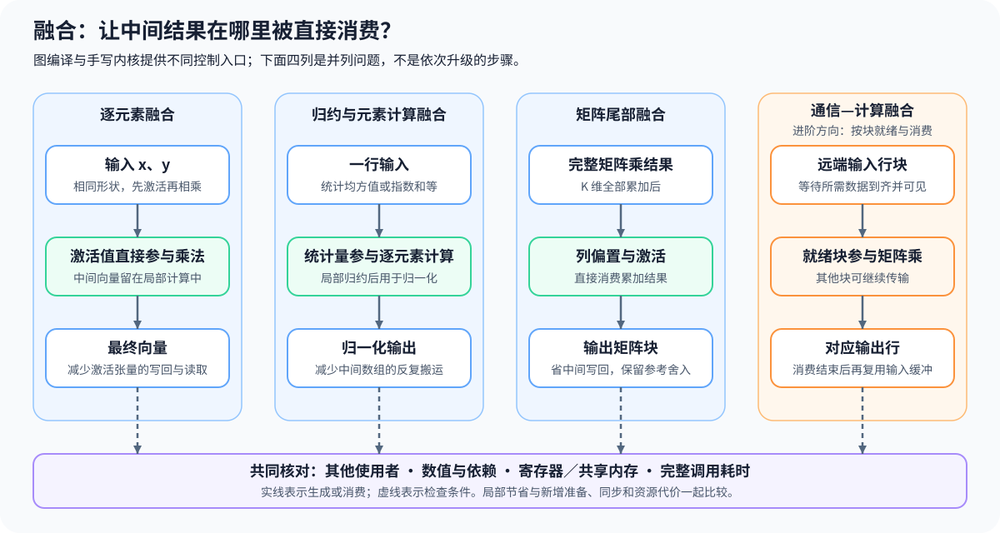
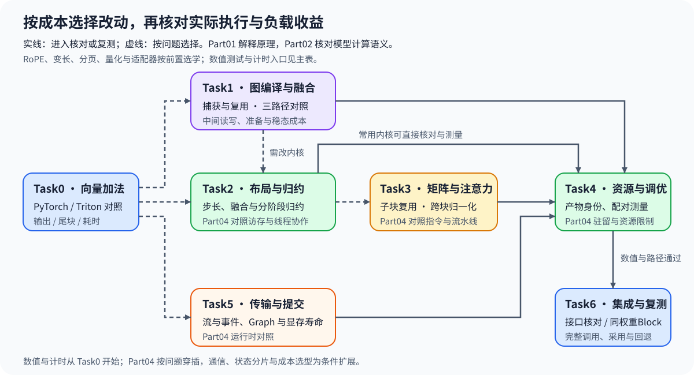
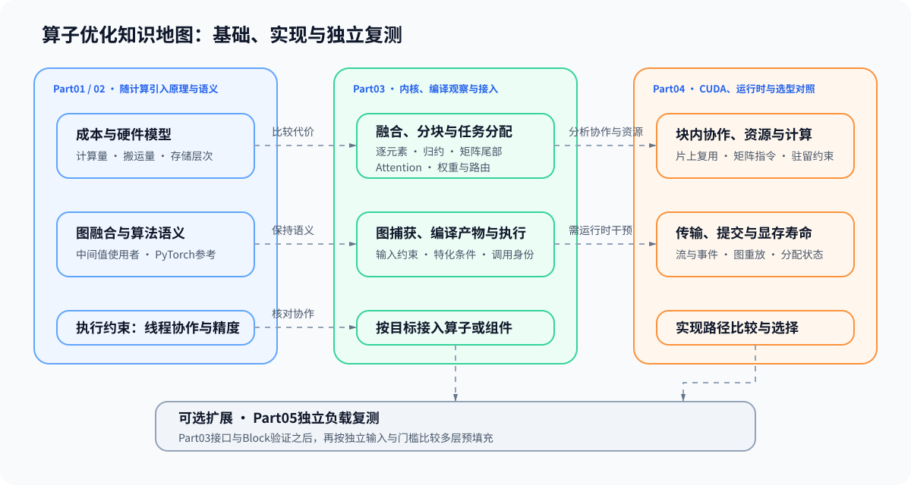

# 算子优化（Operator Optimization）

> 专题类型：主学习路线　学习目标：定位算子瓶颈，在保持数值与行为要求的前提下选择编译、计算内核或运行时优化，并判断局部收益能否传递到目标工作负载。

矩阵乘法、归一化和Attention变慢，可能是计算量大、数据反复搬运，也可能是大量小任务的提交开销。以同输入的PyTorch实现为对照，结合执行轨迹判断瓶颈，再选择编译融合、内核分块或任务提交方式。

需要基本张量运算、矩阵乘法与PyTorch操作；可用[Part 02 · 00 PyTorch热身](../../02_PyTorch_Algorithms/00_PyTorch_Warmup.ipynb)回补。实验环境按[Quickstart](./quickstart.md)选择，原生CUDA分支另检查编译工具链。

连续跟踪一个问题时进入[算子优化问题链](./walkthrough.md)，按现象排查使用[判断手册](./casebook.md)，回查概念与计算条件使用[术语表](./glossary.md)和[公式索引](./formula_reference.md)。

融合关心中间结果如何被下一步直接使用：逐元素、归约和矩阵尾部融合主要减少中间数据的写回与再读取；通信—计算融合还需处理数据块就绪与消费，属于进阶方向。图编译与手写内核是形成候选的两种入口，最后都要核对输出、资源与完整耗时。

## 学习路线

首次学习从向量加法进入，已经定位问题时可直接选择相应阶段。每个阶段先读主要正文理解要减少的工作，再进入Part小节核对或实现，最后返回正文解释代价与下一问题。

Task0先解释Program如何覆盖输入、用掩码保护尾块，并完成数值核对；计时为可选，选择计时时需说明测量范围并计算加速比。Task1比较编译前后的工作，Task2再按需要改写内核；配置搜索与性能归因在Task4展开。

| Task / 主题 | 本阶段要回答的问题 | 学习入口与验证出口 | 学习顺序 | 主要正文入口 |
|:---|:---|:---|:---|:---|
| Task0 · 向量加法与耗时对照 | 同一计算的输出和时间应怎样对照？ | 核心：[Part 03 · 01 向量加法](../../03_Triton_Kernels/01_Triton_Vector_Addition.ipynb)，含可选计时  扩展：[Part 04 · 01 CUDA向量加法](../../04_CUDA_and_System_Optimization/01_CUDA_Custom_Kernel_Intro.ipynb) | 固定输入 → 覆盖与数值核对 → 可选计时与加速比 | [01 优化对象与比较基线](./01_optimization_targets_and_baselines.md) |
| Task1 · 图编译、融合与准备成本 | 图能捕获和改写哪些计算，输入变化后能否复用实现？ | 核心：[Part 01 · 09 图编译](../../01_Hardware_Math_and_Systems/09_AI_Compilers_and_Graph_Optimization.ipynb) → [Part 03 · 21 图捕获与版本复用](../../03_Triton_Kernels/21_Torch_Compile_Graph_Reuse.ipynb) → [Part 03 · 03 SwiGLU](../../03_Triton_Kernels/03_Triton_Fused_SwiGLU.ipynb)的Step1–3与Step5三路径记录 | 09推导读写与调用 → 21观察捕获与复用 → 03比较三路径成本 | [02 图编译、融合与执行候选](./02_graph_compilation_and_fusion.md) |
| Task2 · 布局、逐元素融合与归约 | 布局、融合与归约怎样改变访存成本？ | 核心：[Part 03 · 02 二维布局](../../03_Triton_Kernels/02_Triton_Layouts_and_Memory_Access.ipynb)；按计算选择[Part 03 · 03 SwiGLU](../../03_Triton_Kernels/03_Triton_Fused_SwiGLU.ipynb)、[Part 03 · 04 RMSNorm](../../03_Triton_Kernels/04_Triton_Fused_RMSNorm.ipynb)或[Part 03 · 07 Softmax](../../03_Triton_Kernels/07_Triton_Fused_Softmax.ipynb)；先读所选页Step1–3，再做Step4。SwiGLU承接Task1；Softmax先回顾RMSNorm归约  扩展：[Part 03 · 22 两阶段归约](../../03_Triton_Kernels/22_Triton_Two_Stage_Reduction.ipynb)、[Part 03 · 08 Softmax反向](../../03_Triton_Kernels/08_Triton_Softmax_Backward.ipynb)、[Part 03 · 10 RoPE](../../03_Triton_Kernels/10_Triton_Fused_RoPE.ipynb)、[Part 04 · 02 合并访存](../../04_CUDA_and_System_Optimization/02_CUDA_Global_Memory_Coalescing.ipynb)、[Part 04 · 03 Warp协作](../../04_CUDA_and_System_Optimization/03_Warp_Level_Primitives.ipynb)、[Part 04 · 04 Bank冲突](../../04_CUDA_and_System_Optimization/04_Bank_Conflict_Deep_Dive.ipynb) | 二维布局 → 逐元素融合或行归约 → 数值与边界核对；多Program归约在行内归约之后 | [03 计算内核语义与访存](./03_kernel_semantics_and_memory.md) |
| Task3 · 矩阵分块与 Attention 计算 | 怎样复用输入块，并避免保存完整注意力分数矩阵？ | 核心：[Part 03 · 05 GEMM与尾部融合](../../03_Triton_Kernels/05_Triton_GEMM_Tutorial.ipynb) → [Part 03 · 11 FlashAttention](../../03_Triton_Kernels/11_Triton_Flash_Attention.ipynb)  扩展：解码读[Part 03 · 12 变长GQA解码](../../03_Triton_Kernels/12_Triton_Variable_Length_GQA.ipynb)、[Part 03 · 13 分页解码](../../03_Triton_Kernels/13_Triton_PagedAttention.ipynb)；量化与适配器读[Part 03 · 14 权重量化](../../03_Triton_Kernels/14_Triton_Quantization.ipynb)、[Part 03 · 15 Multi-LoRA](../../03_Triton_Kernels/15_Triton_Multi_LoRA.ipynb)、[Part 03 · 16 KV量化](../../03_Triton_Kernels/16_Triton_KV_Cache_Quantized_Decode.ipynb)；CUDA实现读[Part 04 · 06 共享内存GEMM](../../04_CUDA_and_System_Optimization/06_CUDA_Shared_Memory_Optimization.ipynb)、[Part 04 · 07 WMMA](../../04_CUDA_and_System_Optimization/07_Tensor_Core_MMA_Programming.ipynb)、[Part 04 · 08 流水估算](../../04_CUDA_and_System_Optimization/08_Async_Data_Prefetch_and_Double_Buffering.ipynb)、[Part 04 · 09 异步拷贝](../../04_CUDA_and_System_Optimization/09_CUDA_Async_Copy_Pipeline.ipynb) | 输出分块与K维复用 → 尾部融合／在线状态合并 → 数值边界 | [04 矩阵计算与推理状态的数据路径](./04_attention_and_inference_data_paths.md) |
| Task4 · 编译产物、资源与配置调优 | 配置改变后，为什么同一计算有时更快、有时更慢？ | 核心：[Part 03 · 09 自动调优](../../03_Triton_Kernels/09_Triton_Autotune_and_Profiling.ipynb) → [Part 03 · 18 编译产物与执行](../../03_Triton_Kernels/18_Triton_Compilation_Artifacts_and_Execution.ipynb)；[Part 04 · 05 资源与驻留](../../04_CUDA_and_System_Optimization/05_CUDA_Block_Resources_and_Residency.ipynb)  扩展：[Part 03 · 06 持久化GEMM](../../03_Triton_Kernels/06_Triton_Persistent_GEMM_and_Tile_Scheduling.ipynb)、[Part 03 · 17 内存模型与调试](../../03_Triton_Kernels/17_Triton_Memory_Model_and_Debug.ipynb) | 区分配置、准备与计时 → 核对产物和调用 → 比较资源与配对耗时 | [05 测量归因与自动调优](./05_measurement_profiling_and_autotuning.md) |
| Task5 · 传输、提交与显存生命周期 | 传输、提交和缓冲寿命怎样影响等待与驻留？ | 核心：[Part 04 · 10 Stream与传输](../../04_CUDA_and_System_Optimization/10_PyTorch_CUDA_Streams_and_Transfer.ipynb)、[Part 04 · 11 CUDA Graph重放](../../04_CUDA_and_System_Optimization/11_CUDA_Graph_and_JIT_Compile.ipynb)、[Part 04 · 12 显存管理](../../04_CUDA_and_System_Optimization/12_Memory_Pool_and_VRAM_Management.ipynb)  扩展：[Part 04 · 13 通信原语](../../04_CUDA_and_System_Optimization/13_Distributed_Communication_Primitives.ipynb)、[Part 04 · 14 Ring通信量](../../04_CUDA_and_System_Optimization/14_Ring_AllReduce_Deep_Dive.ipynb)、[Part 04 · 15 通信重叠](../../04_CUDA_and_System_Optimization/15_Communication_Computation_Overlap_Advanced_Scheduling.ipynb) | 定位等待或峰值 → 选择传输、重放或缓冲复用 → 核对依赖与生命周期 | [06 传输、提交与显存生命周期](./06_cuda_execution_and_runtime_constraints.md) |
| Task6 · 接口、组件与负载复测 | 新实现接回组件后，完整调用是否改善？ | 核心：[Part 03 · 19 PyTorch算子接入](../../03_Triton_Kernels/19_Triton_PyTorch_Op_Integration.ipynb)；项目：[Part 03 · 20 同权重Block](../../03_Triton_Kernels/20_Triton_Llama3_Block_Project.ipynb)  扩展：[Part 04 · 18 实现选型](../../04_CUDA_and_System_Optimization/18_CUDA_vs_Triton_vs_PyTorch.ipynb)、[Part 04 · 16 ZeRO配置](../../04_CUDA_and_System_Optimization/16_DeepSpeed_Zero_Config.ipynb)、[Part 04 · 17 CPU／NVMe卸载](../../04_CUDA_and_System_Optimization/17_Heterogeneous_Training_CPU_Offload_NVMe_Offload.ipynb)、[Part 04 · 19 TCO选型](../../04_CUDA_and_System_Optimization/19_TCO_and_Hardware_Selection.ipynb) | 核对接口与梯度 → 接回同权重组件 → 比较完整成本 → 保留、调整或回退 | [07 集成、基准与采用判断](./07_integration_benchmarking_and_adoption.md) |

常用内核通过数值测试后可直接进入Task4；矩阵与注意力问题经过Task3。Task3的内核内装载与计算流水，和Task5的跨批主机传输与设备计算重叠，发生在不同层次。发现传输、提交等待或驻留问题时进入Task5，改动后返回Task4按新调用范围复测；资源竞争也可能改变原有配置的快慢。各分支最后回到Task6，比较包含适配与同步的完整调用。

Task1观察图改写与输入条件下的复用；Task4追踪图编译或手写内核生成的代码与实际调用；Task5的CUDA Graph复用设备操作的提交安排。

按当前计算查知识地图，选择需要回补的原理、语义或运行时方法；融合前后的中间写回对照见[算子优化问题链](./walkthrough.md#省去写回是否值得融合)。

## 扩展与跨专题入口

PyTorch语义按对象回补：融合与归约参考[Part 02 · 02 SwiGLU](../../02_PyTorch_Algorithms/02_SwiGLU_Activation.ipynb)、[Part 02 · 01 RMSNorm](../../02_PyTorch_Algorithms/01_RMSNorm_Tutorial.ipynb)；在线注意力状态参考[Part 02 · 20 FlashAttention模拟](../../02_PyTorch_Algorithms/20_FlashAttention_Sim.ipynb)。

硬件原理按问题回补：精度与计算量看[Part 01 · 1A](../../01_Hardware_Math_and_Systems/1A.md)，执行与内存层次看[Part 01 · 1B](../../01_Hardware_Math_and_Systems/1B.md)；更换设备时，看[Part 01 · 03 GPU架构与设备能力](../../01_Hardware_Math_and_Systems/03_GPU_Architecture_and_Memory.ipynb)，区分架构、型号与计算能力。线程映射和协作看[Part 01 · 15 CUDA执行模型](../../01_Hardware_Math_and_Systems/15_CUDA_Execution_Model.ipynb)、[Part 01 · 16 Warp与共享内存](../../01_Hardware_Math_and_Systems/16_Warp_Block_SharedMemory_Basics.ipynb)、[Part 01 · 18 Triton分块模型](../../01_Hardware_Math_and_Systems/18_Triton_Block_Model.ipynb)；瓶颈分析看[Part 01 · 13 性能剖析](../../01_Hardware_Math_and_Systems/13_Profiling_and_Bottleneck_Analysis.ipynb)。

进一步理解编译时，用[Part 01 · 19 算子融合](../../01_Hardware_Math_and_Systems/19_Operator_Fusion_Introduction.ipynb)追踪中间值的使用者，用[Part 01 · 30 动态形状](../../01_Hardware_Math_and_Systems/30_Dynamic_Shape_Handling.ipynb)理解版本适用条件与复用，用[Part 01 · 32 编译阶段与目标计划](../../01_Hardware_Math_and_Systems/32_TVM_MLIR_Deep_Practice.ipynb)理解中间表示与调度计划。多卡、分片与卸载可回看[Part 04 · 4.4](../../04_CUDA_and_System_Optimization/4_4.md)，硬件成本比较见[Part 04 · 4.5](../../04_CUDA_and_System_Optimization/4_5.md)。

问题涉及其他专题的机制或决策时，按下表进入相应路线。

| 遇到的问题 | 优先入口 | 算子优化的职责 |
|:---|:---|:---|
| 不知道整体慢在哪里 | [性能优化·测量与诊断方法](../performance_optimization/methods/intro.md) | 在定位到局部计算或访存瓶颈后，选择具体实现改动 |
| 不确定Attention、MLP、MoE或记忆结构的语义 | [模型架构演进](../llm_architecture_evolution/intro.md) | 在结构语义稳定后改变图、访存或计算内核 |
| 请求、KV或调度导致变慢 | [推理优化](../inference_optimization/intro.md) | 针对关键路径上的Attention、RoPE、量化或模型组件做局部优化 |
| 多卡通信与扩展效率异常 | [通信与并行](../communication_parallelism/intro.md) | 处理已定位的本地计算或通信计算内核 |
| 低比特表示或质量异常 | [量化与压缩](../quantization_compression/intro.md) | 将选定的量化表示落实为计算路径，策略与质量由量化专题评测 |
| Agent多步任务耗时较长 | [智能体基础设施](../agent/intro.md) | 先区分模型计算与工具等待；张量计算按Task2／3优化，组件收益在Task6核对，完整任务回原专题复测 |

## 实验与项目出口

运行前查看[实验资产表](./experiment_assets.md)中的环境条件与已有结果，再按下表选择需要补充的检查。

量化、适配器与训练反向选择对应组件作比较；扩大到多层预填充负载时，可进入[Part 05 · 05 独立综合项目](../../05_Integrated_Projects_and_Decisions/05_Operator_Optimization_Delivery/index.md)，独立准备输入并复测。

| 证据阶段 | 要回答的问题 | 输出 |
|:---|:---|:---|
| 正确性 | 候选与参考实现在边界输入上是否语义一致？ | 输入分布、形状、数据类型、误差和失败样本 |
| 执行身份与资源 | 比较的是哪份代码、哪种配置和实际调用？ | 特化条件、生成产物、调用记录；按问题读取编译资源或运行时查询 |
| 微基准与归因 | 相同输入下，节省的工作是否转化为更短时间？ | 准备成本、逐轮配对、形状分布；采集到的访存、资源或轨迹证据用于归因 |
| 工作负载复测 | 局部收益能否传递到组件或两层解码器预填充？ | 配对基线、输出误差、负载延迟、显存、环境和失败记录 |
