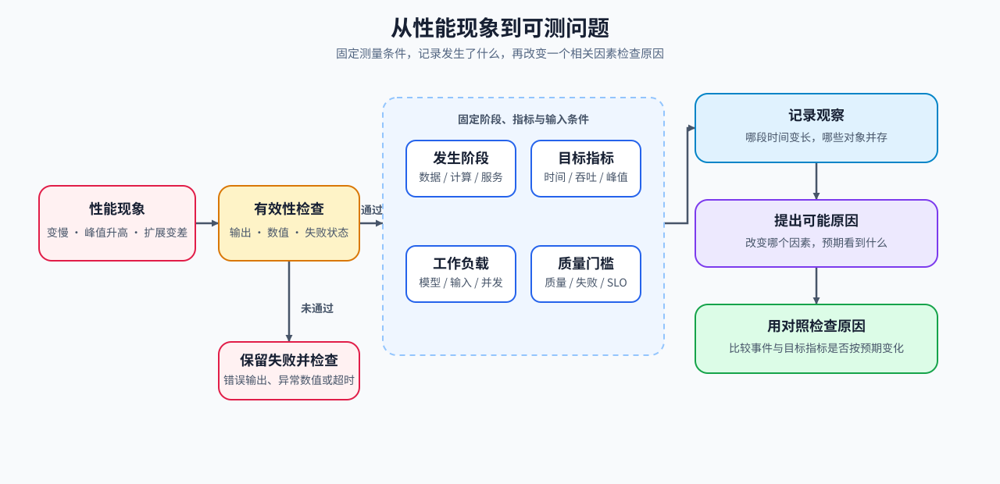

# 01 测量问题与证据链

训练步变慢、首词元延迟（TTFT）变高或多卡扩展变差，都只是现象。先把现象写成可测问题，后续执行轨迹与对照实验才能回答“为什么”。

## 从现象到可测假设

性能测量开始前先排除张量形状、数值异常、输出错误和失败运行；无效运行产生的时间与显存数据不能进入基线。运行通过有效性检查后，再写清对象、指标、条件与质量约束，使假设能够被后续证据支持或推翻。

| 要记录的内容 | 示例 | 作用 |
|:---|:---|:---|
| 现象与阶段 | 解码阶段单输出词元延迟（TPOT）上升 | 限定问题发生的位置 |
| 目标指标 | `TPOT`、`step_time_ms`、峰值显存 | 明确比较方向与单位 |
| 工作负载 | 模型、输入长度、批量、并发与采样参数 | 让结果可复现 |
| 假设 | 输入搬运拉长了关键路径 | 提供可证伪的归因方向 |
| 质量门槛 | 输出一致性、任务分数或失败率不能回归 | 防止“更快但不可用” |

## 证据如何升级

热点、峰值或利用率异常都是观察。只有当它们与固定条件下的基线 / 候选对照相互吻合，才可升级为某一类瓶颈的归因；否则应保留为下一轮测量假设。

| 证据状态 | 可以说明什么 | 下一步 |
|:---|:---|:---|
| 单次计时或截图 | 有值得检查的现象 | 固定工作负载，建立基线 |
| 执行轨迹与阶段变化一致 | 某阶段可能在拖慢关键路径 | 检查输入、形状、同步或状态变化 |
| 固定条件下的对照可重复 | 候选改动影响了目标指标 | 复核质量、波动与其他指标 |

指标、执行轨迹、性能剖析、归因和回归承担不同证据职责，不能用单个热点或单次计时代替完整判断。

| 证据对象 | 主要回答 | 典型内容 |
|:---|:---|:---|
| 指标（Metric） | 发生了多大变化？ | 延迟、吞吐、峰值显存、失败率与扩展效率 |
| 执行轨迹（Trace） | 事件何时发生，谁在等待谁？ | CPU / GPU 时间线、CUDA 流、同步、通信与 I/O |
| 性能剖析（Profile） | 时间和资源集中在哪些对象？ | 算子、计算内核、调用栈、内存对象与驻留 |
| 瓶颈归因（Attribution） | 哪个约束正在限制目标指标？ | 计算、带宽、容量、通信、I/O、排队与判别实验 |
| 性能回归（Regression） | 变化是否超过噪声且未破坏守护条件？ | 基线 / 候选分布、阈值、失败与回退 |

## 进入可重复基线

运行有效性可从[Part 00 · 19 异常定位](../../00_Prerequisites/19_Debugging_and_Anomaly_Localization.ipynb)检查，再用[Part 00 · 20 性能证据与实验设计](../../00_Prerequisites/20_Performance_Evidence_and_Experiment_Design.ipynb)固定指标和结果字段。[Part 01 · 13 性能分析](../../01_Hardware_Math_and_Systems/13_Profiling_and_Bottleneck_Analysis.ipynb)提供资源归因基础；随后进入[可重复基线](./02_reproducible_baseline.md)保存运行条件。

相关阅读：[PyTorch Profiler](https://docs.pytorch.org/docs/stable/profiler.html)。
