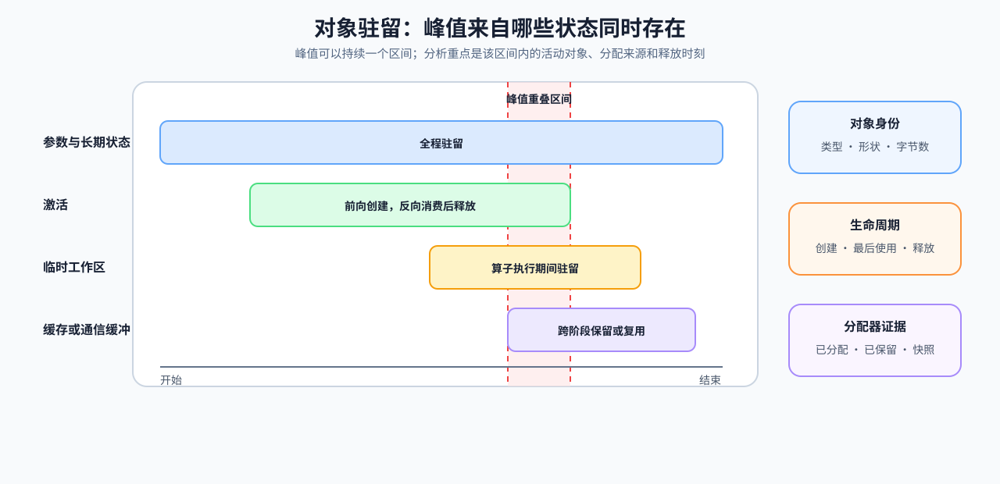

# 04 显存时间线与驻留状态

显存不足时，先找出峰值时仍占用空间的对象；分配频繁或回收延迟时，再检查这些行为是否让计算等待。本节将对象的大小、创建与释放时刻放回同一条时间线，解释峰值怎样形成。

## 先定位峰值与生命周期

把峰值放回运行阶段，区分长期状态与临时工作区。`allocated` 表示张量已分配的显存，`reserved` 表示分配器持有的显存；分析未被活跃分配使用的空间时，比较二者同一时刻的数值。两项区间最大值可能发生在不同时刻，其差不能代表峰值时的保留空间。图中 32、16、8、8 MiB 是说明驻留求和的示意大小，不是本机实测；横向长度表示时间，而非容量。

| 观察 | 可以提出的假设 | 仍需补充的证据 |
|:---|:---|:---|
| `allocated` 峰值抬高 | 活跃对象容量增加 | 对象类型、形状与生命周期 |
| 同一时刻 `reserved` 明显高于 `allocated` | 分配器持有较多未被活跃张量使用的空间 | 显存快照、分配频率与复用情况 |
| 激活跨反向传播驻留 | 训练状态压力上升 | 计算图与激活检查点对照 |
| 缓存随并发增长 | 请求状态容量受限 | 上下文、并发与淘汰策略 |

## 用驻留区间解释峰值

先给每项独立存储标出分配与释放时刻，再统计同一时刻仍驻留的字节数。设存储 $i$ 占用 $b_i$ 字节，分配、释放时刻分别为 $a_i,f_i$，$\mathbf1(\cdot)$ 是条件成立时为 1、否则为 0 的指示函数，则：

$$
M(t)=\sum_i b_i\mathbf1(a_i\le t<f_i),\qquad M_{\mathrm{peak}}=\max_t M(t).
$$

$t$ 是观察窗口内的时间，$M(t)$ 和 $M_{\mathrm{peak}}$ 的单位均为字节。共享底层存储的视图只计一次；同一时刻的分配与释放使用一致的事件顺序。示意图假设每行字节数固定且不共享存储，四类对象共同驻留的区间才是图中峰值区间。真实分配器还包含对齐、缓存等行为，账本应与同一范围的实测值核对，不能直接替代整个设备的显存占用。

`reserved` 高于 `allocated` 表示分配器仍持有未被活跃分配使用的空间；判断是否存在碎片，还需显存快照、分配失败或复用记录。

| 对象 | 常见驻留区间 | 峰值出现时要问的问题 | 可做的判别对照 |
|:---|:---|:---|:---|
| 参数、梯度和优化器状态 | 加载或更新开始后长期存在 | 状态本身是否超过容量预算？ | 固定模型、输入与更新预算，单独改变数据类型、分片或更新范围 |
| 保存的激活 | 前向创建至最后一次消费后释放 | 是否与梯度、临时工作区重叠？ | 激活检查点前后峰值与训练步时间 |
| 临时工作区 | 单个算子或阶段内短暂存在 | 是否正好落在其他对象尚未回收的窗口？ | 固定形状下的算子或后端对照 |
| KV Cache、请求状态 | 请求进入后至完成或淘汰 | 上下文、并发还是淘汰延迟扩大了容量？ | 固定请求长度下改变并发或复用率 |

## 进入容量策略复测

用[Part 00 · 18 显存分析](../../00_Prerequisites/18_Memory_Profiling_and_Optimization.ipynb)练习生命周期估算与构造快照对账；[Part 02 · PERF-MEMORY-TIMELINE](../../02_PyTorch_Algorithms/PERF-MEMORY-TIMELINE_Memory_Residency_and_Peak_Overlap.ipynb)的 CPU 练习从分配与释放事件计算活动对象，GPU 对照则测量生命周期改动后的峰值、耗时和校验和。确认峰值对象后，训练状态进入[性能优化 · 训练输入与状态](../performance_optimization/03_training_memory_ledger.md)，请求状态进入[性能优化 · 推理状态容量](../performance_optimization/04_inference_memory_and_kv_cache.md)，继续比较容量收益与时间、质量代价。
