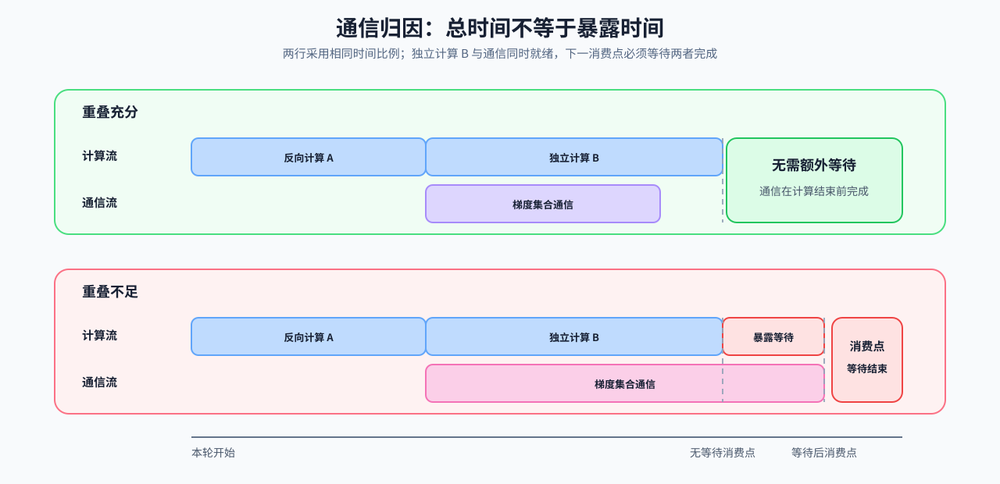

# 05 瓶颈归因：计算、带宽、容量、通信、I/O 与排队

时间线显示谁在等待谁，驻留记录显示峰值时哪些对象同时存在。结合计算量、搬运字节和资源参考，可以提出计算、带宽、容量或等待方面的原因，再设计一组对照检查这个解释。

## 从现象提出可能原因

从已取得的时间线、驻留记录或资源测量中，选择最可能限制目标指标的一项原因，写清支持它的观察，以及下一项能区分原因的对照。多个限制可能同时存在，后续根据对照结果继续检查。

| 可能原因 | 常见现象 | 下一项检查 | 容易误判之处 |
|:---|:---|:---|:---|
| 计算 | 核心算子持续占据关键路径 | FLOPs、Tensor Core 路径、计算内核时间与调用次数 | 算子耗时占比高就必须重写计算内核 |
| 带宽 | 数据量增加时延迟近似线性增长 | 搬运字节、带宽利用率、算术强度和缓存命中 | GPU 利用率低就是显存带宽受限 |
| 容量 | OOM、并发下降或频繁驱逐 | 活跃对象、峰值驻留、碎片与回收事件 | 分配器保留量等于有效状态量 |
| 通信 | 集合通信或同步暴露在关键路径 | 载荷、频率、每进程时间、拓扑和重叠窗口 | 多卡扩展差只由网络带宽造成 |
| I/O | GPU 等待输入、产物或状态搬运 | 读取/解析/H2D/回写阶段时间与队列深度 | 文件读取慢就是端到端主瓶颈 |
| 排队 | TTFT/P99 上升但单次计算稳定 | 到达轨迹、排队等待、准入和批次状态 | 增大批量一定提高服务效率 |

## 用算术强度比较计算与带宽约束

先选定一个算子和存储层级，再将运算量与该层搬运量放到同一模型中。设 $F$ 为浮点运算次数，$B>0$ 为该层读写字节数，$P_{\max}$ 为匹配精度与计算路径的计算吞吐上界，$W_{\max}$ 为该层带宽上界，则理想 Roofline 模型为：

$$
I=\frac{F}{B},\qquad P\le\min(P_{\max},I W_{\max}),\qquad
T\ge\max\left(\frac{F}{P_{\max}},\frac{B}{W_{\max}}\right).
$$

$I$ 是算术强度，单位 FLOP/byte；$P$ 的单位 FLOP/s，$W_{\max}$ 的单位 byte/s，$T$ 的单位秒。两项理想耗时中较大的一项给出资源下界；启动、同步、排队和不充分重叠会进一步增加耗时。采用最低搬运量估计 $B$ 时，应说明缓存复用假设，不能把它当作硬件计数器测出的实际流量。

经验微基准得到的是参考吞吐和参考带宽，不是严格硬件上界。将其代入模型用于比较时，应标为“经验参考”；其他形状或执行路径的测量值可以略高于参考值。算子相对参考值的比例只支持局部分析，是否限制端到端时间仍由关键路径对照判断。

## 通信何时延长完成时间

多卡吞吐未按卡数增长时，应把集合通信、同步、数据搬运与计算放到同一时间线上。通信持续时间只是原始成本；只有没有被计算隐藏的部分进入关键路径时，才构成暴露通信瓶颈。

对一个已经就绪的通信任务，若它能与后续独立计算同时开始，且二者都必须在下一消费点前完成，可用 $T_{\mathrm{wait}}=\max(0,T_{\mathrm{comm}}-T_{\mathrm{ind}})$ 表示该消费点额外等待的时间。$T_{\mathrm{comm}}$ 是通信耗时，$T_{\mathrm{ind}}$ 是独立计算窗口，三者使用相同时间单位。延迟发起、资源争用或更复杂的依赖关系需回到实际时间线，不能直接套用这个简化式。

| 观察 | 可能原因 | 对照方式 |
|:---|:---|:---|
| 集合通信持续时间升高 | 载荷、拓扑或调用频率变化 | 固定模型和全局批量，对齐消息字节与集合通信次数 |
| 计算前后出现空洞 | 同步、依赖或发起时机 | 查看 CUDA 流、事件依赖和每进程时间线 |
| 重叠窗口缩小 | 可重叠计算不足或调度次序变化 | 比较通信时间、可重叠窗口和暴露时间 |
| 尾部进程持续落后 | 数据、路由或硬件负载不均 | 记录每进程阶段时间与载荷分布 |

## 从归因进入判别实验

计算与带宽对照使用[Part 02 · PERF-ROOFLINE](../../02_PyTorch_Algorithms/PERF-ROOFLINE_Arithmetic_Intensity_and_Resource_Ceiling.ipynb)记录工作量和经验参考；原理可回查[Part 01 · 02 参数量与 FLOPs](../../01_Hardware_Math_and_Systems/02_LLM_Params_and_FLOPs.ipynb)、[Part 01 · 03 GPU 架构与显存](../../01_Hardware_Math_and_Systems/03_GPU_Architecture_and_Memory.ipynb)及[Part 01 · 13 瓶颈定位](../../01_Hardware_Math_and_Systems/13_Profiling_and_Bottleneck_Analysis.ipynb)。通信对照从[Part 01 · 05 通信拓扑](../../01_Hardware_Math_and_Systems/05_Communication_Topologies.ipynb)、[Part 01 · 20 NCCL 与 AllReduce](../../01_Hardware_Math_and_Systems/20_NCCL_and_AllReduce_Basics.ipynb)检查载荷和拓扑，再用[Part 02 · 47 NCCL 通信性能分析](../../02_PyTorch_Algorithms/47_Communication_Profiling_with_NCCL.ipynb)采集真实轨迹。

对照结果支持当前解释时，在[诊断记录](./07_diagnosis_and_action_decision.md)中附上测量范围、原始结果及未解释现象，再进入[性能优化](../performance_optimization/intro.md)比较具体方案；与预期不符时，记录被排除的原因并检查下一项。
