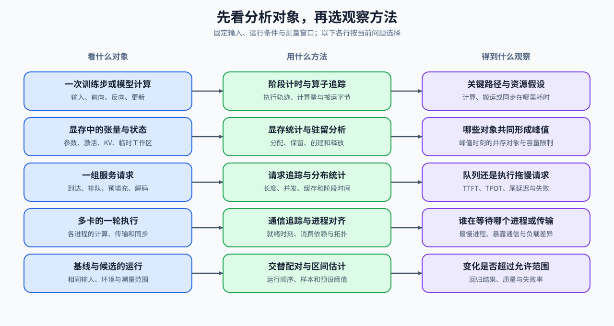
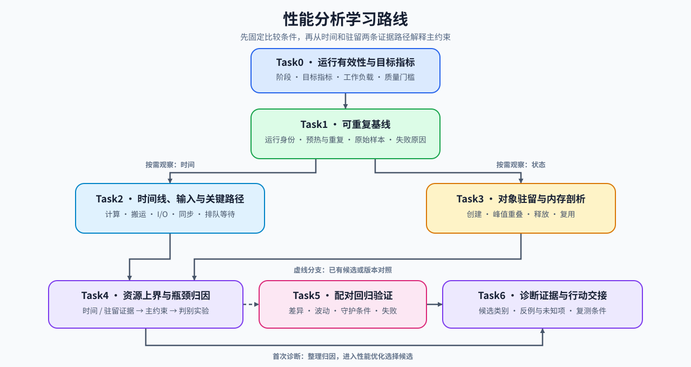
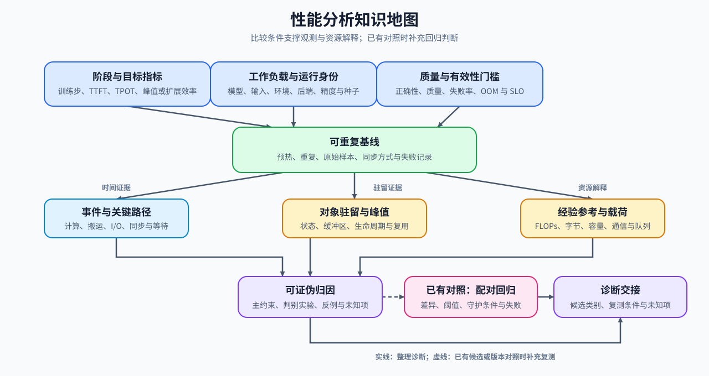

# 性能分析（Performance Analysis）

> 专题类型：基础支撑　能力出口：把性能现象转化为可复查的测量、归因与回归证据

训练变慢、请求延迟升高、显存不足或多卡等待时，先选定要观察的计算、张量、请求或进程，再用计时、事件追踪、驻留记录和配对测量解释变化。学完后，能够指出时间花在哪里、峰值由谁构成，以及哪些原因仍需验证。

性能分析回答“时间和资源去了哪里”；具体策略的机制由训练、推理、量化、通信与算子专题讲解，候选选择、组合复测和工程决策进入[性能优化](../performance_optimization/intro.md)。

## 学习路线

按 Task 顺序学习时使用下表；需要连续完成一次排查时进入[性能分析问题链](./walkthrough.md)，已有现象或结果时使用[性能分析判断手册](./casebook.md)。术语差异查询[术语表](./glossary.md)，跨页核对单位、分母和公式条件时使用[公式索引](./formula_reference.md)。

首次诊断在固定基线后，按问题采集时间或驻留记录，确认归因即可整理诊断并进入性能优化。已有候选改动或版本对照时，再使用配对回归检查更新判断；Task 编号表示学习顺序，不要求每次排查都运行全部实验。

| Task / 主题 | 本阶段要回答的问题 | 学习入口与验证出口 | 学习顺序 | 主要正文入口 |
|:---|:---|:---|:---|:---|
| Task0 · 运行有效性与目标指标 | 当前性能问题对应什么有效运行条件和目标指标？ | 核心：[Part 00 · 20 性能证据与实验设计](../../00_Prerequisites/20_Performance_Evidence_and_Experiment_Design.ipynb)；扩展：[Part 00 · 19 异常定位](../../00_Prerequisites/19_Debugging_and_Anomaly_Localization.ipynb) | 检查运行有效性 → 确定阶段 → 选择目标指标 → 固定质量门槛 | [专题正文 · 01 明确测量对象与问题](./01_why_profiling_matters.md) |
| Task1 · 可重复基线 | 环境和工作负载怎样固定，才能区分真实性能变化与测量波动？ | 核心：[Part 00 · 17 性能分析基础](../../00_Prerequisites/17_PyTorch_Profiling_Basics.ipynb) | 记录运行身份 → 固定工作负载 → 预热与重复 → 保存原始样本与失败原因 | [专题正文 · 02 可重复基线](./02_reproducible_baseline.md) |
| Task2 · 时间线、输入与关键路径 | 哪些计算、搬运或等待真正延长了总耗时？ | 核心：[Part 02 · PERF-TRACE 执行轨迹依赖与关键路径](../../02_PyTorch_Algorithms/PERF-TRACE_Trace_Dependencies_and_Critical_Path.ipynb)；扩展：[Part 02 · PERF-INPUT 训练输入流水线性能](../../02_PyTorch_Algorithms/PERF-INPUT_Training_Input_Pipeline_Performance.ipynb)、[Part 02 · PERF-IO 产物、状态与输出 I/O 关键路径](../../02_PyTorch_Algorithms/PERF-IO_Artifact_State_and_Output_IO_Critical_Path.ipynb) | 继承同一基线 → 划分阶段 → 重建事件依赖 → 识别暴露等待 → 确认关键路径 | [专题正文 · 03 时间线、I/O 与关键路径](./03_time_breakdown_and_trace_reading.md) |
| Task3 · 对象驻留与内存剖析 | 哪些状态和缓冲区在峰值时同时驻留，它们何时创建、释放或复用？ | 核心：[Part 00 · 18 显存分析](../../00_Prerequisites/18_Memory_Profiling_and_Optimization.ipynb) → [Part 02 · PERF-MEMORY-TIMELINE 显存驻留与峰值重叠](../../02_PyTorch_Algorithms/PERF-MEMORY-TIMELINE_Memory_Residency_and_Peak_Overlap.ipynb)；扩展：[Part 02 · 43 训练内存账本](../../02_PyTorch_Algorithms/43_Unified_Training_Memory_Ledger.ipynb) → [Part 02 · 79 训练状态并行基准](../../02_PyTorch_Algorithms/79_Distributed_Parallel_Benchmark.ipynb) | 继承同一基线 → 记录分配事件 → 重建驻留区间 → 定位峰值对象 → 核对回收时刻；需要判断分片收益时，再比较各 rank 的状态驻留 | [专题正文 · 04 显存时间线与驻留状态](./04_memory_timeline_and_residency.md) |
| Task4 · 资源上界与瓶颈归因 | 现有测量支持哪个主要限制，以及怎样验证这个解释？ | 核心：[Part 02 · PERF-ROOFLINE 算术强度与资源上界](../../02_PyTorch_Algorithms/PERF-ROOFLINE_Arithmetic_Intensity_and_Resource_Ceiling.ipynb)；扩展：[Part 02 · 47 NCCL 通信性能分析](../../02_PyTorch_Algorithms/47_Communication_Profiling_with_NCCL.ipynb) → [Part 02 · 79 训练状态并行基准](../../02_PyTorch_Algorithms/79_Distributed_Parallel_Benchmark.ipynb) | 汇总时间或驻留证据 → 对照资源参考 → 提出主约束 → 用判别实验检验；79 用于观察状态分片、通信和扩展效率之间的取舍 | [专题正文 · 05 瓶颈归因](./05_bottleneck_attribution.md) |
| Task5 · 回归、噪声与阈值 | 已有候选或版本对照时，差异是否超过允许退化范围？ | 核心：[Part 02 · PERF-REGRESSION 配对基准与回归阈值](../../02_PyTorch_Algorithms/PERF-REGRESSION_Paired_Benchmark_and_Regression_Thresholds.ipynb) | 对齐比较条件 → 配对采样 → 估计区间 → 检查守护条件 → 输出回归判断 | [专题正文 · 06 基准设计与回归验证](./06_benchmark_design_and_regression_validation.md) |
| Task6 · 诊断证据与行动交接 | 如何把已有测量和归因整理为可复查诊断，并确定下一步？ | 核心：整理 Task0–4 的诊断，已有对照时附 Task5 结果；扩展：[性能优化](../performance_optimization/intro.md) | 汇总证据 → 记录反例与未知项 → 指定待验证方向与复测条件 → 补测或交接优化 | [专题正文 · 07 从归因到行动](./07_diagnosis_and_action_decision.md) |

## 扩展与跨专题入口

按需要解释的对象回查下表。已定位主约束、需要比较候选或组合策略时，进入[性能优化](../performance_optimization/intro.md)。

| 需要解释的对象 | 回补入口 | 性能分析使用的证据 |
|:---|:---|:---|
| 主机与设备的执行顺序 | [Part 01 · 07 异构调度](../../01_Hardware_Math_and_Systems/07_CPU_GPU_Heterogeneous_Scheduling.ipynb)、[Part 01 · 15 CUDA 执行模型](../../01_Hardware_Math_and_Systems/15_CUDA_Execution_Model.ipynb)、[Part 01 · 17 CUDA 流](../../01_Hardware_Math_and_Systems/17_CUDA_Stream_and_Asynchrony.ipynb) | 主机提交、设备执行、同步与可重叠区间 |
| 计算量、搬运字节与资源参考 | [Part 01 · 02 参数量与 FLOPs](../../01_Hardware_Math_and_Systems/02_LLM_Params_and_FLOPs.ipynb)、[Part 01 · 03 GPU 架构与显存](../../01_Hardware_Math_and_Systems/03_GPU_Architecture_and_Memory.ipynb)、[Part 01 · 13 瓶颈定位](../../01_Hardware_Math_and_Systems/13_Profiling_and_Bottleneck_Analysis.ipynb) | 工作量、算术强度、经验参考与限制条件 |
| 训练计算图、激活与优化器状态 | [反向传播与训练机制](../backpropagation_training_mechanism/intro.md) | 前向传播 / 反向传播 / 更新的时间线、状态驻留与峰值 |
| 请求阶段、KV Cache 与调度 | [推理优化](../inference_optimization/intro.md) | TTFT、TPOT、吞吐、并发、队列和状态容量 |
| 量化表示与执行路径 | [量化与压缩](../quantization_compression/intro.md) | 权重、激活或 KV 字节，质量与实际低精度执行路径 |
| 多卡传输与进程等待 | [Part 01 · 05 通信拓扑](../../01_Hardware_Math_and_Systems/05_Communication_Topologies.ipynb)、[Part 01 · 20 NCCL 与 AllReduce](../../01_Hardware_Math_and_Systems/20_NCCL_and_AllReduce_Basics.ipynb)、[通信与并行](../communication_parallelism/intro.md) | 拓扑、集合通信、慢进程和暴露等待 |
| 单算子的计算与访存 | [算子优化](../operator_optimization/intro.md) | 输入形状、实际计算内核、启动与访存开销 |

## 实验与项目出口

首次运行按[实验 Quickstart](./quickstart.md)选择环境；读取已有结果或选择复现实验时使用[实验资产表](./experiment_assets.md)。工具与采集范围的选择见[正文 03 时间线、I/O 与关键路径](./03_time_breakdown_and_trace_reading.md)，跨专题环境关系见[环境资产索引](../../docs/gpu_environment_assets.md)。

| 已有记录或目标 | 直接入口 | 需要带入什么 |
|:---|:---|:---|
| 建立真实训练基线 | [Part 02 · 73 训练性能分析](../../02_PyTorch_Algorithms/73_Training_Performance_Analysis.ipynb) | 模型、输入、更新方式、计时范围与质量要求 |
| 按诊断比较优化方案 | [性能优化专题](../performance_optimization/intro.md) | 当前归因、原始结果、反例、未知项与目标指标 |
| 复测候选并形成项目交接 | [Part 02 · 74 性能剖析驱动优化](../../02_PyTorch_Algorithms/74_Profiling_Driven_End_to_End_Optimization.ipynb) | 可重复基线、候选执行路径、配对结果和回退条件 |
