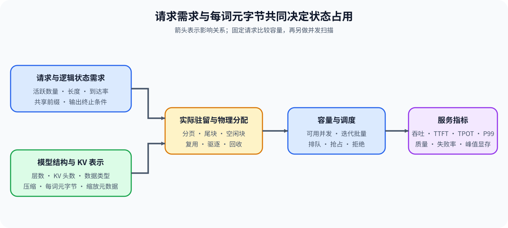

# 04 推理延迟、吞吐与状态容量

## 本节导读

同一个推理服务，首词元慢可能来自排队、输入处理或预填充计算，后续生成慢可能来自每轮计算和调度，显存不足又可能限制可同时运行的请求数。先区分请求在等什么、每轮执行什么，再选择计算、缓存、调度或精度改动。

首词元时间（TTFT）从约定的请求起点计到首个输出词元，后续每词元时间（TPOT）描述首词元后的平均生成间隔，P99是延迟分布的第99百分位。键值缓存（KV Cache）保存历史词元的键和值，避免每轮重复计算已有状态；它随上下文增长并占用容量。下图从这种增长解释可运行并发与延迟，计算和调度还需结合后文的请求阶段一起比较。

## 先判断请求慢在哪个阶段

以一条提示较长的请求为例，排队时间长时，应观察准入和批次选择；预填充慢时，再区分重复前缀计算与单次前向开销。生成阶段每轮通常只推进少量词元，提高批量可能摊薄权重读取成本，也会增加单轮工作和等待。仅有总延迟，难以判断哪项改动解决了问题。

计算实现、缓存与调度的详细机制见[推理优化路线](../inference_optimization/intro.md)。下表先区分各自减少的工作与新增代价，再追踪状态容量如何改变比较条件；更高并发和每条请求更快分别测量。

| 受限阶段 | 可比较的改动 | 减少什么或增加什么机会 | 需要保留的代价 |
|:---|:---|:---|:---|
| 模型前向 | 融合、编译、匹配的注意力后端 | 中间读写、主机提交或计算开销 | 首次编译、工作区、数值误差和形状限制 |
| 重复预填充 | 前缀复用 | 重复计算的前缀词元 | 匹配、缓存维护和失效成本 |
| 生成与批次推进 | 调整批量、连续补位和阶段预算 | 设备空闲与空槽，或改善请求等待 | 单轮延迟、长短请求竞争和状态占用 |
| 权重或历史状态读取 | 权重、激活或KV低精度分支 | 对应对象的表示与读取字节 | 转换、反量化、质量与后端支持 |

## KV 状态怎样随请求增长

先按模型结构估算每词元KV，再按活跃序列统计逻辑容量，最后检查实际块分配、共享与空闲空间。引用计数表示仍有多少使用者依赖同一缓存块，减少到可回收状态时才能安全释放；因此共享后的物理占用不能把每个请求的逻辑字节直接相加。[Part 01 · 11 KV Cache增长](../../01_Hardware_Math_and_Systems/11_KV_Cache_and_Memory_Growth.ipynb)给出基础估算，[Part 02 · 22 PagedAttention](../../02_PyTorch_Algorithms/22_vLLM_PagedAttention.ipynb)与[Part 02 · 37 缓存生命周期](../../02_PyTorch_Algorithms/37_KV_Cache_Lifecycle_and_Capacity_Control.ipynb)解释逻辑状态如何映射为物理块。

| 容量字段 | 回答的问题 | 必须配对的运行信息 |
|:---|:---|:---|
| 每词元的 K/V 表示与数据类型 | 单请求每增加一个词元需要多少状态 | 模型结构、层数、KV 头数、数据类型 |
| 活跃序列长度 | 当前请求各自保留多少历史状态 | 输入/输出长度分布与终止状态 |
| 活跃请求数 | 多少请求同时占用状态 | 排队、准入和迭代批次 |
| 块利用率与碎片 | 物理分配是否浪费容量 | 块大小、尾块和空闲块 |
| 共享与引用计数 | 前缀状态能否被多个请求复用 | 命中、失效、驱逐与回收事件 |

## 请求分布如何改变容量与延迟

相同缓存策略在共享前缀较多的请求中可能显著降低 TTFT，在随机请求中却可能只增加匹配与维护开销。长度、并发和共享前缀分布必须与缓存结果一起记录。

| 请求分布变化 | 首先改变的对象 | 可能出现的服务结果 |
|:---|:---|:---|
| 上下文变长 | 单请求 KV 与注意力读取量 | 并发下降、TPOT 上升、驱逐增加 |
| 活跃请求增多 | 同时驻留的 KV 和迭代工作量 | 吞吐先升后平台，P99 持续增长 |
| 共享前缀增多 | 可复用块与避免的预填充词元 | TTFT 下降，也可能增加匹配成本 |
| 输出长度离散 | 请求退出时刻和尾块占用 | 批次空槽、碎片和尾延迟增加 |

## 分配、复用、驱逐与压缩的代价

缓存命中指找到可以直接复用的前缀状态，驱逐则回收可释放的缓存以腾出空间。[Part 02 · 24 前缀缓存](../../02_PyTorch_Algorithms/24_Prefix_Cache_Matching_and_Reuse.ipynb)和[Part 02 · 34 RadixAttention](../../02_PyTorch_Algorithms/34_SGLang_RadixAttention.ipynb)解释索引与安全回收，[Part 02 · 54 KV量化](../../02_PyTorch_Algorithms/54_KV_Cache_Quantization_Strategies.ipynb)解释表示变化。MLA是使用潜在状态压缩键值历史的注意力架构，需要模型及计算路径配合，不能直接当作普通缓存格式开关。

| 候选 | 预期收益 | 新增代价或限制 |
|:---|:---|:---|
| 分页分配 | 降低连续内存要求和外部碎片 | 页表、尾块与块管理开销 |
| 前缀复用 | 避免重复预填充和状态创建 | 匹配、索引、引用计数和失效处理 |
| 驱逐或重算 | 在容量不足时释放状态 | 命中损失、重算、换入换出或请求延迟 |
| KV 量化 | 降低每词元存储和搬运字节 | 误差、反量化和执行后端限制 |
| MLA 等紧凑表示 | 从模型结构上减少历史状态 | 需要匹配的模型架构和计算路径 |

## 容量收益如何验证

先在相同请求清单、长度、并发和调度配置下比较，再单独测试容量释放后允许的更高并发。服务等级目标（SLO）是预先要求达到的时限或成功率，例如“P99延迟低于某一门槛”。假设并发4时缓存候选没有缩短延迟，但让并发8也能在SLO内完成，它体现的是承载能力增加，两种收益应分开记录。比较完整后进入[单项收益判断](./06_cost_model_and_production_decision.md)；若主要变化来自传输或排队，先补[依赖与重叠检查](./05_compute_communication_and_io.md)。

建立请求参照可从[Part 02 · 66 单卡推理测量基线](../../02_PyTorch_Algorithms/66_Inference_Performance_Comparison.ipynb)进入。该页用客户端首末内容块和流结束事件解释延迟：内容块可能包含多个词元，因此首内容延迟与内容间隔代理不直接等同逐词元TTFT／TPOT。其单并发基线也不能代替本节的并发、排队与容量扫描；已有结果和待补采状态见[推理实验资产](../inference_optimization/experiment_assets.md#baseline-66)。

| 观察 | 必须补查的证据 | 判断 |
|:---|:---|:---|
| 峰值显存下降 | 相同长度、并发、质量和执行路径 | 只能确认容量收益，不能自动确认加速 |
| 命中率提高 | 复用词元、匹配时间、TTFT 与请求分布 | 区分避免预填充的计算收益与请求端 TTFT 是否改善 |
| 并发上限提高 | 排队、TPOT、P99、拒绝和 OOM | 尾延迟与质量仍在门槛内才可采用 |
| 量化后容量提高 | 真实后端、计算内核、反量化和质量 | 执行路径成立后再判断性能收益 |
| 相同请求负载下量化更快 | 相同请求清单、并发、调度、质量门槛和计时范围 | 可以比较该负载下的 TTFT、TPOT、吞吐和尾延迟 |
| 扩大并发后吞吐提高 | 浮点与量化方案各自的并发扫描、峰值、拒绝率和 SLO | 登记为容量带来的服务扩展收益；若浮点基线 OOM，保留失败状态，不计算该点加速比 |
| 驱逐减少 OOM | 重算/换入换出时间、失败率和请求完成率 | 不能用更高尾延迟掩盖容量不足 |
