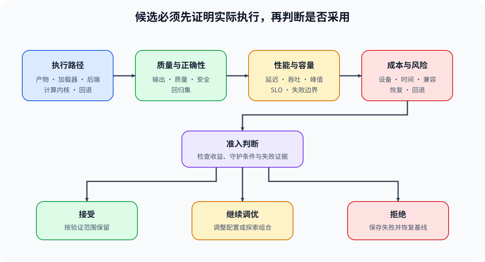

# 06 单候选执行与准入

## 本节导读

以AdamW为例，同一更新规则可以逐个处理参数张量（single-tensor），也可以批量组织多个张量（foreach），或融合更新中的计算（fused）。这些实现可能减少提交与中间操作，但新增临时存储和数值差异也要检查。优化器更新只是训练步的一部分，最终还要测包含前向、反向与更新的完整训练步。

带入基线、候选配置与配对样本，先确认预期改动实际执行，再按主目标和守护条件决定接受、继续调优或拒绝。这里的准入是判断候选是否适合当前任务和已验证范围；服务候选还需满足预先声明的服务等级目标（SLO），例如延迟的第99百分位（P99）和成功率要求。

## 候选是否命中目标执行路径

把候选配置与实际运行逐项对应：需要保存和加载的模型检查产物、加载器和后端；进程内算子改动检查配置是否启用以及实际调用的内核；键值缓存（KV）配置还要检查缓存分配与访问路径。每项检查都保留实际日志或轨迹，静默回退应与目标路径分开测量。

| 执行阶段 | 必须记录 | 常见失败 |
|:---|:---|:---|
| 产物 | 模型/权重版本、格式、数据类型、量化或稀疏元数据 | 产物不完整或与加载器不兼容 |
| 加载器 | 实际读取的文件、转换步骤、警告和回退 | 静默转换为高精度或忽略候选配置 |
| 执行后端 | 后端版本、能力门槛、启用配置 | 后端不支持目标模型、形状或数据类型 |
| 计算内核 | 实际命中的计算路径、输入形状和回退路径 | 产物加载成功但没有命中目标内核 |
| 输出 | 正确性、质量、失败请求和异常状态 | 局部速度提高但结果不可用 |

## 正确性、质量与性能是否通过门槛

配对测量是在相同输入与可比条件下，把基线和候选组织成可对应的测量轮次；交换先后顺序有助于观察预热、温度或后台负载带来的偏差。逐轮差异与统计波动的判断见[Part 02 · PERF-REGRESSION](../../02_PyTorch_Algorithms/PERF-REGRESSION_Paired_Benchmark_and_Regression_Thresholds.ipynb)：该页的`accept`表示未确认超过允许回归幅度；这里采用候选还要求达到任务主目标。正确性回答输出或参数是否在容差内，质量则回答独立任务评测是否达到要求，两者分别检查。

假设优化器更新从20 ms降到10 ms，其余训练阶段固定为80 ms，则完整训练步从100 ms降到90 ms：加速比用100/90计算，约为1.11倍；耗时降幅用(100−90)/100计算，为10%。如果预先要求至少降低15%的训练步时间，这个候选尚未达标；它可以保留为调优对象。两种比例的分母与统计约定见[性能分析公式索引](formula_reference.md#测量窗口、吞吐与延迟)。量化方案还需分开校准数据与独立评测数据，前者用于确定缩放等参数，后者用于判断质量。

| 候选观察 | 先做的准入判断 | 仍需复测的条件 |
|:---|:---|:---|
| 显存下降、单步时间上升 | 有效吞吐与质量是否仍在预算内 | 批量、长度和峰值边界 |
| 吞吐提高、P99 退化 | 是否仍满足交互或批处理 SLO | 高峰并发、队列与回退策略 |
| 低精度后端更快 | 产物、质量和目标计算内核是否同时成立 | 模型版本、质量集和回退精度 |
| 多卡扩展提高 | 暴露通信和设备成本是否抵消增益 | 拓扑、负载、故障恢复和容量 |
| I/O 等待缩短 | 是否真正缩短关键路径 | 冷启动、稳态、网络/存储成本和回压 |
| 后训练质量提高 | 质量增益是否值得训练、采样和验证成本 | 有效样本率、失败重试和回退检查点 |

## 容量、成本与运行风险是否可接受

成本按完成的有效工作比较：例如同样的请求量与质量下，设备数量、运行时间、失败重试和闲置共同影响总开销。高峰或失败请求改变分布后，平均延迟下降仍可能伴随P99变差。成本估算可结合[Part 01 · 33 TCO与成本模型](../../01_Hardware_Math_and_Systems/33_TCO_and_Cost_Model.ipynb)，后端兼容条件见[Part 01 · 34 运行时约束](../../01_Hardware_Math_and_Systems/34_Heterogeneous_Accelerators_and_Runtime_Constraints.ipynb)。

| 维度 | 需要估算或固定的内容 | 常见误判 |
|:---|:---|:---|
| 需求 | 请求量、长度分布、峰值并发、训练步数或作业窗口 | 用平均负载代替高峰分布 |
| 容量 | 单卡/单实例可容纳的批量、并发或训练状态 | 只根据模型参数量估算容量 |
| 直接成本 | 设备、运行时间、功耗、存储和网络 | 忽略预热、失败、重试和闲置 |
| 兼容风险 | 硬件、驱动、后端、模型或数据分布变化 | 将一次成功运行当成长期兼容性 |
| 恢复风险 | 检查点、回退路径、状态重建和失败范围 | 只记录成功结果，不验证恢复 |

## 接受、调优或拒绝

判断只对当前模型、负载、硬件与测量条件成立。为容量目标接受适度变慢时，应在测量前给出允许范围：例如峰值至少下降20%、耗时最多增加15%。满足这两项且质量通过的候选可按容量目标接受，不能仅因耗时增加就拒绝。需要叠加策略时进入[组合对照](./07_end_to_end_performance_engineering.md)，继续检查新增收益与资源竞争。

| 结论 | 必须满足的条件 | 后续动作 |
|:---|:---|:---|
| `accept` | 执行路径成立，达到预设目标，所有守护条件通过；计时目标的改善需超过可解释的波动 | 按已验证范围保留候选，需要叠加策略时进入组合复测 |
| `tune` | 目标机制已执行，但收益未达到要求、波动仍难解释，或只在部分负载成立 | 缩小范围或调整配置后重新配对；正确性、质量与资源安全通过时，可做探索性组合对照，保留未通过项 |
| `reject` | 未执行目标机制、正确性或质量失败、成本越界，或性能退化超出预设允许范围 | 保存失败证据并恢复基线；需要比较回退实现时另列候选 |
