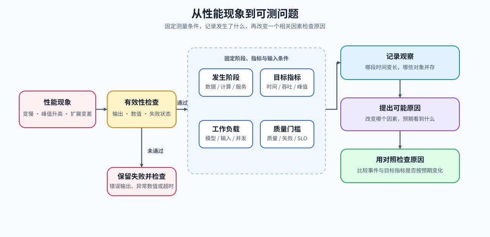

# 01 测量对象、边界与观测层级

同一训练任务可以测“GPU上的前向与反向”，也可以测“从取批到参数更新的完整步骤”。两者即使都叫单步时间，包含的工作也不同。本页先选择要观察的对象和时间边界，再区分指标、执行轨迹与性能剖析能回答的问题；优化目标与比较条件从[主线01](../01_performance_problem_and_benchmark.md)进入。

## 一个问题可以在哪些层级观察

假设输入准备和搬运需要30 ms，设备上的训练还需70 ms，且两部分串行。测量设备就绪后的70 ms，可以比较训练计算改动；若要解释输入预取，则应观察包含输入供给的100 ms。若两阶段允许重叠，完成时间要按依赖和资源重建，不能继续直接相加。这里的数字是边界示例，不是实验结果。

| 观测层级 | 测量起止或对象 | 可以解释什么 |
|:---|:---|:---|
| 计算调用 | 输入就绪后到目标计算完成 | 算子或更新实现的局部成本 |
| 训练步骤 | 约定是否包括取批、搬运、前向、反向、更新和损失读取 | 局部改动是否缩短同范围训练步骤 |
| 推理请求 | 到达或发送请求，到约定的输出事件 | 排队、首输出与完成时间；客户端事件和服务端事件分别记录 |
| 资源对象 | 参数、激活、缓存或工作区的创建至释放 | 哪些对象在峰值时同时驻留 |
| 多进程任务 | 共同开始条件到任务完成，保留各进程活动 | 最慢进程、同步与暴露通信 |

## 怎样用对照检查原因

热点、峰值和利用率提供检查位置。要判断原因，还需在固定条件下改变一个相关因素，观察预期事件和目标指标是否随之变化。例如，检查输入等待时，可以比较相同批次下的搬运时机、设备空闲区间和训练步耗时。这类判别对照用于检查原因；优化方案另需验证收益和质量。

| 已有观察 | 可以说明什么 | 下一步 |
|:---|:---|:---|
| 单次计时或截图 | 有值得检查的现象 | 固定工作负载，建立基线 |
| 执行轨迹与阶段变化一致 | 某阶段可能在拖慢关键路径 | 检查输入、形状、同步或状态变化 |
| 改变一个因素后，事件与目标指标按预期变化 | 当前结果支持该因素限制了性能 | 重复对照，并检查其他可能解释与输出质量 |

## 几类分析结果分别回答什么

指标描述变化大小，执行轨迹记录先后与等待，性能剖析定位耗时对象；结合这些记录提出原因，再用对照检查。已有候选或版本改动时，用性能回归检查判断退化是否超过允许范围。

| 分析结果 | 主要回答 | 典型内容 |
|:---|:---|:---|
| 指标 | 发生了多大变化？ | 延迟、吞吐、峰值显存、失败率与扩展效率 |
| 执行轨迹（Trace） | 事件何时发生，谁在等待谁？ | CPU / GPU 时间线、CUDA 流、同步、通信与 I/O |
| 性能剖析（Profile） | 时间和资源集中在哪些对象？ | 算子、计算内核、调用栈、内存对象与驻留 |
| 瓶颈归因 | 哪类计算、资源或等待正在限制目标指标？ | 计算、带宽、容量、通信、I/O、排队与判别实验 |
| 性能回归检查 | 候选或版本改动是否超过允许退化范围？ | 基线与候选的配对分布、阈值、质量和失败 |

## 进入可重复基线

运行有效性可从[Part 00 · 19 异常定位](../../../00_Prerequisites/19_Debugging_and_Anomaly_Localization.ipynb)检查，再用[Part 00 · 20 性能证据与实验设计](../../../00_Prerequisites/20_Performance_Evidence_and_Experiment_Design.ipynb)固定指标和结果字段。[Part 01 · 13 性能分析](../../../01_Hardware_Math_and_Systems/13_Profiling_and_Bottleneck_Analysis.ipynb)提供资源归因基础；随后进入[可重复基线](./02_reproducible_baseline.md)保存运行条件。

相关阅读：[PyTorch Profiler](https://docs.pytorch.org/docs/stable/profiler.html)。
