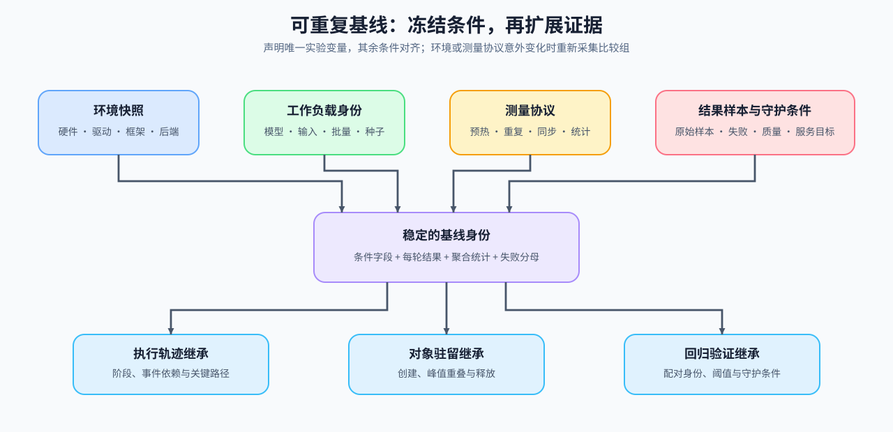

# 02 可重复基线与比较条件

基线保存固定工作负载下的运行条件和逐次结果，供时间线、驻留分析和候选对照使用。先在[主线01](../01_performance_problem_and_benchmark.md)确定目标、变化变量和比较条件，再按[测量对象与边界](./01_why_profiling_matters.md)选定起止点。本页展开如何实际计时、预热和保留重复样本。

## 固定环境、工作负载与测量过程

先完成环境和输入预检，再执行预热；正式重复运行保存每次结果及失败原因，而不只保留汇总值。稳态实验把初始化、编译与预热排除在计时外；冷启动实验单独规定这些阶段是否计入总时间。

| 记录内容 | 至少保存什么 | 用来检查什么 |
|:---|:---|:---|
| 环境 | 硬件、驱动、CUDA、框架、后端、精度与版本 | 非实验变量是否变化，实际执行路径是否相同 |
| 工作负载 | 模型版本、输入与输出长度、批量或并发、数据切分和种子 | 两侧是否处理相同任务与输入分布 |
| 测量方法 | 预热、重复次数、计时范围、同步点、统计方法和超时 | 首次调用、稳态和异步执行时间是否混用 |
| 逐次样本 | 每轮耗时与峰值、运行顺序、失败阶段和原因 | 波动、异常值和失败比例能否复算 |
| 质量与服务要求 | 输出检查、任务分数、失败率和 SLO 及其门槛 | 性能差异是否伴随不可接受的结果退化 |

## 异步执行怎样影响计时

GPU调用通常由主机提交，设备随后执行。假设主机2 ms内提交完操作，设备到20 ms才完成：只在Python调用前后读墙钟，可能得到提交时间，而不是任务完成时间。测完成时间时，应在窗口开始前排除先前未完成的工作，并在窗口末等待本次工作完成；每步同步与整段末同步又会改变可重叠空间，应分别声明。CUDA事件可记录指定流上的设备区间，但不能自动包含事件之外的取批、主机排队或文件读写。

| 计时方式 | 包含什么 | 使用前要明确什么 |
|:---|:---|:---|
| 主机墙钟，不等待设备 | 调用返回前的主机活动 | 异步调用返回不表示设备完成 |
| 主机墙钟，窗口边界等待设备 | 窗口内主机工作与约定设备工作完成所需时间 | 是否含输入准备、输出读取及同步等待 |
| CUDA事件区间 | 起止事件之间的设备时间与流依赖等待 | 事件在哪条流，是否包含跨流依赖和流水线尾部 |
| 客户端请求窗口 | 发送到约定的内容或流结束事件 | 网络、缓冲、队列和词元计数口径 |

## 预热、冷启动与轮次怎样分开

首次调用可能触发模型加载、内存分配、编译或缓存建立。稳态比较先完成规定预热，再保存正式样本；冷启动则把约定的准备阶段纳入单独窗口。只在热缓存下测到的加载时间不能称为冷启动时间。预热次数固定可以提高可重复性，但不能保证设备温度、后台负载或执行路径已经稳定，仍需查看逐次样本。

同一轮基线与候选相邻执行，再交替先后顺序，有助于减少固定顺序偏差。失败记录不删除，也不写成零延迟；发生驱动、模型版本或输入分布等意外变化时，在新的共同条件下重新采集两侧。如何判断变化是否超过允许回归范围，留到[配对统计](./06_benchmark_design_and_regression_validation.md)展开。

## 同一基线怎样用于三类分析

追踪事件、分析驻留或检查回归时，都记录所用基线及变化变量。性能剖析的采集开销单独测量；用于比较延迟的两侧采用相同采集设置，诊断轨迹与独立计时分别保存。

| 分析方法 | 保持哪些条件 | 新增什么 |
|:---|:---|:---|
| 执行轨迹 | 工作负载、环境、阶段定义 | 事件时间线、同步与关键路径 |
| 对象驻留 | 工作负载、环境、预热 | 对象、状态、缓冲区和驻留证据 |
| 性能回归 | 工作负载、测量方法和质量门槛 | 候选配对样本、区间、失败统计和回归判断 |

## 进入时间线与回归判断

[Part 00 · 17 性能分析基础](../../../00_Prerequisites/17_PyTorch_Profiling_Basics.ipynb)提供同步计时、预热和显存观测入口。训练、推理和多卡实验各自保存输入分布和环境快照，按相同规则记录比较条件。

相关阅读：[PyTorch Benchmark Utilities](https://pytorch.org/tutorials/recipes/recipes/benchmark.html)。
