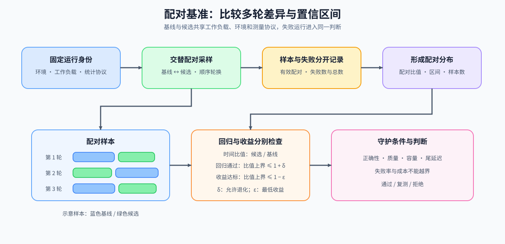

# 06 基准设计与回归验证

这是性能优化Task5／6使用的配对统计方法。比较条件由[主线01](../01_performance_problem_and_benchmark.md)确定，计时与预热按[基线采集方法](./02_reproducible_baseline.md)执行；本页集中推导“是否超过允许退化范围”和“是否达到目标收益”，完整任务的采用判断见[单候选执行与准入](../06_cost_model_and_production_decision.md)。

## 让基线与候选可比较

沿用主线已经固定的模型、输入与变化变量，将同一轮的基线和候选配成一对。图中同一行构成一个样本对，先后顺序逐轮交替；等宽方框仅表示执行顺序，不表示耗时。精度或后端本身就是受控变量时，两侧仍使用同一任务和质量要求。

## 为什么要配对、记录顺序和失败

同一台机器上的背景负载会让两次运行一起变慢或变快。将基线与候选按相邻次序交替运行，再按相同位置配对，可以减少这类共同波动对结论的影响。配对不消除噪声，因此仍要报告样本数、分布或区间。

| 设计选择 | 它控制的误差 | 如果省略会发生什么 |
|:---|:---|:---|
| 基线/候选交替运行 | 温度、缓存和后台负载随时间漂移 | 一组恰好先运行的结果可能被误当成收益 |
| 每对使用相同输入与工作负载配置 | 输入长度、批量或并发差异 | 延迟变化无法归因给候选本身 |
| 保留失败运行及其原因 | 只成功的样本会高估收益 | OOM、超时或质量失败被从分母中移除 |
| 同时检查质量与尾延迟 | 平均值可能掩盖退化 | 更快的平均时间掩盖更差的输出或 P99 |

## 配对比值怎样变成回归判断

对于延迟这类越小越好的指标，每一对有效样本先计算候选相对基线的比值，再汇总配对比值。设 $b_i>0$、 $c_i>0$ 分别为第 $i$ 对基线和候选的耗时， $n$ 为有效配对数：

$$
r_i=\frac{c_i}{b_i},\qquad \widehat r=\mathrm{median}_{i=1,\ldots,n}(r_i).
$$

$r_i<1$ 表示该对候选更快； $\widehat r$ 是配对比值的中位数，不等于两组中位数之比。按完整样本对重采样，可估计 $\widehat r$ 的置信区间 $[L_r,U_r]$；记录置信水平、重采样方法和有效配对数。若样本存在连续相关性，应采用分块采样等与数据结构匹配的方法。

回归检查与收益验证使用不同门槛。设 $\delta\ge0$ 为事先允许的最大相对延迟退化， $\epsilon>0$ 为要求的最小相对延迟降幅，两者均为无量纲比例。下表以质量、失败率和最小配对数已通过检查为前提；失败样本仍保留在运行总数和失败率中，不伪装成正常延迟样本。

| 检查目标 | 判断条件 | 可以得出的结论 |
|:---|:---|:---|
| 未超过回归阈值 | $U_r\le1+\delta$ | 通过该项延迟回归检查，仍可能略慢于基线 |
| 明确超过回归阈值 | $L_r>1+\delta$ | 延迟退化超过容许范围 |
| 回归结论待定 | $L_r\le1+\delta<U_r$ | 当前区间跨越阈值，需要补充配对样本或控制噪声 |
| 证明达到最小收益 | $U_r\le1-\epsilon$ | 在当前工作负载下支持所要求的延迟改善 |

## 结果如何进入下一步

回归通过说明候选没有越过已设门槛，不等于达到主目标。例如，允许延迟退化5%时，稳定慢2%的候选可以通过延迟回归检查，但不能登记为加速。若目标是节省显存，则检查显存收益及预设延迟代价；未达到单项目标但正确性、质量与资源安全通过时，也可进入探索性组合，最终是否采用仍按组合实测判断。

[Part 02 · PERF-REGRESSION 配对基准与回归阈值](../../../02_PyTorch_Algorithms/PERF-REGRESSION_Paired_Benchmark_and_Regression_Thresholds.ipynb)练习配对比值、失败统计、区间与阈值判断。将本次负载、质量结果和判断附入[诊断记录](./07_diagnosis_and_action_decision.md)，再决定补测、进入优化或回退。
