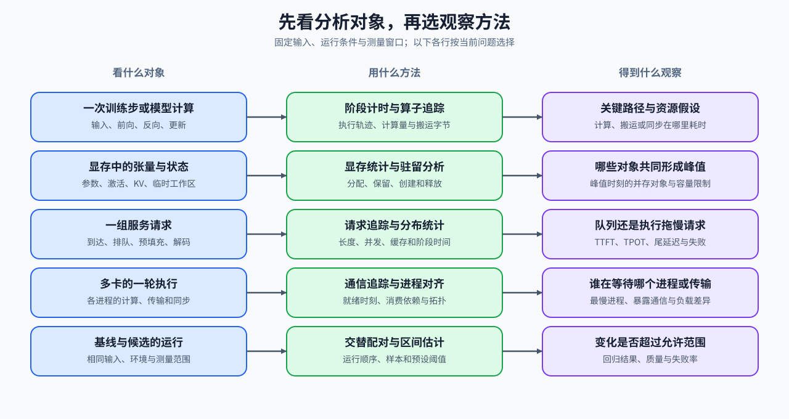
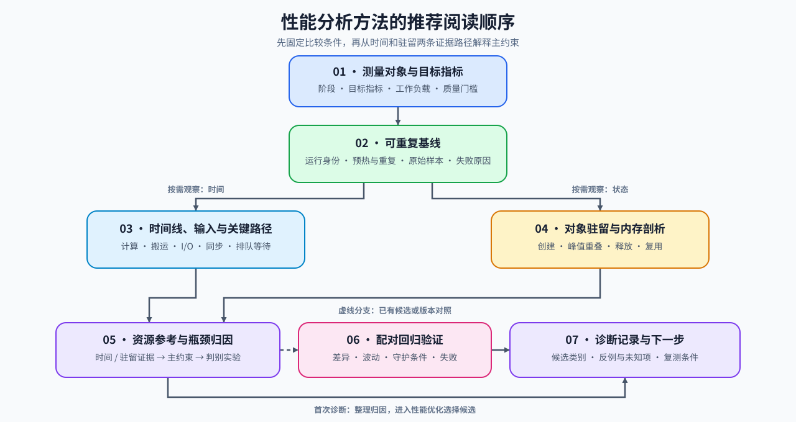

# 测量与诊断方法索引

> 所属路线：性能优化　方法出口：把性能现象转化为可复查的计时、驻留、归因与配对比较

训练变慢、请求延迟升高、显存不足或多卡等待时，先选定要观察的计算、张量、请求或进程，再用计时、执行轨迹、驻留记录和对照解释变化。分析不仅用于第一次定位问题；替换执行路径、改变精度或组合策略后，也需要用同样的方法重新检查耗时与峰值。

这些方法贯穿[性能优化统一学习路线](../intro.md#学习路线)：建立基线时固定测量范围，选择改动前检验原因，改动后重新检查时间、峰值与波动。按当前问题从下表进入即可，无需先读完全部方法。具体排查可查[判断手册](../casebook.md)，连续跟踪一次诊断可看[统一问题链](../walkthrough.md)，术语与公式分别见[术语表](../glossary.md)和[公式索引](../formula_reference.md)。

## 方法索引与推荐阅读

首次学习先读“测量对象”和“可重复基线”，随后按问题选择时间线或显存驻留，结合资源参考检验原因。已有候选或版本对照时使用配对统计；最后把判断和未知项记入诊断，继续选改动或补测。各方法也可在复测中单独回查。

| 方法与主要问题 | 正文入口 | 机制与项目练习 | 在统一路线中的使用位置 |
| --- | --- | --- | --- |
| 测量对象：观察哪一段运行、哪个指标？ | [01 测量对象、边界与观测层级](./01_why_profiling_matters.md) | [Part 00 · 20 性能证据与实验设计](../../../00_Prerequisites/20_Performance_Evidence_and_Experiment_Design.ipynb) | Task0将主线目标落实为测量范围 |
| 可重复基线：怎样固定输入、预热和统计范围？ | [02 可重复基线](./02_reproducible_baseline.md) | [Part 00 · 17 性能分析基础](../../../00_Prerequisites/17_PyTorch_Profiling_Basics.ipynb)；[Part 02 · 73 训练性能分析](../../../02_PyTorch_Algorithms/73_Training_Performance_Analysis.ipynb) | Task0建立基线，Task5／6复测沿用 |
| 时间线与依赖：哪些等待真正延长完成时间？ | [03 时间线、I/O与关键路径](./03_time_breakdown_and_trace_reading.md) | [Part 02 · PERF-TRACE](../../../02_PyTorch_Algorithms/PERF-TRACE_Trace_Dependencies_and_Critical_Path.ipynb)；按问题深入[PERF-INPUT](../../../02_PyTorch_Algorithms/PERF-INPUT_Training_Input_Pipeline_Performance.ipynb)或[PERF-IO](../../../02_PyTorch_Algorithms/PERF-IO_Artifact_State_and_Output_IO_Critical_Path.ipynb) | Task1观察等待，Task3／4改动后重新检查 |
| 对象驻留：峰值时哪些状态同时存在？ | [04 显存时间线与驻留状态](./04_memory_timeline_and_residency.md) | [Part 00 · 18 显存分析](../../../00_Prerequisites/18_Memory_Profiling_and_Optimization.ipynb)；[Part 02 · PERF-MEMORY-TIMELINE](../../../02_PyTorch_Algorithms/PERF-MEMORY-TIMELINE_Memory_Residency_and_Peak_Overlap.ipynb) | Task1解释峰值，Task3／4复查状态变化 |
| 瓶颈归因：什么对照能区分可能原因？ | [05 瓶颈归因](./05_bottleneck_attribution.md) | [Part 02 · PERF-ROOFLINE](../../../02_PyTorch_Algorithms/PERF-ROOFLINE_Arithmetic_Intensity_and_Resource_Ceiling.ipynb)；通信问题可进入[Part 02 · 47 NCCL性能分析](../../../02_PyTorch_Algorithms/47_Communication_Profiling_with_NCCL.ipynb) | Task2选择改动，Task6重新归因 |
| 配对比较：差异来自改动还是测量波动？ | [06 基准设计与回归验证](./06_benchmark_design_and_regression_validation.md) | [Part 02 · PERF-REGRESSION](../../../02_PyTorch_Algorithms/PERF-REGRESSION_Paired_Benchmark_and_Regression_Thresholds.ipynb) | Task5／6区分收益、允许回归与失败 |
| 诊断记录：哪些原因已有支持，哪些仍需补测？ | [07 从归因到行动](./07_diagnosis_and_action_decision.md) | [Part 02 · 74 候选准入与交接](../../../02_PyTorch_Algorithms/74_Profiling_Driven_End_to_End_Optimization.ipynb) | Task2保留假设，Task5／6更新判断与下一动作 |

## 扩展与跨专题入口

按需要解释的对象回查下表。提出改动时进入[性能优化的候选选择](../intro.md#学习路线)；改动后出现新等待或峰值时，按下表重新选择分析方法。

| 需要解释的对象 | 回补入口 | 性能分析使用的证据 |
|:---|:---|:---|
| 主机与设备的执行顺序 | [Part 01 · 07 异构调度](../../../01_Hardware_Math_and_Systems/07_CPU_GPU_Heterogeneous_Scheduling.ipynb)、[Part 01 · 15 CUDA 执行模型](../../../01_Hardware_Math_and_Systems/15_CUDA_Execution_Model.ipynb)、[Part 01 · 17 CUDA 流](../../../01_Hardware_Math_and_Systems/17_CUDA_Stream_and_Asynchrony.ipynb) | 主机提交、设备执行、同步与可重叠区间 |
| 计算量、搬运字节与资源参考 | [Part 01 · 02 参数量与 FLOPs](../../../01_Hardware_Math_and_Systems/02_LLM_Params_and_FLOPs.ipynb)、[Part 01 · 03 GPU 架构与显存](../../../01_Hardware_Math_and_Systems/03_GPU_Architecture_and_Memory.ipynb)、[Part 01 · 13 瓶颈定位](../../../01_Hardware_Math_and_Systems/13_Profiling_and_Bottleneck_Analysis.ipynb) | 工作量、算术强度、经验参考与限制条件 |
| 训练计算图、激活与优化器状态 | [反向传播与训练机制](../../backpropagation_training_mechanism/intro.md) | 前向传播 / 反向传播 / 更新的时间线、状态驻留与峰值 |
| 请求阶段、KV Cache 与调度 | [推理优化](../../inference_optimization/intro.md) | TTFT、TPOT、吞吐、并发、队列和状态容量 |
| 量化表示与执行路径 | [量化与压缩](../../quantization_compression/intro.md) | 权重、激活或 KV 字节，质量与实际低精度执行路径 |
| 多卡传输与进程等待 | [Part 01 · 05 通信拓扑](../../../01_Hardware_Math_and_Systems/05_Communication_Topologies.ipynb)、[Part 01 · 20 NCCL 与 AllReduce](../../../01_Hardware_Math_and_Systems/20_NCCL_and_AllReduce_Basics.ipynb)、[通信与并行](../../communication_parallelism/intro.md) | 拓扑、集合通信、慢进程和暴露等待 |
| 单算子的计算与访存 | [算子优化](../../operator_optimization/intro.md) | 输入形状、实际计算内核、启动与访存开销 |

## 实验与项目出口

首次运行或选择复现实验时，从[性能优化实验总索引](../experiment_assets.md)进入；其中的[测量与诊断记录](../measurement_assets.md)保留本页方法实验的具体输入和结果。工具与采集范围的选择见[正文 03 时间线、I/O 与关键路径](./03_time_breakdown_and_trace_reading.md)，跨专题环境关系见[环境资产索引](../../../docs/gpu_environment_assets.md)。

| 已有记录或目标 | 直接入口 | 需要带入什么 |
|:---|:---|:---|
| 建立真实训练基线 | [Part 02 · 73 训练性能分析](../../../02_PyTorch_Algorithms/73_Training_Performance_Analysis.ipynb) | 模型、输入、更新方式、计时范围与质量要求 |
| 按诊断比较优化方案 | [性能优化专题](../intro.md) | 当前归因、原始结果、反例、未知项与目标指标 |
| 审核候选并形成项目交接 | [Part 02 · 74 性能剖析驱动优化](../../../02_PyTorch_Algorithms/74_Profiling_Driven_End_to_End_Optimization.ipynb) | 可重复基线、候选执行路径、配对结果和回退条件；结论限于输入报告的负载与验证范围 |
