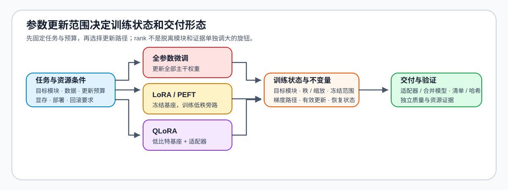

# 02 · LoRA、PEFT 与训练对象

全参微调更新全部权重；LoRA 等参数高效微调（PEFT）方法冻结主干，将可学习更新限制在少量适配器。选择时需要明确目标模块、可更新参数规模和产物交付方式。

## 从全参数更新到适配器

| 选择 | 主要收益 | 主要代价 | 需要固定的证据 |
|:---|:---|:---|:---|
| 全参微调 | 更新容量最大 | 显存、优化器状态和训练成本高 | 模型规模、学习率、恢复与评测 |
| LoRA | 参数与产物小，易回滚 | 目标模块与秩会限制适应能力 | `target_modules`、`rank`、`alpha`、`dropout` |
| QLoRA | 低比特底座降低训练容量 | 量化配置与运行路径增加变量 | 量化配置、计算数据类型、适配器与基线 |
| LoRA 变体 | 可改善稳定性或参数利用 | 比较维度更多 | 固定数据、参数预算与评测集 |

## 设计适配器的顺序

先依据任务与模型结构选择目标模块，再设定秩、缩放系数和训练预算；最后比较适配器是否确实改变目标行为，而不是只观察训练损失。需要低比特训练时，记录底座量化和适配器配置，避免把二者的影响混为一谈。

## 参数适配分支解决不同资源约束

QLoRA 与 LoRA 变体对应两类独立约束：前者改变冻结底座的存储与计算路径，后者改变适配器参数化；每次对照都要固定监督数据、输入长度与有效更新预算。只有长样本出现截断、监督丢失或 Packing 问题时，才追加长上下文微调检查。

| 约束来源 | 对应机制入口 | 主要改变 | 固定比较条件 | 最小证据 |
|:---|:---|:---|:---|:---|
| 可训练参数和更新范围 | Part 02 · 14 LoRA | 目标模块、秩、缩放与合并路径 | 数据、有效更新步和评测 | 参数量、独立质量与产物 |
| 基座显存不足 | Part 02 · 26 QLoRA | 冻结底座的量化表示与计算数据类型 | 适配器、数据和更新预算 | 峰值显存、质量与执行路径 |
| 适配器参数化选择 | Part 02 · 31 LoRA 变体 | LoRA、rsLoRA、DoRA 与预算分配 | 固定秩或固定可训练参数预算 | 质量、稳定性与参数账本 |

## 固定比较条件后再选择产物

全参、LoRA 和 QLoRA 的公平比较至少固定数据切分、有效监督词元、有效优化器步、验证协议和随机种子。固定秩适合观察参数化差异，固定可训练参数预算适合比较模块范围和变体；两种实验回答的问题不同。候选通过验证后，再按推理是否需要基座与适配器分离、是否需要合并以及加载后端支持情况，交付全量权重或适配器。

先用[低秩更新练习](../../02_PyTorch_Algorithms/14_LoRA_Tutorial.ipynb)确认目标模块、秩与缩放如何改变可训练参数，再用[LoRA 变体比较](../../02_PyTorch_Algorithms/31_LoRA_Variants_Theory.ipynb)检查固定秩和固定参数预算是否得出一致选择；只有冻结底座的显存仍超出预算时，才进入[QLoRA 机制](../../02_PyTorch_Algorithms/26_QLoRA_and_4bit_Quantization.ipynb)。选定更新范围后，在[训练控制](./03_training_control.md)中固定有效批量、优化器步和恢复状态，再由[SFT 基线与交付](./04_end_to_end_experiment.md)验证产物。进一步阅读：[PEFT 文档](https://huggingface.co/docs/peft/)。
