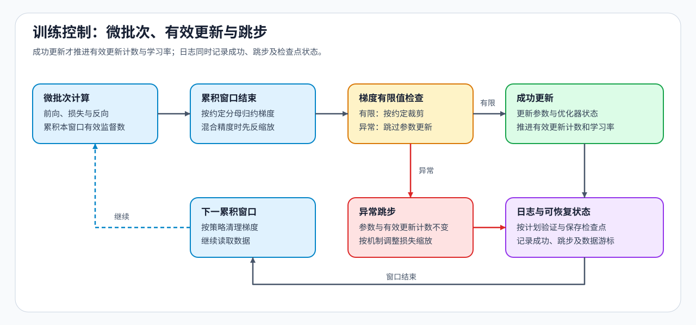

# 03 · 训练控制与低资源 SFT

多次微批次反向计算何时才构成一次参数更新，恢复后又该从哪一步继续？SFT、LoRA 与 QLoRA 都要对齐监督词元、梯度累积、数值检查和保存进度。累计窗口与有效更新的原理见[反向传播与训练机制](../backpropagation_training_mechanism/03_supervision_gradient_scale_effective_update.md)。

## 一次更新需要固定哪些条件

先确定损失分母和每次更新处理的数据，再让学习率调度、验证与保存引用同一成功更新计数；发生数值溢出而跳过更新时，记录跳步原因。

| 共同训练机制 | SFT 执行配置 | 必须记录的证据 |
|:---|:---|:---|
| 有效监督位置 | 模板、标签、忽略标记与截断规则 | 有效词元数、损失分子与分母 |
| 累计窗口 | 微批次大小、累计次数与跨设备同步边界 | 每次有效更新消费的样本和词元数 |
| 有效更新与更新计数 | 优化器、学习率调度器、验证和保存频率 | 成功更新数、跳步状态与当前学习率 |
| 数值与裁剪 | FP32 / BF16 / FP16、缩放器和梯度范数 | 有限值、缩放因子与裁剪前后范数 |
| 状态恢复 | 模型或适配器、优化器、调度器、随机状态和进度 | 父检查点、恢复步与首次恢复后更新结果 |

## SFT 执行栈怎样分工

先用能观察标签、损失和更新步的路径确认训练过程，再按配置复用、硬件预算与设备规模选择工具。同一次比较固定模型版本、切分、模板、有效批量、学习率计划和评测协议。

| 工具层 | 适合解决的问题 | 不应替代的证据 |
|:---|:---|:---|
| Transformers `Trainer` | 组织训练、验证、保存与恢复 | 标签边界、有效监督词元和实际更新步 |
| Accelerate | 保留自定义循环，同时接入混合精度与多设备执行 | 有效批量、调度器推进时机和恢复一致性 |
| TRL | 复用 SFT、奖励建模、DPO 与 GRPO 等后训练器 | 数据格式、参考策略、奖励定义和独立评测 |
| PEFT | 管理 LoRA 等适配器的注入、训练、保存与加载 | 目标模块、秩、缩放系数和底座模型身份 |
| LLaMA-Factory / Axolotl | 用配置文件编排数据、训练方法和分布式后端 | 配置展开后的真实参数与产物清单 |
| Unsloth | 在支持的模型与硬件上尝试低显存训练路径 | 与标准实现的质量、显存和实际更新对照 |

## 低资源配置改变了什么

每次只改变一个主要配置，分别记录它减少的资源与增加的执行代价。累积次数、适配器和混合精度可以组合，但组合后的更新次数和有效批量仍需复算。

| 低资源选择 | 改变的对象 | 必须和基线对齐的字段 |
|:---|:---|:---|
| LoRA | 可训练参数与优化器状态 | 目标模块、秩、缩放系数、学习率 |
| QLoRA | 低比特底座与适配器更新 | 量化配置、计算数据类型、适配器配置 |
| 梯度累积 | 单次微批次与更新节奏 | 有效批量、优化器步、调度器步 |
| AMP | 前向 / 反向计算数据类型 | FP16 / BF16、缩放器、溢出或失败状态 |

## 核对更新后检查恢复

用[梯度累积练习](../../02_PyTorch_Algorithms/11_Gradient_Accumulation.ipynb)和[优化器与调度练习](../../02_PyTorch_Algorithms/12_Optimizer_Updates_and_Learning_Rate_Scheduling.ipynb)检查成功更新与跳步，再进入[SFT 基线与交付](./04_end_to_end_experiment.md)核对保存、恢复和重新加载的结果。框架参数查[Transformers Trainer](https://huggingface.co/docs/transformers/en/main_classes/trainer)、[Accelerate](https://huggingface.co/docs/accelerate/index)和[TRL](https://huggingface.co/docs/trl/index)文档。
