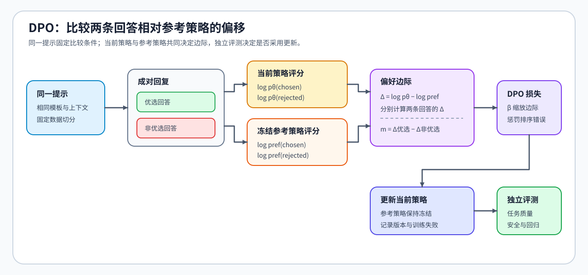

# 05 · DPO、KTO 与离线反馈优化

同一个问题的两条回答，一条正确但简短，另一条流畅却答错。偏好标注选择了前者，训练就需要让模型更倾向于这种选择。直接偏好优化（DPO）使用同提示下的回答对；只有单条回答的正负反馈时，KTO 提供另一种目标。

## 偏好对怎样改变相对概率

这里的策略是模型在给定上下文下生成下一词元的概率分布。整条回答的概率，是沿回答位置将这些条件概率连乘；取对数后，连乘变成求和。提示作为条件保留，不计入回答自身的概率。

设提示为 $x$，优选回答为 $y^+$，非优选回答为 $y^-$。当前策略 $\pi_\theta$ 会随训练改变，参考策略 $\pi_{\mathrm{ref}}$ 是固定的比较起点。对每条回答，先计算当前与参考策略的回答对数概率之差：

$$
d^+=\log\pi_\theta(y^+\mid x)-\log\pi_{\mathrm{ref}}(y^+\mid x),\qquad
d^-=\log\pi_\theta(y^-\mid x)-\log\pi_{\mathrm{ref}}(y^-\mid x).
$$

DPO 再比较优选与非优选回答的这两个变化量。令 $\beta>0$ 为目标尺度系数， $\sigma(z)=1/(1+e^{-z})$ 为 Sigmoid 函数，则一条偏好对的损失为：

$$
z=\beta(d^+-d^-),\qquad L_{\mathrm{DPO}}=-\log\sigma(z).
$$

例如，参考策略给两条回答的对数概率分别为 -10 和 -12，当前策略给出 -9 和 -12。此时 $d^+=1$、 $d^-=0$，优选回答相对参考策略获得了更大的提升。若取 $\beta=1$，损失约为 0.313；两个变化量相同时，损失约为 0.693。这是目标计算示例，不是实际训练结果。

损失取决于两个变化量的差，因此优选回答的绝对概率并不保证每次都增加：非优选回答下降得更多，也可能使目标改善。这也是训练损失下降后仍要观察实际生成回答的原因。

## 参考策略与系数 β

参考策略提供固定的概率比较起点。训练中换掉参考模型，同一对回答的 $d^+,d^-$ 就可能改变，前后的损失也不再具有相同含义。参考策略通常来自可用的指令模型或 SFT 检查点，它与正在更新的模型承担不同角色。

$\beta$ 缩放偏好边际，也影响损失与梯度。在 DPO 的推导中它还关联相对参考策略的正则化强度；实际调整效果不能只由“数值更大”推断。对同一批偏好对比较时，应同时观察生成质量和原有任务表现。

## 单条正负标签为什么不直接组成偏好对

假设日志中只有“回答 A 获赞”和“回答 B 被点踩”，但它们回答的是不同问题。直接配对会把问题难度与上下文差异混入排序。KTO 使用单条回答的正向或负向标签，将其相对参考策略的对数概率变化与一个 KL 基线比较，再按标签构造目标。KL 散度衡量两个概率分布的偏离；这里的基线由独立样本估计，提供总体偏移的参照，而不是某条回答的正确性分数。正负样本数量及类别权重还会影响总体损失。

DPO 与 KTO 都能使用已有离线反馈，不要求每次更新都重新采样。若需要判断当前模型新生成的行为，就要另外组织采样和反馈；偏好形式、更新目标与采样方式是三个相关但不同的选择。

## 偏好拟合与实际回答的差距

如果标注持续偏好更长的回答，模型可能学到长度偏好，而不是正确性。若同一问题的选择理由互相矛盾，降低损失也不能消除反馈冲突。独立任务评测用来区分偏好对拟合与实际能力变化；原有能力与安全要求也不能只由训练稳定性代替。

成对目标见[Part 02 · 17 DPO](../../02_PyTorch_Algorithms/17_DPO_Loss_Tutorial.ipynb)，单条反馈与 KL 基线见[Part 02 · PT-KTO](../../02_PyTorch_Algorithms/PT-KTO_Binary_Feedback_Alignment.ipynb)，符号与归约见[公式索引](./formula_reference.md)。离线候选可以直接进入[独立评测](./10_evaluation_and_adoption_decision.md)；需要当前模型生成新回答并获得奖励时，再进入[在线奖励更新](./06_rlhf_and_ppo_system_cost.md)。
