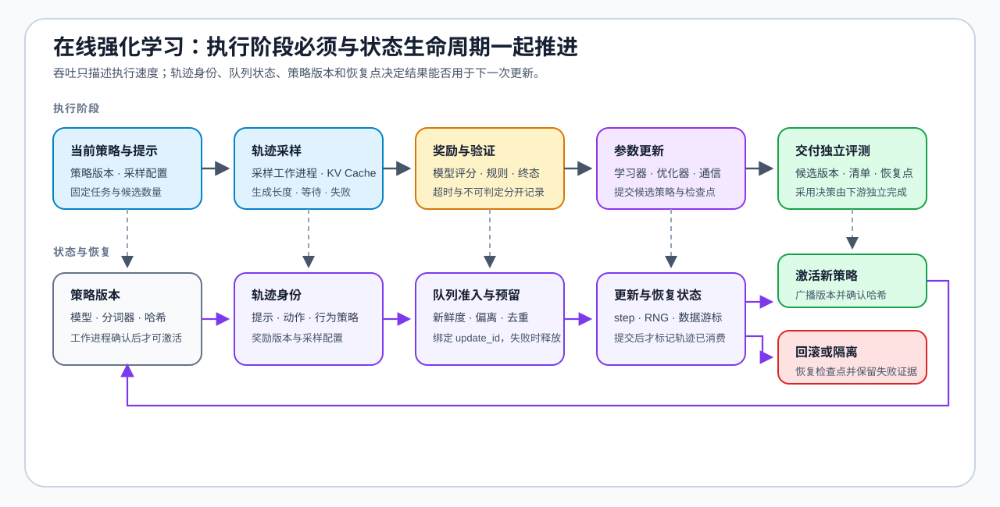

# 09 · 在线训练交付与执行系统

轨迹已经通过检查，训练为什么还在等待？把生成、奖励、更新、权重同步与保存拆成可测阶段，再看工作进程共享还是分开使用设备。每个阶段分别记录吞吐、等待和资源，才能区分采样不足、训练过慢和队列积压。

## 从生成到更新的阶段时间线

轨迹采样是推理工作负载，参数更新是训练工作负载；即使使用同一模型，两者的吞吐单位和同时驻留对象也不同。先记录阶段边界，再分别测量计算、等待、通信与恢复。

| 阶段 | 输入 → 输出 | 主要资源问题 | 最小证据 |
|:---|:---|:---|:---|
| 轨迹采样 | 提示 → 回复或环境轨迹 | 执行后端吞吐、KV Cache、长度波动、队列等待 | 输入 / 输出词元、TTFT、TPOT、失败原因 |
| 奖励与验证 | 轨迹 → 分数或终止信号 | 打分并发、超时、规则版本、无法判定样本 | 奖励分量、验证器版本、失败类型 |
| 参数更新 | 合格轨迹 + 奖励 → 候选策略 | 激活、优化器、参考策略、通信与恢复 | 单步时间、峰值显存、检查点、重试记录 |
| 训练交付 | 候选策略与运行状态 → 可恢复产物 | 版本对应、状态完整性与恢复一致性 | 候选版本、产物清单、检查点与恢复记录 |

## 拓扑、队列与恢复状态

共置拓扑让采样和训练共享 GPU，减少权重传输，但二者会争用显存和计算资源。解耦拓扑允许采样、奖励和训练独立扩缩容，却需要显式管理轨迹队列、策略陈旧和权重交接。混合拓扑只有在资源放置、队列上限和同步时机均被记录后才能比较。

| 系统对象 | 必须携带的状态 | 失败或恢复检查 |
|:---|:---|:---|
| 采样工作进程 | 策略版本、采样配置、提示与轨迹身份 | 重试后不能把旧策略轨迹登记为新版本 |
| 奖励 / 验证工作进程 | 规则或模型版本、奖励分量、失败类型 | 超时和无法判定样本不能静默记为零分 |
| 轨迹队列 | 生产版本、消费状态、时间戳与优先级 | 积压时检查新鲜度、重复消费和背压 |
| 训练工作进程 | 接纳版本、批次身份、优化器与调度器状态 | 恢复后保持更新步、数据游标与随机状态一致 |
| 检查点 | 策略、参考状态、训练进度与数据游标 | 只恢复已经完整写入全部必需状态的检查点 |

## 执行组件怎样分工

按需要处理的阶段选择组件：生成引擎负责采样，训练框架负责更新，编排层负责连接角色与资源。下表列出可选分工；具体版本与本机验证状态见[实验资产表](./experiment_assets.md)。

| 执行层 | 可选组件 | 主要职责 | 比较时仍需固定 |
|:---|:---|:---|:---|
| 算法与小规模验证 | TRL | 奖励建模、偏好优化、组采样或策略更新 | 模型、参考策略、奖励、数据与质量协议 |
| 轨迹生成 | vLLM 或 SGLang | 批量生成、KV Cache 与采样队列 | 长度、并发、采样配置、后端版本与失败 |
| RL 系统编排 | verl 或 OpenRLHF | 连接采样、奖励、训练和权重同步 | 工作进程拓扑、策略版本、通信与恢复 |
| 资源调度 | Ray 或框架内置调度器 | GPU 放置、任务重试和阶段并发 | 等待、超时、资源占用与回滚位置 |
| 训练并行 | PyTorch FSDP、DeepSpeed 或 Megatron Core | 切分训练状态、模型或计算 | 并行策略、通信量、检查点格式与恢复条件 |

## 从小规模状态检查到系统复测

先在[采样、训练与奖励系统练习](../../02_PyTorch_Algorithms/PT-RL-SYSTEM_Rollout_Training_and_Reward_System.ipynb)中比较阶段处理率、资源放置和状态交接，再按需要增加工作进程。阶段瓶颈用[性能分析](../performance_analysis/intro.md)定位，候选改进进入[性能优化](../performance_optimization/intro.md)，多卡状态切分进入[通信与并行](../communication_parallelism/intro.md)。模型是否值得采用由[独立评测](./10_evaluation_and_adoption_decision.md)判断。
