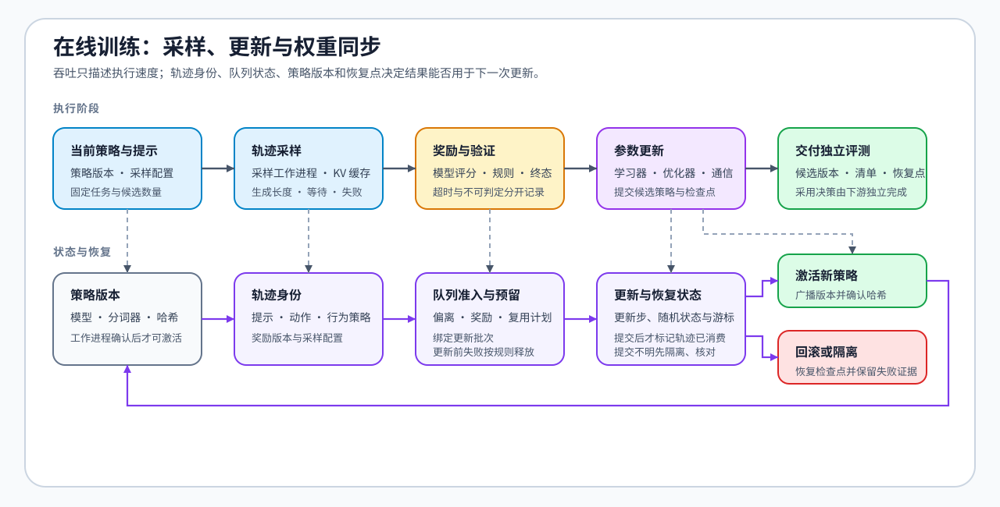

# 09 · 在线训练交付与执行系统

生成回答、计算奖励、更新参数，任何一段过慢都可能让其他阶段等待。承担这些阶段的程序称为工作进程，其中执行参数更新的角色称为学习器；角色、进程与物理设备并非一一对应。增加采样进程不一定提高训练吞吐：如果奖励计算已经跟不上，新增回答会继续留在队列里，生成版本与学习器版本之间的差距也可能扩大。

## 将阶段速度换算到同一单位

采样引擎常用输出词元数描述速度，训练器可能报告每步时间，奖励服务则按回答计数。需要结合回答长度、组大小与更新批量，换算成同一批工作所需的时间或等价轨迹处理率。例如，平均每条回答输出 20 个词元，采样速度为每秒 200 个输出词元，就约为每秒 10 条回答；同一轨迹若按计划参与多轮更新，训练侧还要计入这些复用的总成本。

举一个固定处理能力的示意例子：各阶段可并行执行，忽略无效样本、传输和同步开销，并把训练复用成本折算到每条轨迹后，采样、奖励、训练的处理能力分别是每秒 30、20、25 条轨迹。流水线的理想吞吐上限为每秒 20 条。若采样持续按每秒 30 条送入、不作限流或丢弃，奖励前的队列就会每秒增加 10 条，而不是达到稳定队列。继续增加采样能力不会突破这个瓶颈；共用设备时，还需另外计入阶段争用和切换时间。

## 共用 GPU 与分开部署

共置时，采样与训练使用相同设备或设备池，权重交接可能更直接，但两者争用计算和显存。生成需要 KV 缓存，即保留历史词元的键和值，供后续解码复用；更新则需要用于反向的激活、梯度和优化器状态。阶段切换时哪些资源释放、哪些继续驻留，会改变可用容量和等待时间。

分开部署后，采样、奖励与训练可以分别扩容，但更新后的权重需要传到采样侧。采样侧继续使用旧版本期间，产生的是旧版本轨迹；传输耗时、同步频率和队列积压共同影响轨迹陈旧程度。混合部署则需要沿具体资源放置分析这些竞争与交接，不能只凭拓扑名称推断收益。

## 队列为什么还需要版本与消费状态

对上面的速度例子，排在奖励队列后面的轨迹会等待更久，而学习器可能继续更新。队列不仅存回答，还要保留生成版本、奖励状态与消费身份，才能决定积压后哪些轨迹仍适合使用。

重试又带来另一类问题：采样重试可能重复生成任务，奖励重试可能留下多个评分结果，训练重试可能重复提交更新。轨迹 ID、评分版本和批次提交记录用于区分这些情况。检查点则保存可恢复的参数与训练进度；读取未完整写入的检查点，无法保证参数、优化器和队列消费进度对应。

## 引擎、训练器与编排层的分工

引擎负责执行生成，训练器组织损失与参数更新，编排层安排各阶段的资源和任务。不同系统可能将这些职责组合在一起。分析等待时，可以把设备上的生成、评分、同步和更新区间，与工作进程的提交及队列记录对应起来，定位哪一步推迟了后续计算。

| 执行工作 | 常见组件 | 承担的部分 |
|:---|:---|:---|
| 奖励建模与策略目标 | TRL 等训练器 | 组织相应目标的训练 |
| 批量轨迹生成 | vLLM、SGLang 等 | 生成、KV 缓存与批量调度 |
| 多角色协作 | verl、OpenRLHF 等 | 连接采样、奖励、更新与权重同步 |
| 资源放置与重试 | Ray 或框架内置调度器 | 分配设备与执行任务 |
| 训练状态或模型切分 | PyTorch FSDP（全分片数据并行）、DeepSpeed、Megatron Core 等 | 分担状态、计算与通信 |

阶段处理率与资源放置见[Part 02 · PT-RL-SYSTEM 采样、训练与奖励系统](../../02_PyTorch_Algorithms/PT-RL-SYSTEM_Rollout_Training_and_Reward_System.ipynb)，实际环境与结果见[实验资产表](./experiment_assets.md)。定位跨阶段等待可结合[性能分析](../performance_analysis/intro.md)；系统恢复和执行效率核对后，再通过[独立评测](./10_evaluation_and_adoption_decision.md)判断策略是否真正改善任务表现。
