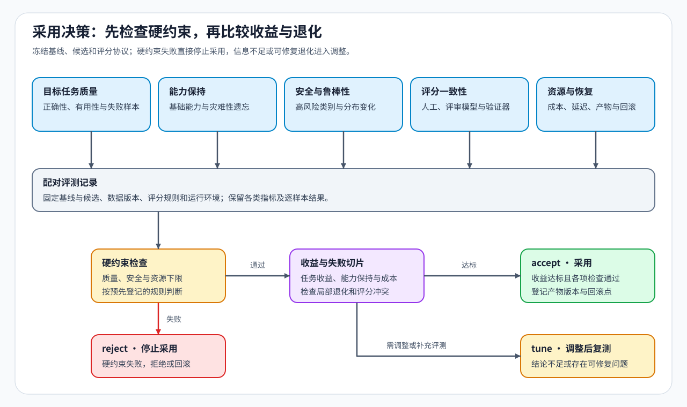

# 10 · 独立评测、能力回归与采用决策

SFT、DPO、PPO、GRPO 或其他后训练候选都必须在固定基线、评测集和评分协议下比较目标能力、通用能力、安全、鲁棒性、资源成本与失败切片。候选先通过[反向传播专题的训练正确性门槛](../backpropagation_training_mechanism/06_correctness_and_performance_evidence.md)，再进入本页的行为质量与采用判断；训练损失、奖励或胜率的单项上升不能直接支持采用。

## 固定共同门槛与专项证据

| 评测对象 | 需要回答的问题 | 常见误判 |
|:---|:---|:---|
| 有用性与正确性 | 候选是否真正完成目标任务 | 用格式改善代替正确性 |
| 通用能力保持 | 目标能力提高时，原有能力是否退化 | 只测试本次训练任务 |
| 安全与拒答 | 是否满足安全要求且不过度拒答 | 只统计拒答率 |
| 鲁棒性 | 输入改写、长度或分布变化后是否稳定 | 只使用训练同分布样本 |
| 评审一致性 | 模型评审器、人工抽检与验证器是否同向 | 把单一评审器当作真值 |
| 资源与失败 | 延迟、显存、成本、失败率和恢复是否可接受 | 忽略训练与服务系统代价 |

其他专题复用这些共同质量门槛，同时补充被改变对象的专项证据：数据工程补充来源、去重、污染和切分；量化补充数值格式、误差和低精度执行；通信与并行补充通信等待、容量溢出和失败进程；部署补充后端、设备、加载路径与回退；性能优化补充工作负载、执行轨迹和重复运行。

## 评测协议怎样保持独立

| 固定项 | 要避免的问题 | 最小记录 |
|:---|:---|:---|
| 基线 / 候选身份 | 比较的不是同一父模型或训练阶段 | 模型版本、父检查点、分词器和配置 |
| 评测集 | 训练、在线反馈或调参样本污染评测 | 数据版本、冻结时间、去污染规则与命中记录 |
| 解码与评分协议 | 参数或评分器变化被误当作模型提升 | 解码配置、评审器 / 验证器版本、评分规则与抽检 |
| 失败切片 | 总体均值掩盖关键能力退化 | 任务、长度、语言、安全类别和高成本样本结果 |
| 采用与回滚门槛 | 指标变差后仍继续更新或上线 | 质量、安全、资源阈值与已验证回滚点 |

模型评审器、人工抽检和规则验证器若结论不一致，应保留分歧样本并重新检查评分协议，不能用其中一个总分覆盖其余证据。

## 怎样输出采用决策

| 决策 | 成立条件 | 后续动作 |
|:---|:---|:---|
| `accept` | 核心质量稳定提升，能力保持、安全与资源门槛通过，产物和恢复清单完整 | 登记候选版本、适用范围和回滚点 |
| `tune` | 目标方向有效，但数据、奖励、配置、成本或波动仍存在可修复问题 | 固定问题切片，只修改一个候选因素后复测 |
| `reject` | 比较身份不一致、核心质量无增益，或触发安全、资源硬约束 | 保留原基线并记录失败证据 |

结论至少同时包含基线、候选、评测集版本、评分协议、运行环境、专项指标和失败样本。偏好数据或评审协议不完整时，回到[偏好数据与评测机制](../../02_PyTorch_Algorithms/50_Preference_Data_and_Evaluation.ipynb)；在线反馈持续变化时，回到[轨迹生命周期](./08_trajectory_lifecycle_and_environment_interaction.md)检查策略版本、奖励状态和消费准入。
