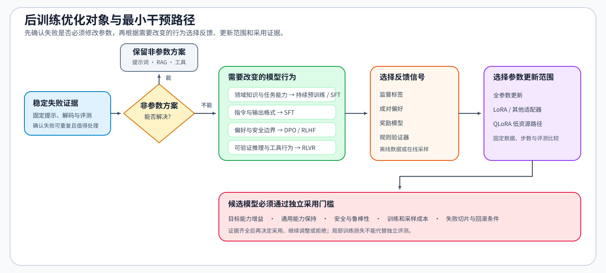
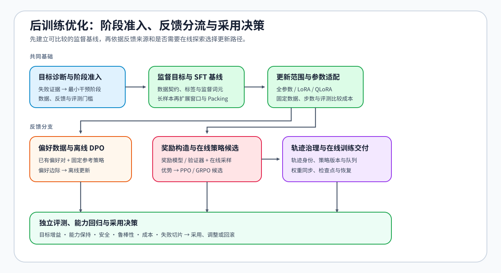

# 后训练优化（Post-Training Optimization）

> 专题类型：主学习路线　主服务目标：从监督微调基线、偏好优化到强化学习与采用决策

后训练优化研究如何在基础模型之上，利用监督数据、偏好反馈或可验证奖励改变模型行为。学习者需要判断问题是否值得通过参数更新解决，在监督微调基线之上选择离线偏好优化或在线策略优化，并依据独立评测、资源成本和回滚条件决定是否采用更新后的模型。

## 共同训练基础

后训练先定义数据、监督或奖励目标，再复用[反向传播与训练机制](../backpropagation_training_mechanism/intro.md)把目标变成参数更新。两者的接口不是某个 Trainer，而是损失、有效位置、待更新参数和训练状态记录。

| 后训练给出的对象 | 反向传播专题核对的机制 | 返回后训练的记录 |
|:---|:---|:---|
| 标签掩码、偏好对、奖励或优势 | 损失分母、上游梯度与梯度汇合 | 可复算的损失与参数梯度 |
| 全参数、LoRA、Policy 或 Critic 的更新范围 | 累计窗口、有限值、裁剪与有效更新 | 参数位移、更新时钟与跳步状态 |
| 激活、参考模型、奖励模型和优化器状态 | 状态生命周期、峰值、重算与搬运 | 峰值对象、单步时间与策略代价 |

## 学习路线

Task 编号用于组织学习顺序，实际训练按数据和反馈条件选择方法。先完成目标诊断、数据检查和 SFT 基线；已有离线反馈时学习 DPO 或 KTO，需要当前策略生成回答时学习 PPO、GRPO 或 RLOO；持续在线训练还要继续检查轨迹版本、权重同步和恢复。所有更新后的模型最后都使用同一套独立评测与回滚条件。需要连续理解因果关系时进入[后训练优化问题链](./walkthrough.md)，已有数据、训练日志或评测报告时使用[后训练优化判断手册](./casebook.md)，术语差异查询[专题术语表](./glossary.md)，跨页核对符号、粒度与损失分母时使用[公式索引与符号约定](./formula_reference.md)。

| Task / 主题 | 本阶段要回答的问题 | 学习与验证页面 | 学习顺序 | 主要正文 |
|:---|:---|:---|:---|:---|
| Task0 · 目标诊断与阶段准入 | 当前失败能否由提示、RAG 或工具解决；若仍需改变模型参数，应先建立 SFT 基线、使用离线偏好，还是进入在线奖励与探索？ | 核心：[后训练问题链 · 阶段选择](./walkthrough.md#一先判断是否需要改变模型参数) → [Part 02 · 33 后训练准入与阶段选择](../../02_PyTorch_Algorithms/33_Fine_Tuning_Readiness.ipynb) | 稳定失败证据 → 提示 / RAG / 工具基线 → 参数内部剩余失败 → SFT 基线状态与反馈形态 → 后训练阶段 | [04 SFT 完成与阶段升级](./04_end_to_end_experiment.md#sft-何时完成何时升级) |
| Task1 · 监督目标与最小 SFT 基线 | 样本怎样经过契约校验、模板和标签掩码变成有效监督 Token；损失与训练状态又怎样形成可检查的有效更新？ | 核心：[Part 02 · 32 SFT 数据契约与泄漏审计](../../02_PyTorch_Algorithms/32_Data_Engineering_for_SFT.ipynb) → [Part 02 · 13 SFT 监督边界与损失](../../02_PyTorch_Algorithms/13_SFT_Training_Loop.ipynb) → [Part 02 · 15 SFT 有效更新与训练闭环](../../02_PyTorch_Algorithms/15_End_to_End_Fine_Tuning_Experiment.ipynb)；项目：[Part 02 · 64 数据准入](../../02_PyTorch_Algorithms/64_SFT_Data_Quality_Project.ipynb) → [Part 02 · 62 训练交付](../../02_PyTorch_Algorithms/62_Instruction_Fine_Tuning_Project.ipynb)；扩展：[Part 02 · 30 长上下文微调](../../02_PyTorch_Algorithms/30_Long_Context_Fine_Tuning.ipynb) | 样本契约与切分隔离 → 模板、标签边界与损失 → 有效更新与配对评估 → 长样本窗口 / 截断 / Packing → 可恢复 SFT 基线 | [01 SFT 数据、监督与长上下文契约](./01_sft_data_and_loss.md) |
| Task2 · 更新范围与参数高效适配 | 监督目标与输入工作负载固定后，哪些参数需要更新，怎样在全参数、LoRA、QLoRA 和 LoRA 变体之间选择？ | 核心：[Part 02 · 14 LoRA](../../02_PyTorch_Algorithms/14_LoRA_Tutorial.ipynb) → [Part 02 · 31 LoRA 变体](../../02_PyTorch_Algorithms/31_LoRA_Variants_Theory.ipynb)；项目：[Part 02 · 63 LoRA 选型](../../02_PyTorch_Algorithms/63_LoRA_Variants_Benchmark.ipynb) / [Part 02 · 65 QLoRA 选型](../../02_PyTorch_Algorithms/65_QLoRA_Selection_Project.ipynb) → [Part 02 · 62 SFT 训练交付](../../02_PyTorch_Algorithms/62_Instruction_Fine_Tuning_Project.ipynb)；扩展：[Part 02 · 26 QLoRA](../../02_PyTorch_Algorithms/26_QLoRA_and_4bit_Quantization.ipynb) | 全参数 / 适配器选择 → 目标模块、秩与缩放 → 固定秩或固定参数预算比较 → 基座显存不足时进入 QLoRA → 可恢复适配器产物 | [02 LoRA / PEFT](./02_lora_peft_design.md) |
| Task3 · 偏好数据与离线策略优化 | 已有成对偏好或单条二元反馈时，怎样固定参考策略，并选择 DPO 或 KTO 形成离线更新？ | 核心：[Part 02 · 50 偏好数据与评测](../../02_PyTorch_Algorithms/50_Preference_Data_and_Evaluation.ipynb) → 成对偏好进入 [Part 02 · 17 DPO](../../02_PyTorch_Algorithms/17_DPO_Loss_Tutorial.ipynb)，单条二元反馈进入 [Part 02 · PT-KTO](../../02_PyTorch_Algorithms/PT-KTO_Binary_Feedback_Alignment.ipynb)；项目：[Part 02 · 84 离线 DPO](../../02_PyTorch_Algorithms/84_DPO_Preference_Project.ipynb) | 固定反馈含义 → 成对或非成对数据分支 → 固定参考策略 → 离线更新与独立复测 → 模型或适配器、配置与评测记录 | [05 DPO、KTO 与离线反馈优化](./05_dpo_and_preference_optimization.md) |
| Task4 · 奖励构造与在线策略候选 | 当前策略生成的回答由人类偏好、奖励模型还是规则验证器评分；评分怎样经过校准和基线估计形成受约束的 PPO、GRPO 或 RLOO 更新？ | 核心：[Part 02 · PT-REWARD-MODEL 奖励模型训练、校准与过度优化](../../02_PyTorch_Algorithms/PT-REWARD-MODEL_Reward_Model_Training_and_Calibration.ipynb) → [Part 02 · PT-REWARD-SIGNAL 奖励、价值与优势](../../02_PyTorch_Algorithms/PT-REWARD-SIGNAL_Reward_Model_Value_and_Advantage.ipynb)，再选择 [Part 02 · 16 PPO](../../02_PyTorch_Algorithms/16_RLHF_PPO_Memory.ipynb)、[Part 02 · 18 GRPO](../../02_PyTorch_Algorithms/18_GRPO_Loss_Tutorial.ipynb) 或 [Part 02 · PT-RLOO](../../02_PyTorch_Algorithms/PT-RLOO_Leave_One_Out_Policy_Optimization.ipynb)；项目：[Part 02 · 85 GRPO / RLVR 候选](../../02_PyTorch_Algorithms/85_GRPO_Groupwise_Alignment_Project.ipynb) | 奖励来源 → 奖励训练与留出校准 → 在线采样 → Critic、组均值或留一基线 → 优势 → 受约束更新 → 候选策略与新轨迹 | [06 奖励信号、PPO 与 RLHF](./06_rlhf_and_ppo_system_cost.md) → [07 GRPO、RLOO 与组内奖励](./07_grpo_and_groupwise_alignment.md) |
| Task5 · 轨迹治理与在线训练交付 | 在线轨迹怎样绑定策略、奖励和环境版本，经过新鲜度与消费状态检查进入更新；采样、奖励和训练组件又怎样同步权重、保存检查点并从失败中恢复？ | 核心：[Part 02 · PT-ROLLOUT-LIFECYCLE 轨迹与策略新鲜度](../../02_PyTorch_Algorithms/PT-ROLLOUT-LIFECYCLE_Rollout_and_Policy_Freshness.ipynb) → [Part 02 · PT-RL-SYSTEM 采样、训练与奖励系统](../../02_PyTorch_Algorithms/PT-RL-SYSTEM_Rollout_Training_and_Reward_System.ipynb)；Agent 扩展：[Part 02 · PT-AGENTIC-RL 环境轨迹与奖励归因](../../02_PyTorch_Algorithms/PT-AGENTIC-RL_Environment_Trajectory_and_Credit_Assignment.ipynb)；在线偏好扩展：[Part 02 · 51 在线 DPO](../../02_PyTorch_Algorithms/51_Online_DPO.ipynb)；项目：[Part 02 · 85 在线奖励候选](../../02_PyTorch_Algorithms/85_GRPO_Groupwise_Alignment_Project.ipynb) → [Part 02 · 86 生命周期与恢复](../../02_PyTorch_Algorithms/86_DPO_Online_Benchmark.ipynb) | 策略版本 → 轨迹身份与环境状态 → 奖励版本 → 新鲜度与消费准入 → 采样 / 奖励 / 训练拓扑 → 权重同步、检查点、恢复与候选交接 | [08 轨迹生命周期与环境交互](./08_trajectory_lifecycle_and_environment_interaction.md) → [09 在线训练交付与执行系统](./09_rl_execution_system_and_efficiency.md) |
| Task6 · 独立评测、能力回归与采用决策 | 在冻结评测集和评分协议下，候选是否获得目标能力增益并保持通用能力、安全性和鲁棒性；其训练与服务成本、失败切片和回滚条件是否允许采用？ | 核心：[Part 02 · 50 偏好数据与评测](../../02_PyTorch_Algorithms/50_Preference_Data_and_Evaluation.ipynb) / [Part 02 · 51 在线更新与回滚](../../02_PyTorch_Algorithms/51_Online_DPO.ipynb)；项目：[Part 05 · 后训练交付综合项目](../../05_Integrated_Projects_and_Decisions/02_Post_Training_Delivery/index.md)，读取 [Part 02 · 86 生命周期交接](../../02_PyTorch_Algorithms/86_DPO_Online_Benchmark.ipynb) | 冻结评测集与评分协议 → SFT 基线 / 已交接候选 → 目标增益与能力保持 → 安全、鲁棒性与评审一致性 → 资源、失败切片与回滚 → `accept / tune / reject` | [10 独立评测、能力回归与采用决策](./10_evaluation_and_adoption_decision.md) |

### 监督目标与参数方案怎样汇合

监督目标和参数方案在训练控制阶段汇合。正文 01 固定样本、模板、标签和有效监督词元，正文 02 选择全参数、LoRA 或 QLoRA 等更新范围；两者共同进入正文 03，对齐有效批量、优化器步、混合精度和恢复状态，再由正文 04 形成可恢复的 SFT 基线与升级判断。

`数据与标签检查（01） + 参数更新方案（02） → 训练控制（03） → SFT 基线与交付（04）`

阶段选择发生两次：训练前先排除提示、RAG 或工具等非参数方案；完成 SFT 后，再根据基线表现和反馈形态判断继续监督训练、进入离线偏好，还是进入在线奖励路径。前一次判断见[后训练准入与阶段选择](../../02_PyTorch_Algorithms/33_Fine_Tuning_Readiness.ipynb)，后一次判断见[SFT 完成与阶段升级](./04_end_to_end_experiment.md#sft-何时完成何时升级)。

数据对象、学习信号、运行状态与独立评测结果的对应关系见[后训练优化问题链](./walkthrough.md#一先判断是否需要改变模型参数)。

## 扩展与跨专题入口

| 需要补齐的能力 | 首选入口 | 在本专题中的作用 |
|:---|:---|:---|
| 计算图、有效更新、训练状态、检查点与卸载 | [反向传播与训练机制](../backpropagation_training_mechanism/intro.md) | 核对梯度、更新时钟、状态峰值和策略代价 |
| 数据生命周期、清洗质量与后训练接口 | [数据生命周期与契约](../data_engineering/00_data_lifecycle_and_contract.md) / [清洗与质量链](../data_engineering/02_cleaning_quality_chain.md) / [后训练数据接口](../data_engineering/05_post_training_data_interfaces.md) | 为 SFT、偏好和轨迹数据提供来源、去污染、版本与交付证据 |
| 训练峰值、多模型驻留与轨迹采样吞吐 | [性能优化 Task2](../performance_optimization/03_training_memory_ledger.md) | 建立 SFT、QLoRA、DPO、PPO 和 GRPO 的资源账本 |
| QLoRA、低比特产物与部署格式 | [量化与压缩](../quantization_compression/intro.md) | 解释低比特训练底座与产物约束 |
| 多卡状态切分、轨迹通信与扩展 | [通信与并行](../communication_parallelism/intro.md) | 解释工作进程、通信与规模化代价 |
| 工具轨迹、环境反馈与沙盒执行 | [Agent 工作负载与轨迹](../agent/00_agent_workload_and_trace.md) / [轨迹数据](../agent/01_agent_trajectory_data.md) / [沙盒环境](../agent/02_agent_sandbox_environment.md) | 仅为工具调用与环境交互轨迹补充任务、回放和执行证据；普通文本轨迹仍由本专题管理 |

## 实验与项目验证

首次运行先按[实验 Quickstart](./quickstart.md)创建或恢复环境，再从[实验资产表](./experiment_assets.md)选择机制页、模型、候选和结果路径；跨专题 Profile 与隔离关系查询[环境资产索引](../../docs/gpu_environment_assets.md)，实际软件版本与硬件快照写入结果 JSON。

| 验证阶段 | 要回答的问题 | 产出与继续阅读 |
|:---|:---|:---|
| CPU 机制 | 数据、目标、奖励和决策关系是否正确？ | 13–18、30–33、50–51、KTO、RLOO、四页 RL 公共机制页与 PT-AGENTIC-RL 的 Step1–4 |
| 单卡监督训练 | 参数更新、长度和适配器路径是否可执行？ | `PT-SFT-CUDA`；14、15、30、31 |
| 单卡偏好与奖励 | 奖励头、偏好边际、组内优势和奖励信号是否按预期变化？ | `PT-RL-CUDA`；PT-REWARD-MODEL、PT-REWARD-SIGNAL、17、18 |
| 多工作进程系统 | 轨迹采样、奖励、更新、通信和恢复能否在固定策略版本下运行？ | 项目指定的分布式环境；状态登记见实验资产表 |
| 项目交付 | 数据、参数方案、SFT 基线与后训练候选是否形成可追溯产物？ | 64 → 63 / 65 → 62 → 84 / 85 |
| 采用决策 | 候选是否通过质量、安全、资源与回滚门槛？ | Part 05 读取 86 的生命周期交接清单，在冻结协议下复测后形成最终状态 |
