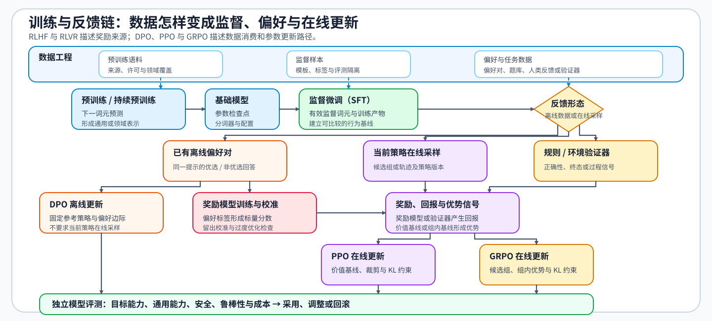
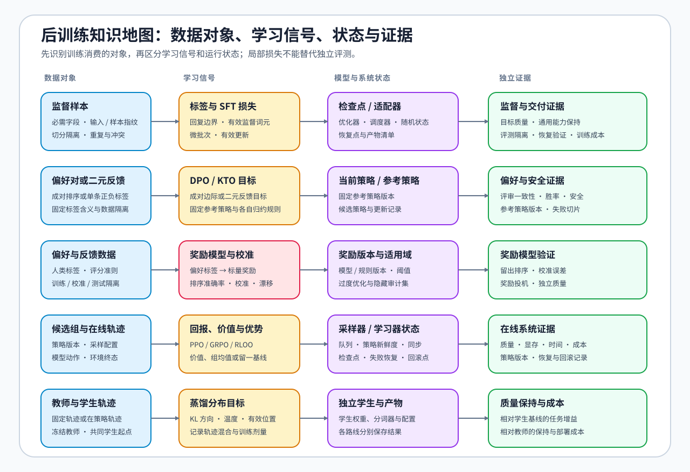
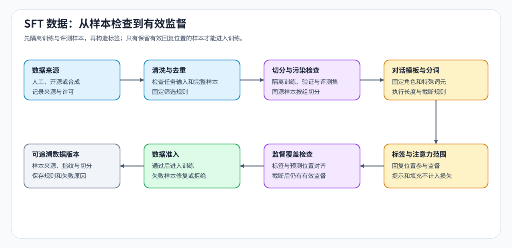
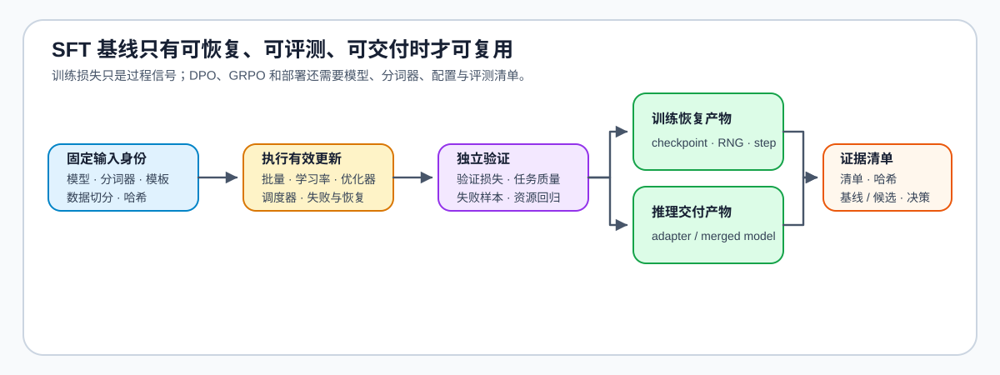
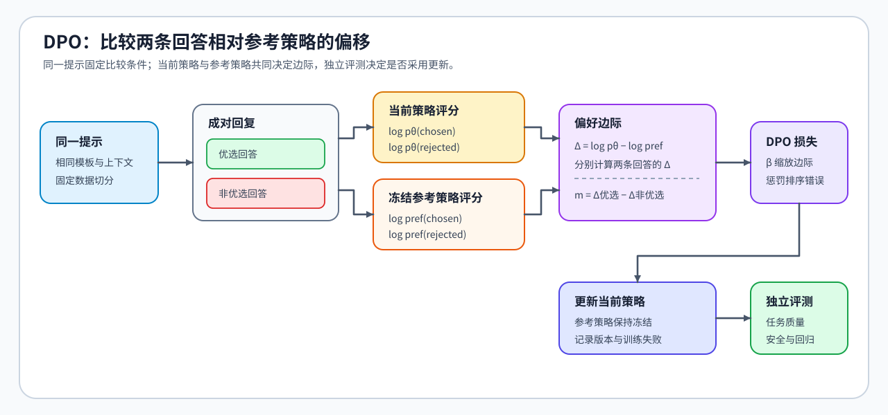
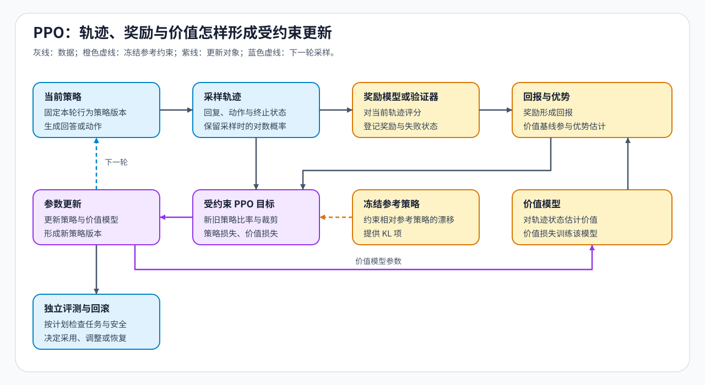
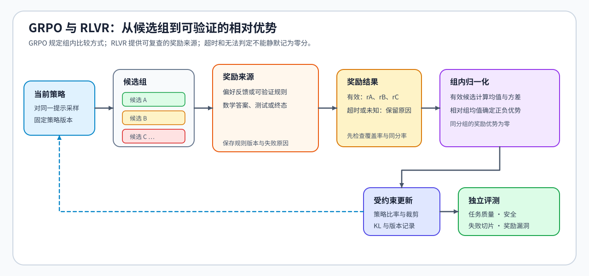
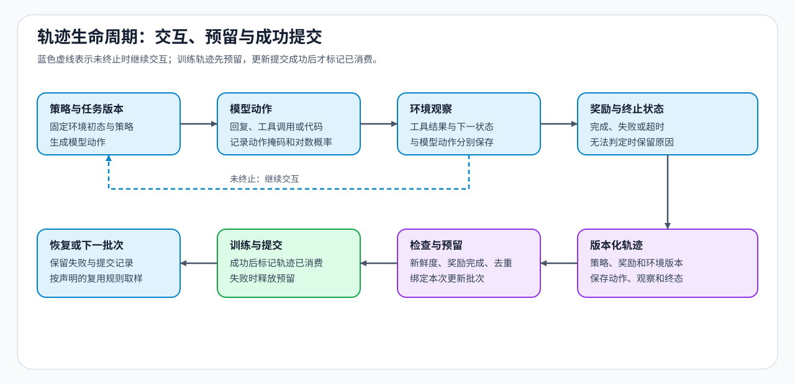

# 后训练优化问题链 | Post-Training Walkthrough

后训练先根据重复失败和基线测量判断是否修改参数，再依据数据和反馈形态选择 SFT、DPO、KTO、PPO、GRPO 或 RLOO。本文始终跟踪同一条用户提示及其回答，观察它怎样成为监督样本、成对偏好、单条二元反馈或带奖励的轨迹，最后用独立评测决定是否采用更新后的模型。

`提示与目标 → 监督样本与 SFT 基线 → 偏好对或奖励轨迹 → 策略更新 → 独立评测与决策`

## 一、先判断是否需要改变模型参数

先固定提示集合、解码配置和独立评测样本，再复测失败是否重复出现。若失败来自指令表达或外部知识，先比较提示工程、RAG 和工具调用；比较始终基于同一批失败样本上的任务结果，MCP、函数调用或业务 API 负责提供工具接入方式。

非参数方案仍无法解决的重复失败，才进入参数更新。此时继续检查已有模型能否遵循任务格式、SFT 留出指标是否仍随高质量示范提升，以及反馈来自离线偏好对还是当前策略生成的新候选，据此选择监督微调、离线偏好优化或在线策略更新。

预训练和持续预训练用大规模语料上的下一词元预测改变模型表示；后训练则使用示范标签、偏好关系或环境奖励改变模型在目标任务上的输出行为。它们复用前向传播、反向传播和优化器，但消费的数据、计算的目标和判断模型是否可用的证据不同。

| 阶段 | 主要数据对象 | 学习信号 | 主要产物 | 继续使用或切换方法的判断条件 |
|:---|:---|:---|:---|:---|
| 预训练 | 大规模通用语料 | 下一词元预测 | 基础模型检查点 | 留出损失、通用能力评测与训练资源记录 |
| 持续预训练 | 领域、长上下文或新时间段语料 | 下一词元预测 | 更新后的基础模型 | 领域指标增益与通用能力回归检查 |
| SFT | 指令、输入与参考回答 | 有效监督词元上的交叉熵 | 全参数检查点或适配器 | 格式错误率、留出任务指标与重新加载结果 |
| 偏好优化 / RL | 偏好对、候选组、轨迹与奖励 | 偏好边际、优势或可验证奖励 | 更新后的策略版本 | 目标任务增益、能力保持、安全与奖励一致性 |
| 独立评测与部署反馈 | 冻结评测集、线上失败样本与成本记录 | 不参与当前候选训练 | 采用、调整或回滚决策 | 数据隔离、资源预算和回滚条件齐全 |

## 二、从监督目标建立最小 SFT 基线

同一条提示与目标回答经过聊天模板和分词后形成词元序列、注意力掩码和标签。标签掩码决定哪些词元进入监督损失；样本契约、任务输入指纹、样本指纹和数据切分决定样本能否进入训练池。真实示范不足时，先生成带身份的合成候选，经过训练集与批内去重、污染和验证器检查后，再返回最终切分审计。训练后在冻结验证集上比较更新前后的任务结果，并重新加载保存的模型或适配器复测，得到 DPO、KTO、PPO、GRPO 或 RLOO 共用的 SFT 基线。数据与标签关系见[监督数据契约](./01_sft_data_and_loss.md)，合成候选准入见[PT-SYNTHETIC-DATA](../../02_PyTorch_Algorithms/PT-SYNTHETIC-DATA_Instruction_Generation_and_Verifier_Admission.ipynb)，保存、恢复和验证关系见[SFT 基线与交付](./04_end_to_end_experiment.md)。

## 三、选择更新范围与资源方案

固定监督目标、输入长度与 SFT 基线后，再比较全参数更新、LoRA、QLoRA 和 LoRA 变体。[参数高效适配](./02_lora_peft_design.md)决定更新哪些模块、采用多大秩以及是否量化冻结底座；[训练控制](./03_training_control.md)则确保各候选使用相同有效批量、优化器步和学习率推进时机。

这些候选必须使用相同数据切分、评测集、有效监督词元和优化器步，分别记录可训练参数、峰值显存、更新时间和产物形态。若格式错误仍多，或增加高质量示范后留出指标仍持续改善，应继续修正数据和 SFT；只有固定更新预算下的新增示范已不能带来预设的最小增益，而剩余错误又需要区分优选与非优选回答或评价新生成候选时，才转向偏好或奖励优化。

## 四、根据反馈形态选择优化方法

先区分训练对象来自已有离线数据，还是必须由当前策略在线生成。已有可复查的优选 / 非优选回答时使用 DPO；只有单条正负标签且无法稳定配对时可使用 KTO。离线负反馈可以直接进入偏好优化；决策依赖当前策略新生成的回答时进入在线采样。显式价值模型提供状态基线时使用 PPO，同一提示下的多回答可按组均值进入 GRPO，或按留一基线进入 RLOO。

RLHF 与 RLVR 描述反馈来源，不与某一种更新算法一一绑定。人类偏好或奖励模型可以形成 DPO、KTO、PPO、GRPO 或 RLOO 所需的反馈；标准答案、单元测试和环境终态等可验证信号也可以接入不同在线方法。典型组合分别见 [05 DPO / KTO](./05_dpo_and_preference_optimization.md)、[06 奖励信号、PPO / RLHF](./06_rlhf_and_ppo_system_cost.md) 与 [07 GRPO / RLOO](./07_grpo_and_groupwise_alignment.md)。

| 数据与执行形态 | 基线形式 | 典型更新机制 | 可用反馈来源 |
|:---|:---|:---|:---|
| 已有离线偏好对 | 固定参考策略下的相对偏好边际 | DPO | 人工偏好、模型偏好或规则生成的偏好对 |
| 已有离线单条二元反馈 | 固定参考策略下的回答偏移与 KL 基线 | KTO | 点赞、点踩或验收标签 |
| 当前策略在线生成轨迹 | 价值模型估计的状态基线 | PPO | 奖励模型或可验证奖励 |
| 当前策略在线生成候选组 | 同一提示下的组内基线 | GRPO | 模型评分、标准答案、测试或环境终态 |
| 当前策略在线生成回答组 | 排除当前回答后的留一基线 | RLOO | 模型评分、标准答案、测试或环境终态 |

## 五、轨迹怎样进入在线训练系统

强化学习需要分别测量轨迹采样、奖励或验证器、参数更新与模型保存。每条轨迹记录提示、回复词元或环境动作、生成它的策略版本、奖励分量和消费状态；学习器比较轨迹策略版本与当前版本，只接纳版本差未超过实验门槛且尚未消费的轨迹。轨迹字段、版本和消费检查见[轨迹生命周期与环境交互](./08_trajectory_lifecycle_and_environment_interaction.md)；拆分采样、奖励和训练工作进程后，还要按[在线训练交付与执行系统](./09_rl_execution_system_and_efficiency.md)检查队列等待、权重同步、失败重试和恢复位置。

## 六、用独立评测决定采用、调整或回滚

训练损失、奖励或胜率上升都不足以直接采用。回到开头冻结的提示和评测样本，对基线与候选执行相同解码与评分协议，再检查任务正确性、通用能力保持、安全、鲁棒性、评审一致性、资源成本和失败切片。全部门槛通过时采用候选（`accept`）；方向有效但仍有可修复失败时调整后复测（`tune`）；核心质量无增益或触发安全、资源约束时拒绝并保留原基线（`reject`）。具体判断条件见[独立评测、能力回归与采用决策](./10_evaluation_and_adoption_decision.md)。

