# 后训练优化问题链 | Post-Training Walkthrough

以“计算 12×(3+4)，只输出整数”为例，模型可能算错，也可能答对却附带多余解释。先复测这两类失败，再观察同一任务怎样形成监督样本、回答偏好或奖励轨迹，最后用独立评测决定是否保留更新后的模型。这里的算术任务用于说明对象怎样变化，不是已登记的训练结果。

`提示与目标 → 复测已有模型，或用监督样本与参数方案建立 SFT 基线 → 按剩余失败选择是否继续更新 → 独立评测与决策`

## 一、先判断是否需要改变模型参数

先固定提示集合、解码配置和独立评测样本，再复测失败是否重复出现。若明确“只输出整数”就能解决格式问题，可以保留提示方案；计算仍不可靠时，可比较计算工具。若任务需要模型输入之外的事实，则比较检索增强生成（RAG），把检索结果加入上下文。每次比较都回到同一批失败样本，检查是哪类问题仍未解决。

非参数方案仍无法解决的重复失败，才进入参数更新。此时继续检查已有模型能否遵循任务格式、SFT 留出指标是否仍随高质量示范提升，以及反馈来自离线偏好对还是当前策略生成的新候选，据此选择监督微调、离线偏好优化或在线策略更新。

预训练和持续预训练用大规模语料上的下一词元预测改变模型表示；后训练则使用示范标签、偏好关系或环境奖励改变模型在目标任务上的输出行为。它们复用前向传播、反向传播和优化器，但消费的数据、计算的目标和判断模型是否可用的证据不同。

| 阶段 | 主要数据对象 | 学习信号 | 主要产物 | 继续使用或切换方法的判断条件 |
|:---|:---|:---|:---|:---|
| 预训练 | 大规模通用语料 | 下一词元预测 | 基础模型检查点 | 留出损失、通用能力评测与训练资源记录 |
| 持续预训练 | 领域、长上下文或新时间段语料 | 下一词元预测 | 更新后的基础模型 | 领域指标增益与通用能力回归检查 |
| SFT | 指令、输入与参考回答 | 有效监督词元上的交叉熵 | 全参数检查点或适配器 | 格式错误率、留出任务指标与重新加载结果 |
| 偏好优化 / RL | 偏好对、候选组、轨迹与奖励 | 偏好边际、优势或可验证奖励 | 更新后的策略版本 | 目标任务增益、能力保持、安全与奖励一致性 |
| 独立评测与部署反馈 | 冻结评测集、线上失败样本与成本记录 | 不参与当前候选训练 | 采用、调整或回滚决策 | 数据隔离、资源预算和回滚条件齐全 |

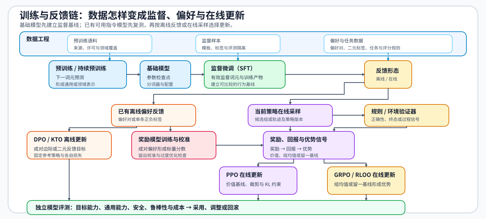

## 二、确定样本怎样形成监督目标

若要用示范训练，这道题的目标回答可以是“84”。提示与目标回答经过聊天模板和分词后形成词元序列、注意力掩码和标签，标签掩码选出实际进入损失的回答位置。记录样本来源、输入与完整样本指纹，再检查训练和评测切分，可以发现同题重叠。示范不足时，合成候选也要经过去重、污染与答案验证，再返回切分审计；具体位置关系见[监督数据与损失](./01_sft_data_and_loss.md)，候选生成与验证见[Part 02 · PT-SYNTHETIC-DATA](../../02_PyTorch_Algorithms/PT-SYNTHETIC-DATA_Instruction_Generation_and_Verifier_Admission.ipynb)。

确定了模型要预测哪些位置，还要选择更新哪些参数、怎样累计梯度，才能执行最小 SFT。已有指令模型若已具备任务所需的基本行为，可以先复测并固定其版本，直接作为后续比较起点。

将提示、回答与结束标记拆成位置后，可以看见提示末尾的输出怎样预测首个回答词元。下图沿用正文01的简化位置记号，展示目标向后对齐，以及哪三个位置进入损失；它不对应这道算式的实际分词。

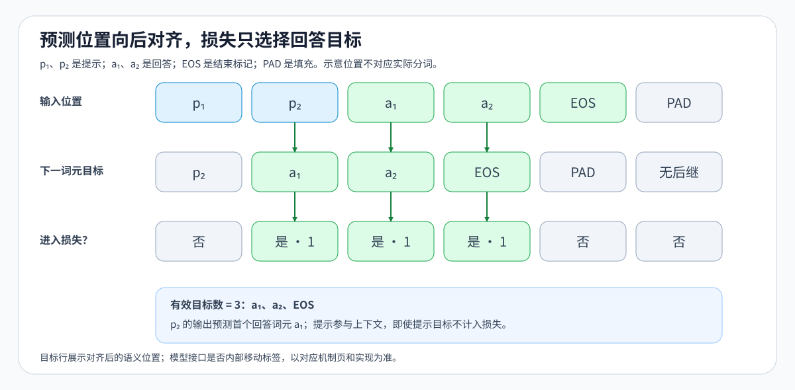

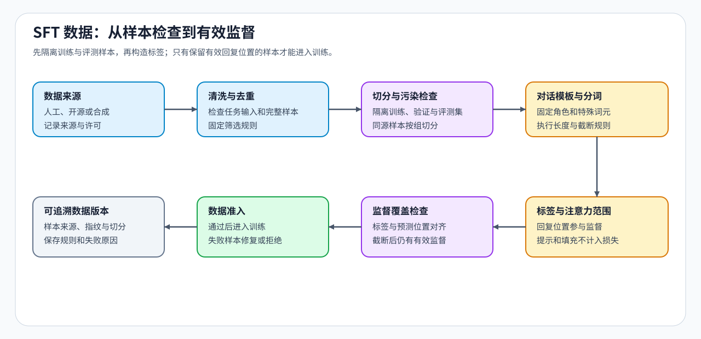

## 三、让参数方案与训练控制形成可复测基线

固定监督目标、输入长度和训练前模型后，先选择能在预算内运行的参数方案，建立最小 SFT 基线，再按需要比较全参数更新、LoRA、QLoRA 和 LoRA 变体。[参数高效适配](./02_lora_peft_design.md)决定更新哪些模块、采用多大秩以及是否量化冻结基座；[训练控制](./03_training_control.md)将监督目标与参数方案汇合，确定有效批量、损失归约和学习率推进时机。

比较参数方案时，固定数据切分、评测集与约定的训练预算，核对有效监督词元和成功更新步，分别记录可训练参数、峰值显存、更新时间和产物形态。训练后重新加载保存的模型或适配器，在冻结验证集上比较更新前后的任务结果，并检查训练恢复，得到可复用的基线；保存与恢复见[SFT 基线与交付](./04_end_to_end_experiment.md)。

若任务表现已满足要求，就进入独立评测与采用判断。格式错误或示范覆盖不足时，可以继续修正数据和 SFT；已有可用基线、剩余问题需要表达回答偏好或评价新生成行为时，再按反馈选择离线或在线更新。选择依据是剩余失败与反馈是否匹配，而不是必须先证明 SFT 已无改善空间。

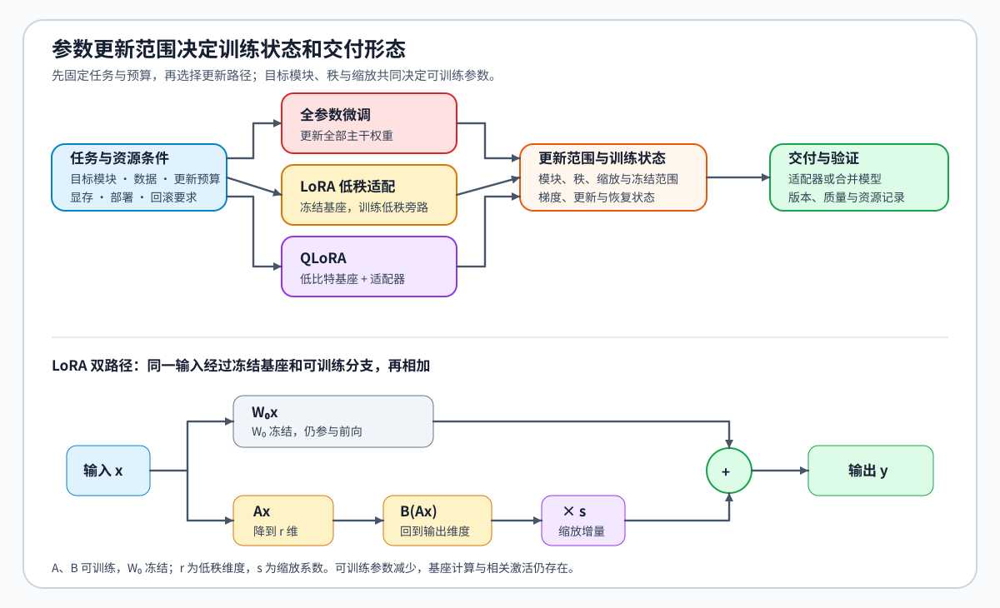

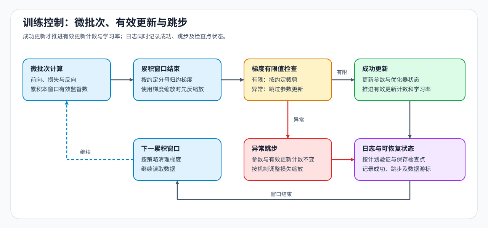

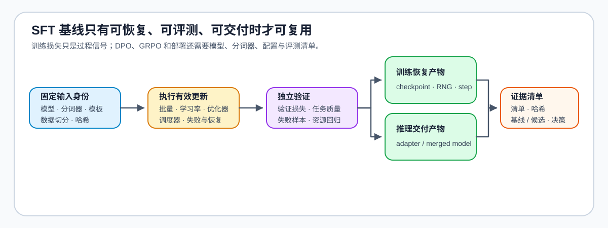

## 四、根据反馈形态选择优化方法

若这道题已有“84”优于“48”的可复查回答对，可以用 DPO 比较两条回答相对参考策略的概率变化；日志只有单条回答的正负标签时，可用 KTO，避免跨问题强行配对。若要让当前模型继续尝试新回答，就需要在线采样，再用答案验证或其他可靠评分判断结果。

在线更新还要选择优势基线。PPO 用价值模型估计状态的预期回报；对同一提示生成多个回答时，GRPO 可以用组内均值，RLOO 则用排除当前回答后的其他奖励均值。反馈来自哪里、由谁生成回答、怎样构造更新目标，是三个相关但不同的选择。

RLHF 与 RLVR 描述反馈来源，不与某一种更新算法一一绑定。人类偏好或奖励模型可以形成 DPO、KTO、PPO、GRPO 或 RLOO 所需的反馈；标准答案、单元测试和环境终态等可验证信号也可以接入不同在线方法。典型组合分别见 [05 DPO / KTO](./05_dpo_and_preference_optimization.md)、[06 奖励信号、PPO / RLHF](./06_rlhf_and_ppo_system_cost.md) 与 [07 GRPO / RLOO](./07_grpo_and_groupwise_alignment.md)。

| 数据与执行形态 | 基线形式 | 典型更新机制 | 可用反馈来源 |
|:---|:---|:---|:---|
| 已有离线偏好对 | 固定参考策略下的相对偏好边际 | DPO | 人工偏好、模型偏好或规则生成的偏好对 |
| 已有离线单条二元反馈 | 固定参考策略下的回答偏移与 KL 基线 | KTO | 点赞、点踩或验收标签 |
| 当前策略在线生成轨迹 | 价值模型估计的状态基线 | PPO | 奖励模型或可验证奖励 |
| 当前策略在线生成候选组 | 同一提示下的组内基线 | GRPO | 模型评分、标准答案、测试或环境终态 |
| 当前策略在线生成回答组 | 排除当前回答后的留一基线 | RLOO | 模型评分、标准答案、测试或环境终态 |

组内比较还要区分基线与缩放。下面用同组奖励 0、1、3 展示：减去组均值与减去留一基线得到的优势同号，但幅度不同；GRPO 按总体标准差缩放后又会改变尺度。这是构造计算例，实际目标还需核对奖励塑形、比率粒度和归约。

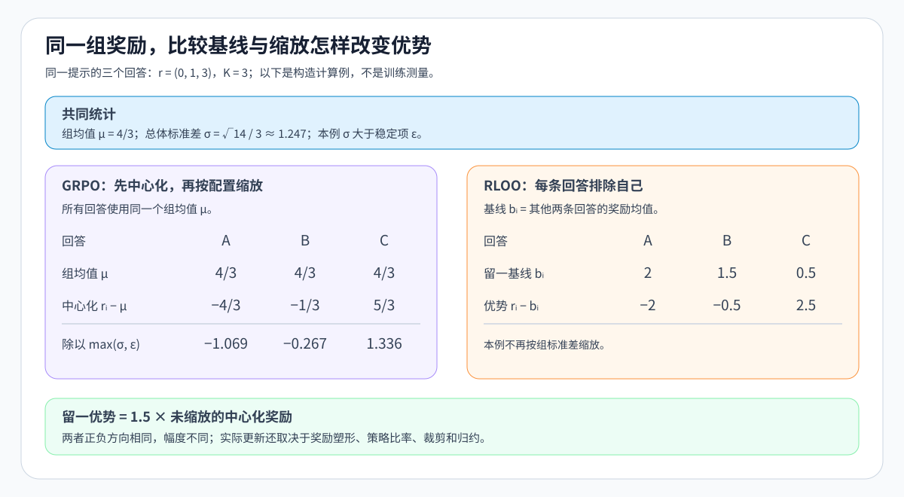

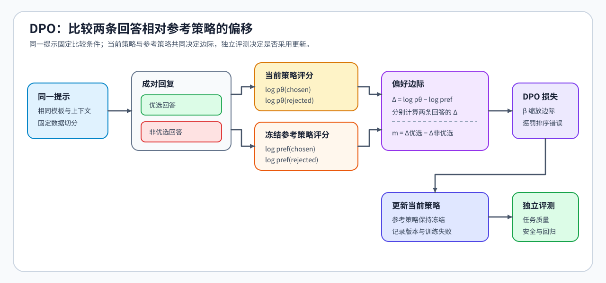

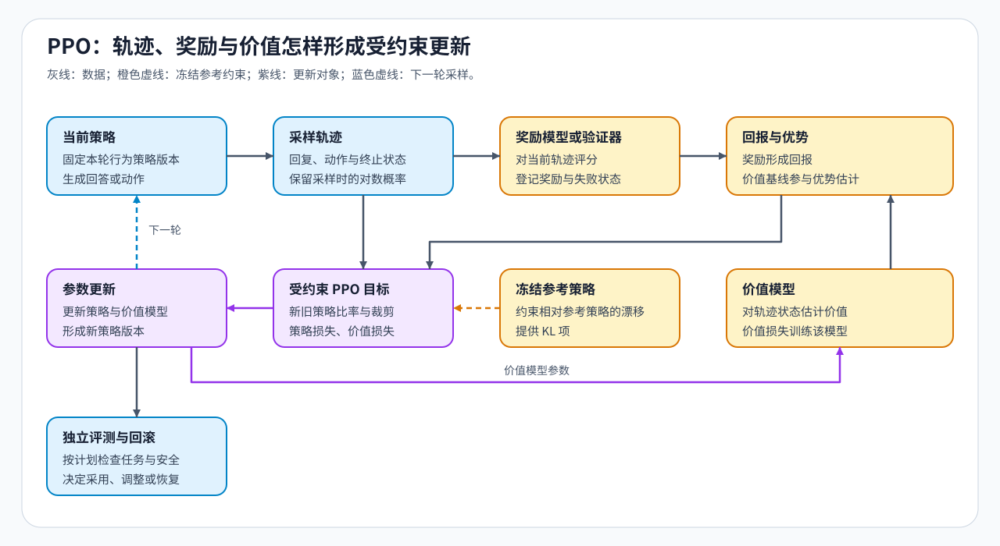

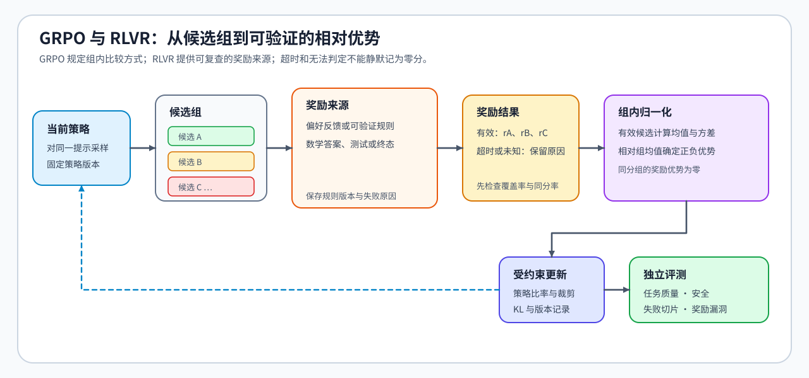

## 五、轨迹怎样进入在线训练系统

强化学习需要分别测量轨迹采样、奖励或验证器、参数更新与模型保存。每条轨迹记录提示、回复词元或环境动作、生成它的策略版本、行为概率、奖励分量和消费状态。版本差用于发现积压；能否接纳，还需检查当前策略与行为策略在相同动作上的概率偏离、奖励是否完成，以及所选算法允许的复用与修正规则。版本接近本身并不保证轨迹可用。

预留将轨迹绑定到指定更新批次，成功提交后才登记对应消费。更新前失败可按恢复规则释放预留；参数可能已更新而提交状态不明时，先隔离该批次，核对提交记录与检查点，再决定恢复位置。PPO 按声明计划进行的多轮复用与意外重复提交是两回事，应分别记录计划次数与已完成更新。轨迹字段与准入见[轨迹生命周期与环境交互](./08_trajectory_lifecycle_and_environment_interaction.md)；多工作进程中的队列、同步和恢复见[在线训练交付与执行系统](./09_rl_execution_system_and_efficiency.md)。

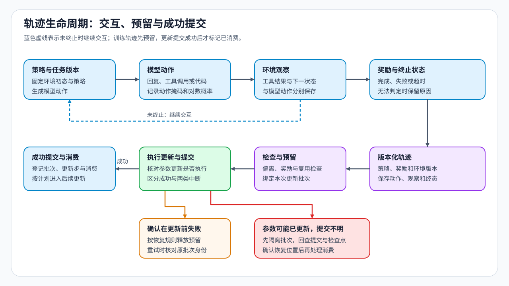

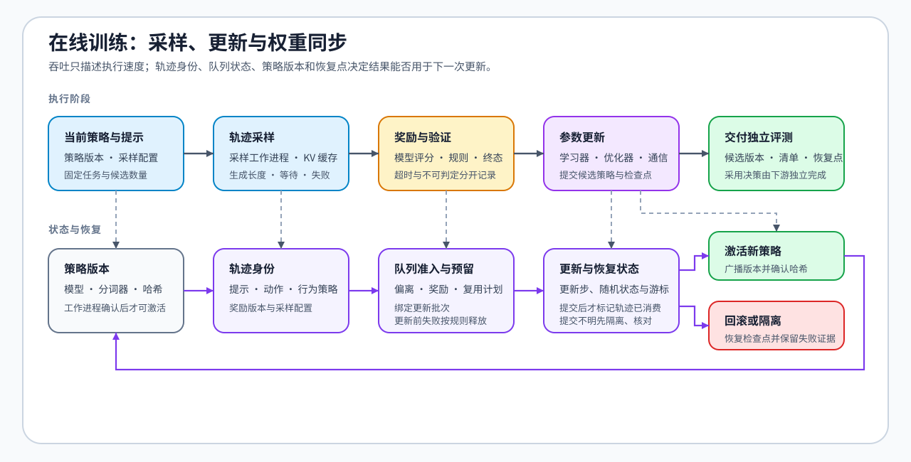

## 六、用独立评测决定采用、调整或回滚

算对这道训练题，还不能说明其他算式、工具调用和原有任务都得到改善。对冻结的独立题集，使用相同解码与评分协议比较基线和候选，按任务类型检查正确性、能力保持、安全及资源成本。已有模型满足目标时可以保留现有方案；新增训练候选则需要证明预设收益。

教师反馈形成的学生候选也进入这一步，但要用两种参照：与共同训练前学生比较训练收益，与冻结教师比较质量保持和部署成本。学生压缩可以按预设容差换取成本收益，而不必先完成偏好或在线奖励训练。收益与硬约束通过时采用（`accept`），存在可修复问题或可补齐证据时调整（`tune`），比较无效或触发必须满足的质量、安全、资源约束时拒绝（`reject`）；具体条件见[独立评测与采用决策](./10_evaluation_and_adoption_decision.md)。

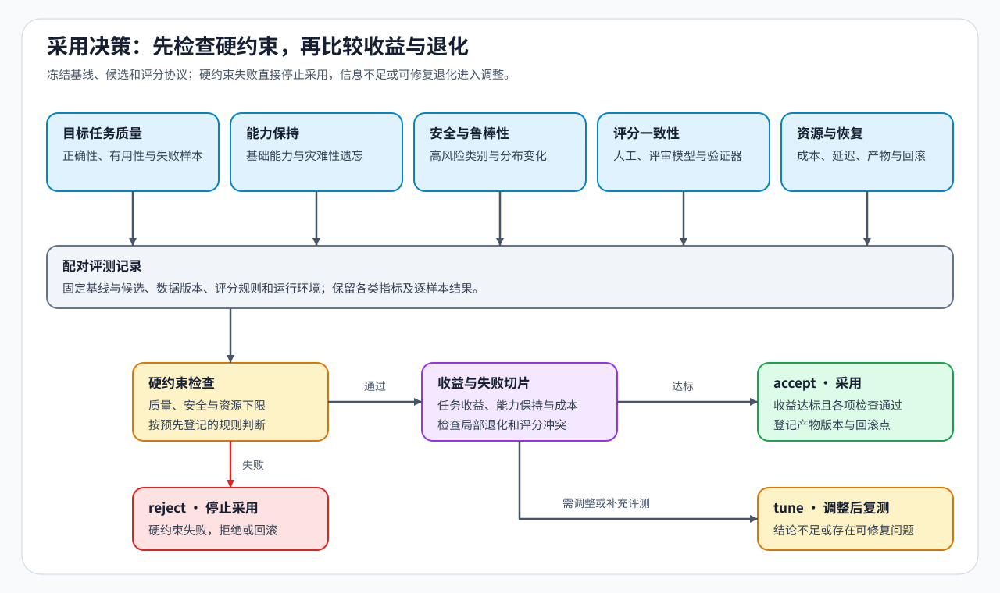
